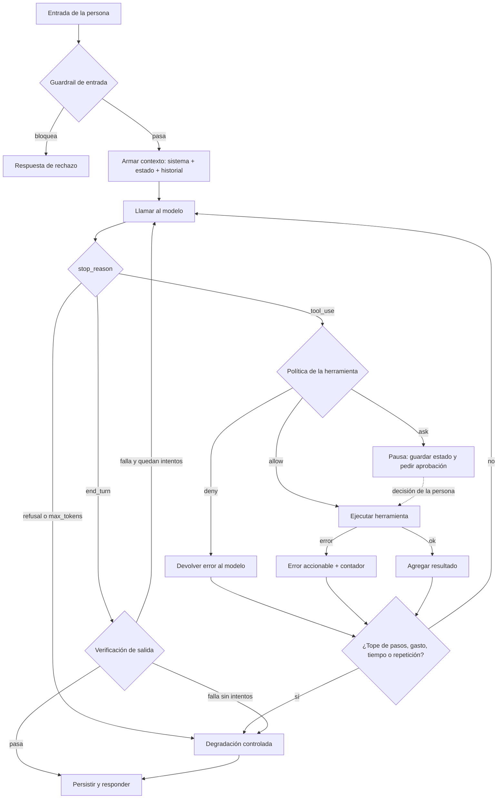

# A2 — Harness engineering

> Parte de la base de conocimiento `docs/investigacion-agentes/`. Investigación, no especificación.
> Marcas: **[DOC]** documentado por el autor sobre su propio producto, sistema o código · **[EXP]** opinión, paper o reporte de terceros · **[REC]** recomendación o inferencia de esta investigación.
> Fecha de consulta: **2026-11-14**. Enlaces al final y en `fuentes.md`. Lo que no se pudo abrir está en `preguntas-abiertas.md`.

## 1. Qué es un agent harness

**Harness** (arnés): todo lo que no es el modelo. La formulación más citada es "Agent = Model + Harness": si no eres el modelo, eres el harness. [EXP] [LC-ANATOMY]. Otras definiciones coincidentes:

- El sistema de software que gobierna cómo opera el agente. Analogía: modelo = CPU, ventana de contexto = RAM, harness = sistema operativo, agente = aplicación. [EXP] [SCHMID]
- El andamiaje de runtime que convierte un modelo en agente: conduce las llamadas a modelo y herramientas, gestiona estado y contexto, y aplica políticas de aprobación. [DOC] [MAF-HARNESS]
- En la arquitectura de Managed Agents: el loop que llama a Claude y enruta herramientas, separado de la **sesión** (log solo de anexado) y del **sandbox** (donde se ejecuta). [DOC] [MA-ENG]

**Harness engineering**: el término se popularizó en 2026. Una definición operativa: cada vez que el agente comete un error, se construye una solución para que no lo repita, incluida la capacidad del agente de verificar que lo hizo bien. [EXP] [HASHIMOTO]. El post de OpenAI que lleva ese título no se pudo abrir (HTTP 403); lo que se sabe de él viene de terceros y queda como no verificado.

### 1.1 Capas: modelo, framework, runtime, harness

| Capa | Qué aporta | Ejemplos citados | Fuente |
|---|---|---|---|
| Modelo | Razonamiento | Claude, GPT | [EXP] [SCHMID] |
| Framework | Abstracciones | LangChain, Vercel AI SDK, CrewAI, OpenAI Agents SDK, Google ADK | [EXP] [LC-FRH] |
| Runtime | Ejecución durable, streaming, aprobación humana, persistencia | LangGraph; cercanos: Temporal, Inngest | [EXP] [LC-FRH] |
| Harness | Prompts por defecto, manejo de llamadas a herramienta, planificación, memoria, topes, verificación | Claude Agent SDK, Deep Agents, Claude Code, Codex CLI | [EXP] [LC-FRH] |

El autor de esa clasificación admite que las fronteras son difusas. [EXP] [LC-FRH]

### 1.2 Dos ejes para pensar los controles

| | **Guides** (antes de actuar) | **Sensors** (después de actuar) |
|---|---|---|
| **Computacional** (determinista, rápido, barato) | Esquemas estrictos, enums, validación de entrada, permisos | Reglas de dominio, tests, validadores de salida |
| **Inferencial** (LLM, lento, caro, no determinista) | Instrucciones, skills, ejemplos | Juez LLM, agente revisor |

Fuente del marco: [EXP] [BOCKELER]. Reglas que trae: los chequeos baratos van temprano y los caros después; solo-feedback repite errores y solo-feedforward nunca verifica si la regla funcionó.

### 1.3 Tres principios que cruzan las fuentes

1. **Cada componente del harness codifica un supuesto sobre lo que el modelo no puede hacer solo**; hay que volver a probar ese supuesto con cada modelo nuevo y quitar el componente si dejó de hacer falta. [DOC] [HARNESS-APPS]. En la misma línea: "build to delete". [EXP] [SCHMID]
2. **El harness pesa tanto como el modelo.** LangChain declara haber pasado de top 30 a top 5 en un benchmark cambiando solo el harness (sin cifras exactas) [EXP] [LC-ANATOMY]; Vercel pasó de 17 herramientas a 2 y subió éxito de 4/5 a 5/5 con 3,5× menos tiempo, en una muestra de 5 consultas [DOC] [VERCEL-80].
3. **El error se compone.** Con 95% de acierto por paso, 10 pasos dan ~60% y 100 pasos ~0,6%. [EXP] [HUYEN]. Por eso los topes y la verificación no son opcionales.

## 2. Instrucciones, restricciones y responsabilidades

- **Altitud correcta**: ni lógica if-else frágil en el prompt, ni guía vaga. [DOC] [CTX-ENG]
- **Decir para qué sirve una regla funciona mejor que la regla sola**: restringir la memoria a "solo fallas" bajó su beneficio. [DOC] [MEMORY-COMP]
- **Instrucciones just-in-time**: en vez de un system prompt con mil reglas, devolver la guía junto al resultado de la herramienta que la necesita. Shopify lo adoptó tras su "muerte por mil instrucciones". [DOC] [SHOPIFY]
- **Skills**: instrucciones que se cargan solo cuando la tarea las requiere (*progressive disclosure*). [EXP] [LC-ANATOMY], [DOC] [FOLD]
- **Las restricciones duras van en código, no en el prompt.** Los guardrails no reemplazan autenticación ni autorización. [DOC] [OAI-GUIA]
- **Prefijo estable**: el prompt de sistema no debe llevar nada variable; un solo token distinto invalida la caché desde ahí. [DOC] [MANUS], [API-CACHE]

## 3. Cómo se construye el loop

Elementos y cómo los resuelven implementaciones reales:

### 3.1 Condiciones de salida y criterios de éxito

- Un agente corre herramientas en un loop **para lograr una meta**; eso implica condición de término: no son loops infinitos. [EXP] [WILLISON-AG]
- Salidas normales: el modelo responde sin llamar herramientas, o se invoca una herramienta de salida final con formato definido. [DOC] [OAI-GUIA]
- "No reconocer la condición de término" es el tercer modo de falla más frecuente en sistemas multiagente (12,4%). [EXP] [MAST]
- La **falsa declaración de tarea terminada** es un modo de falla que hay que medir explícitamente. [EXP] [HUYEN]. En agentes largos se ataca con una lista de criterios que el agente solo puede marcar como cumplidos tras verificarlos [DOC] [HARNESS-LONG] y con contratos previos sobre qué es "terminado" [DOC] [HARNESS-APPS].

### 3.2 Topes

| Implementación | Tope por defecto | Fuente |
|---|---|---|
| OpenAI Agents SDK | `maxTurns` 10 | [DOC] [OAI-RUN] |
| Vercel AI SDK 7 `ToolLoopAgent` | `isStepCount(20)` | [DOC] [AISDK-LOOP] |
| LangGraph | `recursionLimit` 25 super-steps; lanza `GraphRecursionError` | [DOC] [LG-GRAPH] |
| Mastra | `maxSteps` 5 | [DOC] [MASTRA-AGENT] |
| Pydantic AI | `request_limit` 50; además `tool_calls_limit`, `cost_limit` | [DOC] [PYD-AGENT] |
| Claude Agent SDK | `maxTurns` y `maxBudgetUsd`, sin límite por defecto | [DOC] [CAS-LOOP] |
| Managed Agents | `budget.max_list_cost` por sesión | [DOC] [CMA-REF] |
| Nuestra base | 6 iteraciones; en la última se fuerza `tool_choice: none` | `web/src/lib/agent/run.ts` |

Un tope de gasto que se compara después de cada respuesta puede excederse por el costo de esa respuesta. [DOC] [CAS-LOOP]

### 3.3 Detección de repetición

El caso mejor documentado en código abierto es el servicio de detección de loops de Gemini CLI: [DOC] [GEMINI-LOOP]

1. **Llamadas idénticas**: hash de nombre + argumentos; corta con 5 llamadas idénticas seguidas, y detecta ciclos de hasta 5 llamadas alternadas.
2. **Texto repetido**: trozos de 50 caracteres que aparecen 10 veces a poca distancia.
3. **Chequeo con LLM**: desde el turno 30, cada 5 a 15 turnos, un modelo rápido revisa las últimas 20 entradas contra el pedido original y exige confianza ≥ 0,9, confirmada por un segundo modelo.

Microsoft Agent Framework lo resuelve en la orquestación: en cada ronda el manager responde si el equipo está en loop y si hay progreso; rondas sin progreso suben un contador y al superar `max_stall_count` se replanifica. [DOC] [MAF-MAGENTIC]

Los umbrales de OpenHands, Cline, Roo Code y Aider (en torno a 3 errores o repeticiones consecutivas) solo se obtuvieron de resultados de búsqueda y quedan como no verificados.

### 3.4 Manejo de errores y excepciones

- **El error vuelve al modelo como dato.** Dejar los intentos fallidos en el contexto ayuda a no repetirlos. [DOC] [MANUS]. Formato accionable, no códigos opacos. [DOC] [TOOLS-ENG]
- **Contador de errores consecutivos** que se reinicia al primer éxito; umbral sugerido ~3 por herramienta; al superarlo se corta el loop y se escala a una persona. [EXP] [12F-9]
- **Distinguir errores**: reintentable (red, límite de tasa) vs fatal. Vercel Workflows: `RetryableError` y `FatalError`, 3 reintentos por defecto [DOC] [WF-ERR]; Inngest: `NonRetriableError`, 4 reintentos con backoff y jitter [DOC] [INNGEST-STEPS]; LangGraph: `retryPolicy` por nodo, opt-in [DOC] [LG-FAULT].
- **Reparar la llamada mal formada** antes de fallar: `repairToolCall`. [DOC] [AISDK-TOOLS]
- **Degradación en vez de excepción**: manejadores que devuelven una respuesta final razonable ante tope de vueltas, rechazo del modelo o salida inválida. [DOC] [OAI-RUN]
- **Una llamada cortada por `max_tokens` no se ejecuta**: el input puede estar truncado. Ya lo hace nuestra base (`run.ts`).

### 3.5 Idempotencia

Ningún motor durable garantiza "exactamente una vez" hacia afuera: un reintento re-ejecuta el paso completo (semántica *at-least-once*). [DOC] [LG-FAULT], [INNGEST-STEPS]. La defensa es una **clave de idempotencia** generada por el cliente: el servidor guarda la primera respuesta y la devuelve ante un reintento con la misma clave. [DOC] [STRIPE-IDEM]

## 4. Checkpoints y recuperación de estado

**Checkpoint**: foto del estado de ejecución guardada en un punto conocido, desde la que se puede reanudar.

| Implementación | Qué guarda y cuándo | Fuente |
|---|---|---|
| LangGraph | El estado del grafo en cada frontera de super-step, por `thread_id`; además las escrituras de cada nodo terminado, para no repetirlo si otro falla | [DOC] [LG-CKPT] |
| Microsoft Agent Framework | Estado de todos los executors y solicitudes pendientes al final de cada superstep | [DOC] [MAF-CKPT] |
| OpenAI Agents SDK | `RunState` serializable completo al pausar por una aprobación | [DOC] [OAI-HITL] |
| Vercel Workflows / Inngest / Temporal | Log de eventos: el resultado de cada paso; al reanudar se re-ejecuta el orquestador y se reutilizan los resultados guardados | [DOC] [WF-FOUND], [INNGEST-EXEC], [TEMPORAL-WF] |
| Mastra | Snapshot del workflow al suspender | [DOC] [MASTRA-SUSPEND] |
| Managed Agents | La sesión es un log solo de anexado fuera de la ventana de contexto; `wake(sessionId)` reanuda | [DOC] [MA-ENG] |
| Cline (agente de código) | Snapshot en un repositorio git paralelo tras cada uso de herramienta | [DOC] [CLINE-CKPT] |

Lecciones:

- **Reanudar desde el punto de falla, no reiniciar.** [DOC] [MARS]
- **Estado de ejecución y estado de negocio unificados**: si viven separados se desincronizan. [EXP] [12F]
- **El agente como reductor sin estado**: dado el estado guardado y un evento nuevo, produce el estado siguiente; lanzar, pausar y reanudar con APIs simples. [EXP] [12F]
- **El almacén de checkpoints es una frontera de confianza.** [DOC] [MAF-CKPT]. Un estado serializado no se autentica solo: hay que guardarlo en el servidor y autorizar a quien lo reanuda. [DOC] [OAI-HITL]
- **Versionar**: una aprobación que tarda días puede reanudarse con código nuevo; guardar la versión de la aplicación junto al estado. [DOC] [OAI-HITL]. Anthropic usa despliegues "rainbow" para no romper agentes en vuelo. [DOC] [MARS]
- **Compactar es irreversible; el log no.** [DOC] [MA-ENG]

## 5. Decisiones reversibles e irreversibles

- **Clasificar cada herramienta por riesgo**: lectura vs escritura, reversibilidad, permisos necesarios e impacto financiero; el nivel decide si se ejecuta, se pausa o se escala. [DOC] [OAI-GUIA]
- **Acciones de escritura suben capacidad y riesgo**; aprobación explícita antes de las riesgosas. [EXP] [HUYEN]
- **Lo irreversible no tiene rollback automático.** En sistemas distribuidos el patrón es la *saga*: una secuencia de pasos locales con **transacciones compensatorias** escritas explícitamente. [EXP] [SAGA]. Nuestra base ya compensa a mano en un caso: `propose_outfit` borra el outfit si falla la inserción de sus prendas.
- **Anotación destructiva**: en Codex, las herramientas que se declaran destructivas siempre piden aprobación. [DOC] [CODEX-SEC]

**[REC]** Para el producto, la frontera natural es: *leer* (clóset, clima, catálogo) y *proponer* (outfit en estado `proposed`) son reversibles; *escribir en el perfil o la memoria* es reversible pero visible; *salir del sistema hacia un tercero* (abrir un checkout, enviar datos a una tienda) y *pagar* son irreversibles y exigen aprobación explícita (DP-09).

## 6. Supervisión y aprobación humana

### 6.1 Niveles de autonomía

Cinco niveles definidos por el **rol de la persona**: operador (el agente actúa solo cuando se le invoca), colaborador, consultor, **aprobador** (el agente solo consulta ante bloqueo o acción consecuente) y observador. La autonomía es una decisión de diseño separada de la capacidad. [EXP] [AUTONOMY]

### 6.2 Modelos de permiso

- **allow / ask / deny** por herramienta, con reglas por patrón; si ninguna regla coincide, se pregunta; respuestas "esta vez", "siempre" o "rechazar". [DOC] [OPENCODE-PERM]
- **Dos controles independientes**: qué puede hacer técnicamente (sandbox) y cuándo se detiene a preguntar (política de aprobación). [DOC] [CODEX-SEC]
- **Orden de evaluación** en el Agent SDK: hooks → reglas deny → reglas ask → modo → reglas allow → callback. [DOC] [CAS-PERM]

### 6.3 La aprobación como pausa serializable

Todas las implementaciones convergen en lo mismo: la herramienta **no se ejecuta**, el estado se guarda, la persona decide, y el run se reanuda.

| Implementación | Mecanismo | Fuente |
|---|---|---|
| LangGraph | `interrupt()` dentro de un nodo; se reanuda con `Command({ resume })`. El nodo se re-ejecuta desde el inicio al reanudar | [DOC] [LG-HITL] |
| OpenAI Agents SDK | `needsApproval` → `result.interruptions` → `state.approve()` / `reject()` | [DOC] [OAI-HITL] |
| Vercel AI SDK 7 | `toolApproval`: la llamada **no pausa**, termina con una solicitud y se vuelve a llamar con la respuesta. Ofrece firma HMAC porque el historial lo controla el cliente | [DOC] [AISDK-APPROVAL] |
| Vercel Workflows | `createHook()` suspende sin consumir cómputo; el token no autentica a quien responde | [DOC] [WF-HOOKS] |
| Inngest | `step.waitForEvent` con `timeout`; devuelve `null` si vence | [DOC] [INNGEST-WAIT] |
| Managed Agents | Evento `user.tool_confirmation` | [DOC] [CMA-REF] |
| Tool runner de Claude | No lo trae; la doc recomienda loop manual para aprobación | [DOC] [TOOL-RUNNER] |

Reglas de seguridad comunes: autenticar y autorizar a quien aprueba en el servidor; consumir la solicitud de forma atómica para evitar doble reanudación; definir qué pasa si nadie responde (timeout). [DOC] [OAI-HITL], [WF-HOOKS]

**Límite de la aprobación humana**: las explicaciones persuasivas de un agente pueden llevar a aprobar acciones dañinas (OWASP ASI09) [DOC] [OWASP-AGENTIC]; y una persona que confirma a ciegas anula la defensa [EXP] [RULE-OF-TWO]. La tarjeta de aprobación debe mostrar **datos verificados por el servidor** (monto, tienda, producto), no el texto del modelo. [REC]

### 6.4 Compras: qué exigen los protocolos vigentes

- OpenAI/Stripe (Agentic Commerce Protocol, en beta): la persona revisa y aprueba la compra; el consentimiento vale para esa transacción específica; la credencial de pago no se reutiliza. [DOC] [ACP], [OAI-COMMERCE]
- Stripe Shared Payment Tokens: token por transacción con moneda, **monto máximo** y **expiración**, revocable. La lista de países leída no incluye Chile. [DOC] [STRIPE-SPT]
- Google AP2: "el usuario siempre en control" e "intención verificable, no acción inferida"; mandatos firmados criptográficamente. [DOC] [AP2]

**[REC]** Aunque el producto no ejecutará pagos en el piloto (DP-09), estos protocolos fijan el estándar de qué es una "autorización explícita": acotada a una transacción, con monto máximo, con expiración y revocable.

## 7. Context engineering

**Context engineering**: curar todo lo que entra a la ventana (instrucciones, herramientas, datos, historial), no solo redactar el prompt. El contexto es un presupuesto de atención finito. [DOC] [CTX-ENG]

### 7.1 Por qué importa

- **Context rot**: en 18 modelos el rendimiento cae al crecer la entrada, y cae más con distractores temáticamente cercanos. En una prueba de memoria, ~300 tokens enfocados rindieron muy por encima de ~113.000 completos. [EXP] [CHROMA]
- Cuatro modos de falla del contexto: envenenamiento, distracción, confusión y choque. [EXP] [LC-CTX]

### 7.2 Las cuatro operaciones

| Operación | Qué es | Ejemplo |
|---|---|---|
| **Write** (escribir fuera) | Notas, scratchpad, memoria entre sesiones | Memory tool del lado del cliente [DOC] [API-MEM]; `todo.md` reescrito para "recitar" el plan al final del contexto [DOC] [MANUS] |
| **Select** (traer lo justo) | Recuperación just-in-time con referencias livianas en vez de precargar todo | [DOC] [CTX-ENG] |
| **Compress** | Compactar el historial; limpiar resultados de herramientas viejos | Edición de contexto y compactación de la API (beta) [DOC] [API-CTXEDIT], [API-COMPACT] |
| **Isolate** | Subagente con ventana propia que devuelve un resumen | [DOC] [CTX-ENG], [MA-WHEN] |

Marco de las cuatro operaciones: [EXP] [LC-CTX].

### 7.3 Reglas prácticas

- **Caché primero**: la tasa de acierto de caché es la métrica más importante de un agente en producción según Manus; contexto solo de anexado, serialización determinista, sin marcas de tiempo al inicio. [DOC] [MANUS]. Nuestra base ya lo aplica (prompt estático + bloque `<contexto_persona>`).
- **Enmascarar herramientas, no quitarlas** a mitad de tarea: cambiar el set invalida la caché y confunde si el historial las referencia. [DOC] [MANUS], [API-CACHE]
- **La compresión debe ser restaurable**: se descarta el contenido de una página pero se conserva su URL. [DOC] [MANUS]
- **Lo inyectado debe ser chico**: Claude Code carga solo las primeras 200 líneas o 25 KB del archivo de memoria. [DOC] [MEMORY-COMP]
- **Compactar puede perder instrucciones tempranas**: las reglas persistentes van fuera del historial. [DOC] [CAS-LOOP]
- **No imitarse a sí mismo**: variar formatos para que el modelo no repita un patrón por inercia. [DOC] [MANUS]

### 7.4 Memoria

Jerarquía: transcripciones → notas → representaciones consolidadas → contexto inyectado; la consolidación puede ocurrir fuera de línea. Con memoria, la eval CL-Bench subió de 0,655 a 0,838 en Opus 5.5. [DOC] [MEMORY-COMP]. Riesgo propio: **envenenamiento de memoria** (OWASP ASI06): un hecho malicioso guardado influye en todas las conversaciones futuras. [DOC] [OWASP-AGENTIC]

## 8. Diseño de herramientas

- **Pocas y consolidadas por flujo** en vez de una por endpoint. [DOC] [TOOLS-ENG]
- **Umbrales observados**: hasta 20 herramientas, límites claros; 20 a 50, difusos; más de 50, difícil de razonar. [DOC] [SHOPIFY]. La selección se degrada sobre ~30–50 definiciones [DOC] [FOLD]; el problema es el solapamiento más que el número [DOC] [OAI-GUIA].
- **Descripciones que dicen cuándo usarla**, con ejemplos de entrada: 72% → 90% de exactitud en parámetros complejos. [DOC] [ADV-TOOLS]
- **Poka-yoke**: argumentos que hacen difícil equivocarse. [DOC] [BEA]
- **Salidas pensadas para el modelo**: nombres legibles en vez de identificadores opacos, paginación, truncado con valores por defecto; Claude Code limita las respuestas a 25.000 tokens. [DOC] [TOOLS-ENG]
- **Esquema estricto**: `strict: true`; máximo 20 herramientas estrictas por request. [DOC] [API-SO]
- **Se evalúan como cualquier otra pieza**: tareas realistas, leer transcripciones, métricas de exactitud, número de llamadas, tokens y errores. [DOC] [TOOLS-ENG]
- **Carga diferida** cuando el catálogo crece: útil sobre ~10 herramientas o ~10.000 tokens de definiciones. [DOC] [ADV-TOOLS]

## 9. Seguridad

### 9.1 El modelo de amenaza

**Trifecta letal**: un agente que combina (1) acceso a datos privados, (2) exposición a contenido no confiable y (3) capacidad de comunicar hacia afuera puede ser inducido a filtrar esos datos. La mitigación es evitar la combinación; un filtro que detecta 95% de los ataques es una nota reprobatoria en seguridad. [EXP] [TRIFECTA]

**Regla de dos**: un agente no debe cumplir más de dos de: [A] procesa entradas no confiables, [B] accede a datos privados o sistemas sensibles, [C] cambia estado o comunica hacia afuera. Si necesita las tres, no corre autónomo: requiere supervisión humana. [EXP] [RULE-OF-TWO]

| Propiedad | Nuestra base hoy | Con personal shopper (búsqueda web) |
|---|---|---|
| [A] Entradas no confiables | Sí: fotos y nombres de prendas | Sí, mucho más: páginas de tiendas |
| [B] Datos privados | Sí: perfil, clóset, fotos | Sí |
| [C] Cambia estado o comunica afuera | Parcial: escribe perfil, memoria y clóset; no hay salida de red | **Sí**: consultas a la web, enlaces a tiendas |

**[REC]** El paso a personal shopper lleva al agente a cumplir las tres propiedades. Es la razón de seguridad, además de la de contexto, para aislar la búsqueda de productos: un componente que lee la web **sin** acceso al perfil ni a las herramientas de escritura.

### 9.2 Vectores concretos

- **Texto en imágenes**: instrucciones visibles en una foto fueron obedecidas; también texto casi blanco sobre blanco, invisible para la persona. [EXP] [WILLISON-IMG]. Aplica directo a fotos de prendas, selfies y capturas de productos.
- **Exfiltración por imagen o enlace**: el modelo emite una imagen o enlace cuya URL lleva datos privados; al cargarse, llegan al atacante. Casos reales: Microsoft 365 Copilot, GitLab Duo. También por previsualización automática de enlaces. [EXP] [WILLISON-EXFIL]
- **Listas de dominios permitidos con agujeros**: redirecciones abiertas, dominios que aceptan datos por GET, dominios expirados. [EXP] [WILLISON-EXFIL]
- **Contenido web**: Codex usa por defecto un índice en caché en vez de páginas vivas para reducir exposición, y trata los resultados como no confiables. [DOC] [CODEX-SEC]
- **Reporte de un subagente**: es contenido no confiable para el padre. [DOC] [CAS-SUB]

### 9.3 Patrones de diseño que resisten inyección

Principio: después de ingerir contenido no confiable, el agente debe quedar restringido de modo que ese contenido no pueda disparar acciones consecuentes. Seis patrones: [EXP] [SEC-PATTERNS], [WILLISON-PATTERNS]

| Patrón | Idea | Aplicación posible |
|---|---|---|
| Action-Selector | El modelo elige acciones pero nunca ve sus salidas | Menús de respuestas sugeridas |
| Plan-Then-Execute | Se fija la secuencia de herramientas **antes** de tocar datos no confiables | Evaluar una compra: el plan es fijo, la página solo aporta datos |
| LLM Map-Reduce | Un subagente aislado por ítem no confiable, que devuelve un resultado estrecho | Extraer ficha de producto de cada página |
| Dual LLM | Un modelo privilegiado coordina a otro en cuarentena que lee lo no confiable | Asesor + lector de páginas |
| Code-Then-Execute | El modelo privilegiado escribe un programa; los datos no alteran el flujo | Base de CaMeL [EXP] [CAMEL] |
| Context-Minimization | Se quita del contexto lo que ya no se necesita | Descartar el HTML tras extraer la ficha |

CaMeL resolvió 77% de las tareas de un benchmark con seguridad demostrable, contra 84% sin defensa: la seguridad por diseño tiene un costo medible en utilidad. [EXP] [CAMEL]

### 9.4 Mínimo privilegio y referencias

- OWASP Top 10 para aplicaciones agénticas (dic. 2025): secuestro de objetivo, mal uso de herramientas, abuso de identidad y privilegios, cadena de suministro, ejecución de código inesperada, envenenamiento de memoria y contexto, comunicación insegura entre agentes, fallas en cascada, explotación de la confianza persona-agente, agentes fuera de control. [DOC] [OWASP-AGENTIC]
- OWASP Top 10 para aplicaciones LLM: existe edición 2026 (agosto), cuya lista no se pudo leer; la edición 2025 incluye inyección de prompt, agencia excesiva y consumo sin límite. [DOC] [OWASP-LLM]
- Credenciales fuera del alcance del modelo: en Managed Agents los tokens viven en una bóveda y las llamadas pasan por un proxy. [DOC] [MA-ENG]
- En nuestra base: ninguna herramienta recibe `user_id`, todo pasa por RLS, las rutas de foto se validan contra la sesión y contra las fotos del turno. Es mínimo privilegio bien aplicado y se conserva.

## 10. Medir desempeño y calidad

### 10.1 Vocabulario

*Task* (caso), *trial* (un intento), *grader* (evaluador), *transcript* (traza del intento), *outcome* (estado final del entorno: que el outfit exista en la base, no que el agente diga que lo creó), *evaluation harness* (lo que corre las evals), *agent harness* (lo evaluado). [DOC] [EVALS]

### 10.2 Tres tipos de evaluador

| Tipo | Fortaleza | Debilidad | Cuándo |
|---|---|---|---|
| Código | Rápido, barato, determinista | Frágil ante variaciones válidas | Siempre que exista una regla |
| Modelo (juez LLM) | Flexible | No determinista; requiere calibración contra personas | Solo donde hace falta juicio |
| Persona | Patrón oro | Caro | Para calibrar y para lo nuevo |

Fuente: [DOC] [EVALS], [EXP] [HAMEL-FAQ]

### 10.3 Reglas que más cambian la práctica

- **Partir por análisis de errores, no por infraestructura**: leer al menos 100 trazas, anotar la primera falla de cada una, agrupar por modo de falla. Los evaluadores se escriben para fallas observadas, no imaginadas. [EXP] [HAMEL-FAQ]
- **20 a 50 casos sacados de fallas reales** bastan para empezar. [DOC] [EVALS]
- **Aprobado/reprobado**, no escalas de 1 a 5. [EXP] [HAMEL-FAQ]
- **Evaluar el resultado, no el camino**; y balancear casos donde la conducta debe ocurrir y donde no. [DOC] [EVALS]
- **pass^k, no pass@k**: para un agente de cara a personas importa que acierte **todas** las veces. Con 75% por intento, acertar 3 de 3 ocurre solo 42% de las veces. [DOC] [EVALS]
- **Un juez por dimensión**, con opción "no sé". [DOC] [EVALS]. Calibrado con 100 a 200 ejemplos etiquetados y medido con tasa de verdaderos positivos y de verdaderos negativos por separado: un juez que siempre aprueba tiene 95% de acuerdo si solo 5% falla. [EXP] [HAMEL-JUDGE]
- **Un experto de dominio principal** que juzga con crítica escrita. [EXP] [HAMEL-JUDGE]. Shopify llevó el acuerdo de su juez de kappa 0,02 a 0,61, con techo humano de 0,69. [DOC] [SHOPIFY]
- **Un juez LLM como guardrail síncrono rara vez es apropiado**: los guardrails en línea son deterministas y de milisegundos. [EXP] [HAMEL-FAQ]
- **Llamadas a herramienta**: chequear por separado nombre, argumentos, resultado y estado resultante; y verificar **autorización y precondiciones** (una llamada válida está mal si la persona nunca la aprobó). [EXP] [HAMEL-FAQ]
- **Simular a la persona** con un segundo modelo, o dar N−1 turnos reales y evaluar el siguiente. [DOC] [EVALS], [EXP] [HAMEL-FAQ]
- **En producción**: muestrear trazas, evaluar asíncrono, y mover las fallas nuevas al set de regresión. [EXP] [HAMEL-FAQ]

Evidencia de que lo simple compite: un juez LLM de una sola llamada con rúbrica funcionó para el sistema de research de Anthropic, que partió con ~20 consultas [DOC] [MARS].

### 10.4 Trazas y observabilidad

- Estructura mínima de una traza: raíz por turno → un span por paso → span de llamada al modelo y span por herramienta. Así lo emiten el AI SDK (`invoke_agent`, `step`, `chat`, `execute_tool`) [DOC] [AISDK-TEL], el Agents SDK [DOC] [OAI-TRACE] y Agent Framework [DOC] [MAF-OBS].
- Las convenciones semánticas de OpenTelemetry para GenAI siguen en estado **Development** (no estables) y se mudaron a un repositorio propio. [DOC] [OTEL-GENAI]
- Cuidado con datos personales: en el AI SDK el registro de entradas y salidas viene activo por defecto. [DOC] [AISDK-TEL]
- Herramientas: Langfuse (MIT salvo carpetas `ee`, autoalojable gratis; nube gratis hasta 50.000 unidades al mes) [DOC] [LANGFUSE]; Arize Phoenix (Elastic License 2.0, autoalojable) [DOC] [PHOENIX]; Braintrust (propietaria; gratis hasta 10.000 evaluaciones) [DOC] [BRAINTRUST]; LangSmith (propietaria; gratis 1 asiento y 5.000 trazas al mes; autoalojamiento solo Enterprise) [DOC] [LS-PRICING].

### 10.5 Métricas de producción

Por turno: pasos, tokens de entrada, salida y caché, costo, tiempo al primer texto y al resultado, herramientas llamadas, errores de herramienta, motivo de término (normal, tope, rechazo, error). Por modo de falla: herramienta inválida, parámetros inválidos, falla de objetivo, falsa declaración de término. [EXP] [HUYEN]. De negocio: lo que ya define el producto (outfit guardado, feedback).

## 11. Resultado: los componentes de nuestro harness

Lista de componentes que debería tener un harness propio para este producto. Cada uno con qué hace, por qué existe, cómo lo resuelven al menos dos implementaciones reales, la práctica vigente y el estado en nuestra base. La columna "Hoy" se basa en la lectura de `web/src/lib/agent/` del 2026-11-14.

| # | Componente | Qué hace | Por qué existe | Implementaciones reales | Práctica vigente | Hoy |
|---|---|---|---|---|---|---|
| 1 | **Contrato del agente** | Define propósito, límites y qué decide el modelo vs el código | Evita que el agente se desvíe y que el prompt acumule ramas | Instrucciones + `handoffDescription` en Agents SDK [OAI-AGENTS]; `AgentDefinition` con `tools` y `disallowedTools` [CAS-SUB] | Prompt estático a la altitud correcta; restricciones duras en código | Parcial: prompt bien armado; sin tabla explícita de "quién decide qué" |
| 2 | **Ensamblador de contexto** | Decide qué entra a la ventana en cada paso | Context rot y costo | `prepareStep` del AI SDK [AISDK-LOOP]; estado tipado + middleware en LangChain (`A3`) | Prefijo estable, estado al inicio, historial acotado, recuperación just-in-time | Sí (`context.ts`, `history.ts`); sin compactación ni resumen |
| 3 | **Registro de herramientas con política** | Cada herramienta declara esquema, riesgo (lectura / escritura / irreversible) y política allow / ask / deny | Mínimo privilegio y aprobación coherente | Reglas allow/ask/deny de opencode [OPENCODE-PERM]; `needsApproval` [OAI-HITL]; `toolApproval` [AISDK-APPROVAL] | Clasificar por reversibilidad e impacto; la política vive en código | Parcial: esquemas estrictos y validación; **sin clasificación de riesgo ni política** |
| 4 | **Loop con condiciones de salida** | Itera modelo → herramientas y sabe cuándo terminar | Sin salida explícita no hay control | `Runner` [OAI-RUN]; `ToolLoopAgent` + `stopWhen` [AISDK-LOOP]; `StateGraph` [LG-GRAPH] | Manejar cada `stop_reason`; herramienta o formato de salida final | Sí (`run.ts`) |
| 5 | **Presupuestos** | Topes de pasos, tokens, costo y tiempo por turno y por persona | Error compuesto y costo desbocado | `maxTurns` + `maxBudgetUsd` [CAS-LOOP]; `UsageLimits` [PYD-AGENT]; presupuestos del AI Gateway [VERCEL-GW] | Varios topes combinados; cierre controlado al alcanzarlos | Parcial: 6 pasos y `max_tokens`; **sin tope de costo ni de tiempo, ni por persona** |
| 6 | **Detector de repetición y estancamiento** | Detecta llamadas idénticas y falta de progreso | El tope de pasos llega tarde y gasta | Gemini CLI [GEMINI-LOOP]; contadores de estancamiento de Magentic [MAF-MAGENTIC] | Hash de nombre + argumentos; cortar a pocas repeticiones | **No** |
| 7 | **Manejo de errores** | Clasifica errores, los devuelve accionables, cuenta consecutivos, reintenta con backoff | Los errores son la norma | Errores al contexto + contador [12F-9]; `RetryableError` / `FatalError` [WF-ERR]; `errorHandlers` [OAI-RUN] | Error accionable al modelo; ~3 consecutivos y degradar o escalar | Parcial: errores accionables; **sin contador ni clasificación reintentable/fatal** |
| 8 | **Validadores de dominio** | Reglas deterministas sobre la salida (outfit válido, prendas propias) | El modelo no garantiza invariantes | Guardrails de salida [OAI-GUARD]; validación con reintento acotado [PYD-OUTPUT]; guardrail de tarea con `guardrail_max_retries` [CREW-TASKS] | Código primero; reintento acotado; nunca confiar en que el texto cumple | Sí (`outfit-rules.ts`, zod) |
| 9 | **Guardrails de entrada y salida** | Relevancia, seguridad, datos sensibles, límites del producto | Defensa en capas | Guardrails con tripwire [OAI-GUARD]; callbacks y plugins [ADK-CB] | Deterministas en línea; juez LLM solo fuera de línea | Parcial: reglas en el prompt; **sin verificación en código de precios, marcas o lenguaje sobre el cuerpo** |
| 10 | **Estado del turno y checkpoints** | Persiste el estado de ejecución por paso para reanudar | Fallas, aprobaciones y cortes de función | Checkpointer por `thread_id` [LG-CKPT]; `RunState` serializable [OAI-HITL]; log de eventos [WF-FOUND] | Estado de ejecución y de negocio juntos; reanudar, no reiniciar | **No**: el estado vive en memoria; un corte pierde el turno (O-A5 lo anticipa) |
| 11 | **Compuerta de aprobación** | Pausa antes de una acción con política `ask`, guarda, espera y reanuda | Acciones irreversibles; DP-09 | `interrupt()` [LG-HITL]; `interruptions` [OAI-HITL]; hooks de Workflows [WF-HOOKS] | Pausa serializable; autenticar al aprobador; mostrar datos del servidor; timeout | **No** (hoy ninguna herramienta lo requiere; el shopper sí) |
| 12 | **Aislamiento de contenido no confiable** | Separa a quien lee la web o imágenes de quien tiene datos y permisos | Trifecta letal | Subagente con contexto limpio [CAS-SUB]; patrón Dual LLM / Map-Reduce [SEC-PATTERNS] | Regla de dos; devolver datos estructurados y estrechos | Parcial: visión como función de una llamada con salida estructurada; **falta para web** |
| 13 | **Memoria** | Qué se recuerda entre conversaciones, quién lo escribe y cómo se consolida | Personalización sin inflar el contexto | Memory tool [API-MEM]; Store de LangGraph (`A3`); working memory de Mastra [MASTRA-MEM] | Poco, visible, borrable; proteger contra envenenamiento | Sí (tres capas, DT-07); sin consolidación |
| 14 | **Trazas** | Registro por paso: modelo, herramientas, decisiones, costo, motivo de término | Sin trazas no hay análisis de errores | Spans del AI SDK [AISDK-TEL]; tracing del Agents SDK [OAI-TRACE] | Una traza por turno con span por paso; sin datos personales en claro | Parcial: `ai_usage` por llamada; **sin traza por paso ni motivo de término** |
| 15 | **Evals** | Banco de casos, evaluadores de código y juez calibrado, corrida comparable | Sin medir, cada cambio de prompt es a ciegas | Evals de Anthropic [EVALS]; scorers de Mastra [MASTRA-EVALS]; evaluación de ADK [ADK-EVAL] | Análisis de errores primero; pass^k; juez por dimensión | **No** corre aún (planificado en el plan "agente primero") |
| 16 | **Modo simulado** | Reemplaza al modelo de forma determinista | Tests sin gasto | `AI_MODE=mock` propio; modelos de prueba en varios SDK | Mismo camino de código, solo cambia el modelo | Sí (DT-13) |
| 17 | **Versionado y despliegue** | Versiona prompt, herramientas y estado; no rompe turnos en vuelo | Aprobaciones largas y cambios de comportamiento | Agentes versionados [CMA-OVERVIEW]; versión junto al estado [OAI-HITL]; despliegues rainbow [MARS] | Prompt y herramientas como código; re-evaluar en cada cambio | Parcial: prompt en código; sin versión registrada por turno |

(Todas las referencias de la columna "Implementaciones reales" son [DOC] salvo [12F-9] y [SEC-PATTERNS], que son [EXP]; la columna "Hoy" y la selección de componentes son [REC].)

**[REC] Lectura**: la base actual tiene bien resueltos el loop, el contexto con caché, los validadores de dominio, el mínimo privilegio y el modo simulado. Le faltan, como sistema, cinco cosas: **política de herramientas por riesgo, estado persistido del turno, compuerta de aprobación, detección de repetición con presupuestos completos, y trazas + evals**. Ninguna exige cambiar de framework; todas son componentes que se pueden agregar al loop propio. La prioridad y el camino están en `E`.

## Enlaces

[BEA]: https://www.anthropic.com/engineering/building-effective-agents
[MARS]: https://www.anthropic.com/engineering/multi-agent-research-system
[CTX-ENG]: https://www.anthropic.com/engineering/effective-context-engineering-for-ai-agents
[TOOLS-ENG]: https://www.anthropic.com/engineering/writing-tools-for-agents
[HARNESS-LONG]: https://www.anthropic.com/engineering/effective-harnesses-for-long-running-agents
[HARNESS-APPS]: https://www.anthropic.com/engineering/harness-design-long-running-apps
[ADV-TOOLS]: https://www.anthropic.com/engineering/advanced-tool-use
[MA-ENG]: https://www.anthropic.com/engineering/managed-agents
[MEMORY-COMP]: https://www.anthropic.com/engineering/components-of-agent-memory
[EVALS]: https://www.anthropic.com/engineering/demystifying-evals-for-ai-agents
[MA-WHEN]: https://claude.com/blog/building-multi-agent-systems-when-and-how-to-use-them
[FOLD]: https://claude.com/resources/articles/building-agents-when-to-fold-subagents-into-your-main-agent-loop
[CAS-LOOP]: https://code.claude.com/docs/en/agent-sdk/agent-loop
[CAS-SUB]: https://code.claude.com/docs/en/agent-sdk/subagents
[CAS-PERM]: https://code.claude.com/docs/en/agent-sdk/permissions
[CMA-OVERVIEW]: https://platform.claude.com/docs/en/managed-agents/overview
[CMA-REF]: https://platform.claude.com/docs/en/managed-agents/reference
[TOOL-RUNNER]: https://platform.claude.com/docs/en/agents-and-tools/tool-use/tool-runner
[API-SO]: https://platform.claude.com/docs/en/build-with-claude/structured-outputs
[API-CACHE]: https://platform.claude.com/docs/en/build-with-claude/prompt-caching
[API-MEM]: https://platform.claude.com/docs/en/agents-and-tools/tool-use/memory-tool
[API-CTXEDIT]: https://platform.claude.com/docs/en/build-with-claude/context-editing
[API-COMPACT]: https://platform.claude.com/docs/en/build-with-claude/compaction
[MAST]: https://arxiv.org/abs/2503.13657
[OAI-GUIA]: https://cdn.openai.com/business-guides-and-resources/a-practical-guide-to-building-agents.pdf
[OAI-AGENTS]: https://openai.github.io/openai-agents-js/guides/agents/
[OAI-RUN]: https://openai.github.io/openai-agents-js/guides/running-agents/
[OAI-GUARD]: https://openai.github.io/openai-agents-js/guides/guardrails/
[OAI-HITL]: https://openai.github.io/openai-agents-js/guides/human-in-the-loop/
[OAI-TRACE]: https://openai.github.io/openai-agents-js/guides/tracing/
[OAI-COMMERCE]: https://developers.openai.com/commerce/llms-full.txt
[ADK-CB]: https://adk.dev/callbacks/
[ADK-EVAL]: https://adk.dev/evaluate/
[MAF-HARNESS]: https://learn.microsoft.com/en-us/agent-framework/concepts/harness
[MAF-CKPT]: https://learn.microsoft.com/en-us/agent-framework/workflows/checkpoints
[MAF-MAGENTIC]: https://learn.microsoft.com/en-us/agent-framework/workflows/orchestrations/magentic
[MAF-OBS]: https://learn.microsoft.com/en-us/agent-framework/agents/observability
[LC-ANATOMY]: https://www.langchain.com/blog/the-anatomy-of-an-agent-harness
[LC-FRH]: https://www.langchain.com/blog/agent-frameworks-runtimes-and-harnesses-oh-my
[LC-CTX]: https://www.langchain.com/blog/context-engineering-for-agents
[LG-GRAPH]: https://docs.langchain.com/oss/javascript/langgraph/graph-api
[LG-CKPT]: https://docs.langchain.com/oss/javascript/langgraph/checkpointers
[LG-HITL]: https://docs.langchain.com/oss/javascript/langgraph/interrupts
[LG-FAULT]: https://docs.langchain.com/oss/javascript/langgraph/fault-tolerance
[LS-PRICING]: https://www.langchain.com/pricing
[AISDK-LOOP]: https://ai-sdk.dev/docs/agents/loop-control
[AISDK-TOOLS]: https://ai-sdk.dev/docs/ai-sdk-core/tools-and-tool-calling
[AISDK-APPROVAL]: https://ai-sdk.dev/docs/agents/tool-approvals
[AISDK-TEL]: https://ai-sdk.dev/docs/ai-sdk-core/telemetry
[VERCEL-80]: https://vercel.com/blog/we-removed-80-percent-of-our-agents-tools
[VERCEL-GW]: https://vercel.com/docs/ai-gateway
[WF-FOUND]: https://workflow-sdk.dev/docs/foundations/workflows-and-steps
[WF-ERR]: https://workflow-sdk.dev/docs/foundations/errors-and-retries
[WF-HOOKS]: https://workflow-sdk.dev/docs/foundations/hooks
[INNGEST-STEPS]: https://www.inngest.com/docs/learn/inngest-steps
[INNGEST-EXEC]: https://www.inngest.com/docs/learn/how-functions-are-executed
[INNGEST-WAIT]: https://www.inngest.com/docs/features/inngest-functions/steps-workflows/wait-for-event
[TEMPORAL-WF]: https://docs.temporal.io/workflows
[MASTRA-AGENT]: https://mastra.ai/reference/agents/generate
[MASTRA-SUSPEND]: https://mastra.ai/docs/workflows/suspend-and-resume
[MASTRA-MEM]: https://mastra.ai/docs/memory/overview
[MASTRA-EVALS]: https://mastra.ai/docs/evals/overview
[PYD-AGENT]: https://pydantic.dev/docs/ai/core-concepts/agent/
[PYD-OUTPUT]: https://pydantic.dev/docs/ai/core-concepts/output/
[CREW-TASKS]: https://docs.crewai.com/en/concepts/tasks
[SCHMID]: https://www.philschmid.de/agent-harness-2026
[HASHIMOTO]: https://mitchellh.com/writing/my-ai-adoption-journey
[BOCKELER]: https://martinfowler.com/articles/exploring-gen-ai/harness-engineering.html
[WILLISON-AG]: https://simonwillison.net/2025/Sep/18/agents/
[12F]: https://github.com/humanlayer/12-factor-agents
[12F-9]: https://github.com/humanlayer/12-factor-agents/blob/main/content/factor-09-compact-errors.md
[HUYEN]: https://huyenchip.com/2025/01/07/agents.html
[GEMINI-LOOP]: https://raw.githubusercontent.com/google-gemini/gemini-cli/main/packages/core/src/services/loopDetectionService.ts
[OPENCODE-PERM]: https://dev.opencode.ai/docs/permissions
[CODEX-SEC]: https://learn.chatgpt.com/docs/agent-approvals-security
[CLINE-CKPT]: https://docs.cline.bot/features/checkpoints
[STRIPE-IDEM]: https://docs.stripe.com/api/idempotent_requests
[STRIPE-SPT]: https://docs.stripe.com/agentic-commerce/concepts/shared-payment-tokens.md?agent-seller=agent
[ACP]: https://github.com/agentic-commerce-protocol/agentic-commerce-protocol
[AP2]: https://ap2-protocol.org/
[SAGA]: https://microservices.io/patterns/data/saga.html
[AUTONOMY]: https://arxiv.org/abs/2506.12469
[MANUS]: https://manus.im/blog/Context-Engineering-for-AI-Agents-Lessons-from-Building-Manus
[CHROMA]: https://www.trychroma.com/research/context-rot
[SHOPIFY]: https://shopify.engineering/building-production-ready-agentic-systems
[HAMEL-FAQ]: https://hamel.dev/blog/posts/evals-faq/
[HAMEL-JUDGE]: https://hamel.dev/blog/posts/llm-judge/
[OTEL-GENAI]: https://github.com/open-telemetry/semantic-conventions-genai
[LANGFUSE]: https://langfuse.com/pricing
[PHOENIX]: https://github.com/Arize-ai/phoenix
[BRAINTRUST]: https://www.braintrust.dev/pricing
[TRIFECTA]: https://simonwillison.net/2025/Jun/16/the-lethal-trifecta/
[RULE-OF-TWO]: https://ai.meta.com/blog/practical-ai-agent-security/
[CAMEL]: https://arxiv.org/abs/2503.18813
[SEC-PATTERNS]: https://arxiv.org/abs/2506.08837
[WILLISON-PATTERNS]: https://simonwillison.net/2025/Jun/13/prompt-injection-design-patterns/
[WILLISON-IMG]: https://simonwillison.net/2023/Oct/14/multi-modal-prompt-injection/
[WILLISON-EXFIL]: https://simonwillison.net/tags/exfiltration-attacks/
[OWASP-AGENTIC]: https://genai.owasp.org/2025/12/09/owasp-top-10-for-agentic-applications-the-benchmark-for-agentic-security-in-the-age-of-autonomous-ai/
[OWASP-LLM]: https://genai.owasp.org/llm-top-10/
