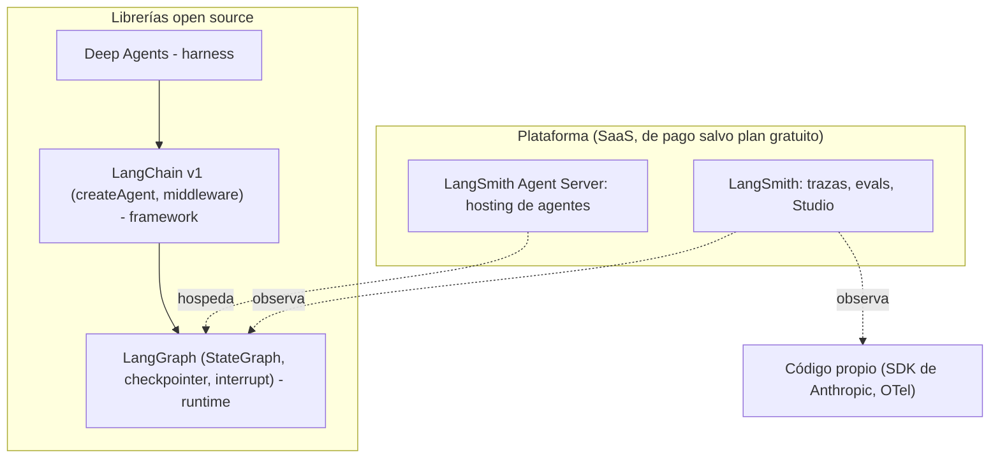
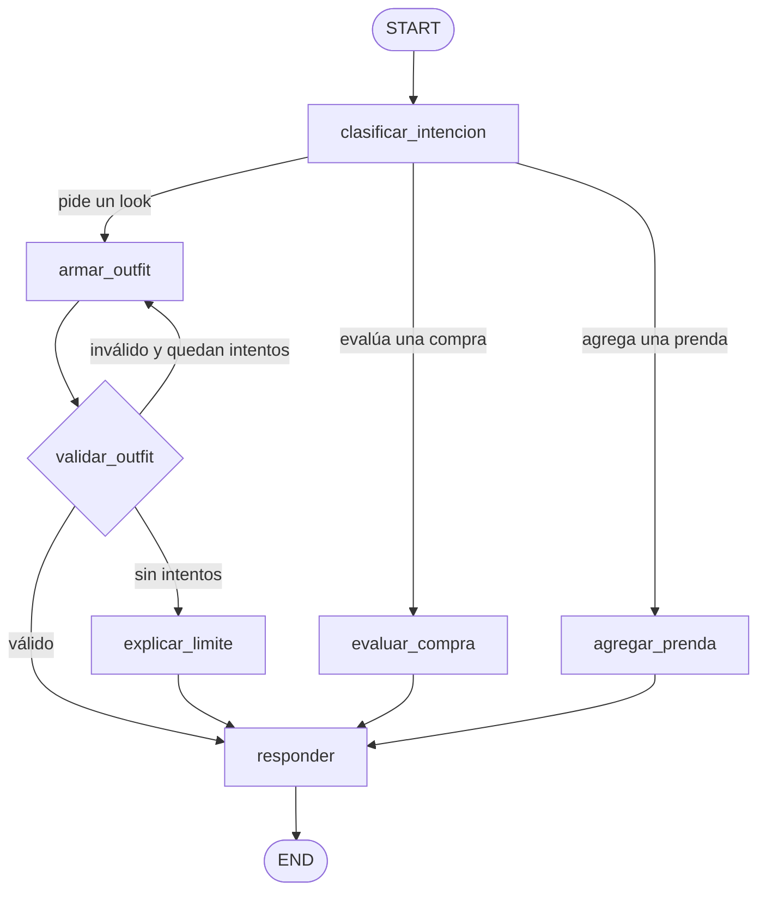
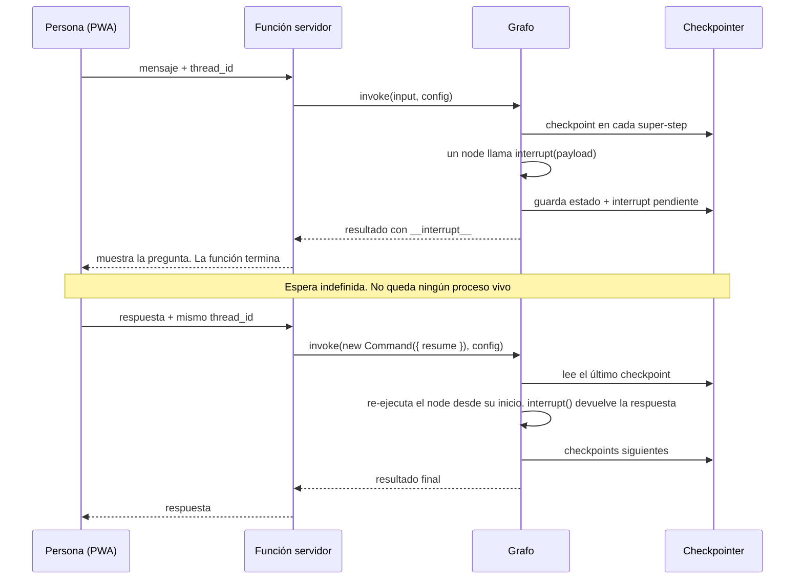
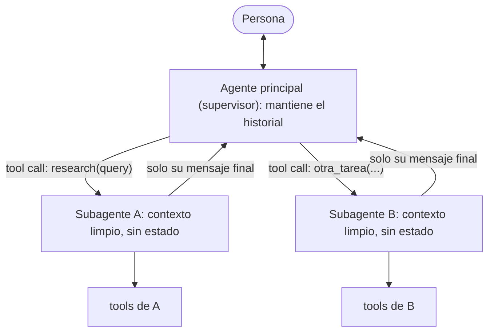

# A3 — LangGraph y el ecosistema LangChain

> Parte de la base de conocimiento `docs/investigacion-agentes/`. Investigación, no especificación.
> Marcas: **[DOC]** documentado por el proveedor sobre su propio producto (doc oficial, README o código del repo oficial, registro npm) · **[EXP]** terceros, caso de estudio o blog publicado por el proveedor, encuesta, issue, material experimental · **[REC]** recomendación o inferencia de esta investigación.
> Fecha de consulta de todas las fuentes: **2026-11-14**. Los enlaces están al final del documento.
> Variante descrita: **LangGraph.js (TypeScript)**. Cuando Python difiere, se dice.
> **Ningún fragmento de código de este documento fue ejecutado.** Son copias, recortes o adaptaciones de la doc oficial; cada uno indica su origen. Los nombres de modelo que aparecen (`"gpt-6.1-sol"`, `"google:gemini-4-hydrogen"`, `"anthropic:claude-sonnet-5"`) son los marcadores de los ejemplos de la doc, no una recomendación.
> Este documento **explica el sistema**. No recomienda adoptarlo ni descartarlo: esa evaluación vive en `D-evaluacion-tecnologica.md`.

Versiones vigentes en npm al 2026-11-14 [DOC] [LG-NPM]:

| Paquete | Versión | Publicada | Nota |
|---|---|---|---|
| `@langchain/langgraph` | 1.7.4 | 2026-11-12 | La 1.0.0 salió el 2025-10-18. `engines.node >= 18` |
| `langchain` (trae `createAgent`) | 1.6.6 | 2026-11-13 | |
| `@langchain/core` | 1.4.1 | 2026-11-13 | |
| `@langchain/langgraph-checkpoint-postgres` | 1.1.3 | 2026-11-12 | Depende de `pg ^8.12.0` |
| `@langchain/langgraph-supervisor` | 1.1.3 | 2026-09-25 | No marcado deprecated en npm |
| `@langchain/langgraph-swarm` | 1.0.4 | 2026-09-25 | No marcado deprecated en npm |
| `@langchain/anthropic` | 1.6.5 | 2026-11-13 | |
| `deepagents` | 1.16.5 | 2026-11-12 | |
| `langsmith` | 0.12.0 | 2026-11-10 | |
| `agentevals` · `openevals` | 0.0.7 · 0.2.3 | 2026-03-03 · 2026-10-22 | |

Versiones mínimas que la doc exige para funciones usadas más abajo [DOC]: event streaming (`streamEvents` con `version: "v3"`) desde 1.2 [LG-STREAM]; timeouts por nodo, `errorHandler`, `setNodeDefaults` y `RunControl` desde 1.4.0 [LG-FAULT]; `responseSchema` en `interrupt()` desde 1.4.16 [LG-INT].

## 1. Las piezas del ecosistema y cómo se relacionan

### 1.1 Mapa

| Pieza | Qué es | Capa | Licencia / costo |
|---|---|---|---|
| **LangGraph** (`@langchain/langgraph`) | Librería para definir un agente o flujo como grafo con estado, con persistencia, pausas y streaming. | **Runtime** (ejecución) | [DOC] Open source; "works on its own" [LG-OVERVIEW] |
| **LangChain v1** (`langchain`) | Abstracciones e integraciones: modelos, tools, y el agente prearmado `createAgent` con middleware. | **Framework** | [DOC] Open source [LC-V1] |
| **Deep Agents** (`deepagents`) | Agente prearmado con planificación, subagentes y sistema de archivos virtual. | **Harness** | [DOC] SDK open source; existe versión gestionada de pago ("Managed Deep Agents") [LC-DEEP] |
| **LangSmith** | Plataforma de observabilidad y evaluación: trazas, datasets, evaluadores, Studio. | Plataforma (SaaS) | [DOC] Plan gratuito limitado y planes de pago [LS-PRICING] |
| **LangSmith Agent Server** (antes "LangSmith Deployment") | Servidor que hospeda agentes: API de assistants, threads y runs, cola de trabajos, persistencia gestionada. | Plataforma de despliegue | [DOC] De pago: plan Plus o superior en Cloud; licencia propia en modo standalone [LS-DEPLOYMENT], [LS-STANDALONE] |

Relaciones documentadas:

- [DOC] "LangChain's agents are built on top of LangGraph": `createAgent` devuelve un grafo LangGraph por debajo. [LC-PRODUCTS]
- [DOC] LangGraph "does not require LangChain": se puede usar el runtime sin el framework. [LC-PRODUCTS]
- [DOC] Deep Agents corre el mismo loop de tool calling sobre LangChain y LangGraph, con capacidades ya integradas. [LC-DEEP]
- [DOC] LangSmith no exige LangChain ni LangGraph: se puede trazar código propio (ver 2.14). [LS-ANTHROPIC], [LS-OTEL]
- [DOC] Con Agent Server no se configura checkpointer ni store: los maneja el servidor. [LG-PERSIST]
- [DOC] Nombre vigente del producto de despliegue: "LangSmith Deployment is now **LangSmith Agent Server**"; el hosting gestionado también aparece como "LangSmith Cloud". En las páginas leídas ya no figura "LangGraph Platform"; quedan como rastro el CLI `langgraph`, el archivo `langgraph.json` y la variable `LANGGRAPH_CLOUD_LICENSE_KEY`. [LS-DEPLOYMENT], [LG-DEPLOY]



### 1.2 Framework, runtime y harness

Definición del propio proveedor [DOC] [LC-PRODUCTS]; el post que la originó es [EXP] [LC-FRH]:

| | Runtime | Framework | Harness |
|---|---|---|---|
| Aporta | Ejecución durable, streaming, human-in-the-loop, persistencia | Abstracciones e integraciones | Tools, prompts y subagentes predefinidos |
| Cuándo | Control de bajo nivel; flujos largos con estado | Partir rápido; estandarizar al equipo | Agentes más autónomos; tareas complejas no deterministas |
| Ejemplos que da la doc | LangGraph, Temporal, Inngest | LangChain, Vercel AI SDK, CrewAI, OpenAI Agents SDK, Google ADK, LlamaIndex | Deep Agents SDK, Claude Agent SDK, Manus |

- [DOC] La doc define el agente como "Agent = Model + Harness." [LC-OVERVIEW]. Es la misma noción de harness que usa `A1` §1.
- [REC] Lectura para nosotros: nuestro loop propio con 8 herramientas ya es un harness mínimo. La pregunta que LangGraph responde es la de la capa de abajo —cómo se ejecuta, se guarda y se retoma ese loop—, no la de qué herramientas o prompts tener.

### 1.3 Qué cambió con la v1

- [DOC] La v1 de LangGraph es de estabilidad: las primitivas de grafo y el modelo de ejecución "are unchanged". [LG-V1]
- [DOC] `createReactAgent` (agente prearmado de LangGraph) queda **deprecado**; se reemplaza por `createAgent` de `langchain`, y `prompt` pasa a llamarse `systemPrompt`. [LG-V1], [LG-MIG]
- [DOC] LangChain v1: `createAgent` es "the standard way to build agents in LangChain 1.0"; lo legado (chains, retrievers, indexing) se mueve a `@langchain/classic`; se agregan standard content blocks. [LC-V1]
- [EXP] El anuncio promete que no habrá cambios incompatibles hasta la 2.0. [LC-V1-BLOG]
- [DOC] La doc se reorganizó: `durable-execution` redirige a `persistence`; `use-functional-api` y `choosing-apis` redirigen a `functional-api`; hay páginas nuevas del Graph API (`graph-api-state`, `graph-api-control-flow`, `graph-api-send-command`, `graph-api-nodes`). Un tutorial anterior a la v1 puede apuntar a rutas que ya no existen. [LG-PERSIST], [LG-FUNC]
- [DOC] Discrepancia entre fuentes oficiales: la guía de migración pide "Node.js 22+", pero npm declara `engines.node >= 18` para la 1.7.4. No se determinó cuál rige en la práctica. [LG-MIG], [LG-NPM]

## 2. Los conceptos, uno por uno

### 2.1 StateGraph y construcción de grafos

**Qué es.** [DOC] `StateGraph` es "the main graph builder", parametrizado con el esquema de estado. Un grafo tiene tres partes: **estado** (los datos compartidos), **nodes** (funciones que leen el estado y devuelven actualizaciones) y **edges** (transiciones, fijas o condicionales). El grafo se **compila** antes de usarse; al compilar se validan la estructura y se adjuntan el checkpointer y los breakpoints. [LG-GRAPH], [LG-OVERVIEW]

**Cómo se usa.**

```ts
// Fuente: https://docs.langchain.com/oss/javascript/langgraph/graph-api ("Compiling your graph")
import { END, START, StateGraph, StateSchema } from "@langchain/langgraph";
import * as z from "zod";

const State = new StateSchema({ text: z.string() });

const graph = new StateGraph(State)
  .addNode("nodeA", (state) => ({ text: `${state.text}a` }))
  .addEdge(START, "nodeA")
  .addEdge("nodeA", END)
  .compile();

await graph.invoke({ text: "" }); // { text: 'a' }
```

**Qué problema resuelve.** [DOC] Control explícito del estado y del flujo, mezclando pasos deterministas con pasos guiados por el LLM. [LG-OVERVIEW]

**Graph API vs Functional API.** [DOC] Hay una segunda forma de escribir lo mismo: la **Functional API**, que envuelve funciones normales con persistencia, pausas y streaming. Tiene dos piezas: `entrypoint` (el flujo) y `task` (unidad de trabajo cuyo resultado se guarda). [LG-FUNC]

```ts
// Adaptado de https://docs.langchain.com/oss/javascript/langgraph/functional-api ("Execution")
import { MemorySaver, entrypoint, task } from "@langchain/langgraph";

const slowComputation = task("slowComputation", async (inputValue: number) => {
  return inputValue * 2;
});

const myWorkflow = entrypoint(
  { checkpointer: new MemorySaver(), name: "workflow" },
  async (someInput: number): Promise<number> => {
    return await slowComputation(someInput);
  }
);
```

| | Graph API | Functional API |
|---|---|---|
| Flujo de control | Nodes y edges declarados | `if` y bucles del lenguaje |
| Estado | Esquema compartido con reducers | Sin esquema compartido |
| Cuándo se guarda | Tras cada super-step | Los resultados de cada `task`, dentro del checkpoint del entrypoint |
| Visualización del grafo | Sí | No |
| Posición de la doc | "Prefer the Graph API for building new agents." | Para envolver agentes ya escritos (incluso de otros frameworks) y llevarlos al runtime |

Fuente de la tabla: [DOC] [LG-FUNC].

**Advertencias.** [DOC]
- "You must compile the graph before you invoke or stream it." [LG-GRAPH]
- En TypeScript no existe `.ainvoke`: `invoke` y `stream` ya son asíncronos. [LG-FLOW]
- Las dependencias que no van en el estado (clientes, identificador de la persona) se declaran como **contexto**: segundo argumento de `StateGraph`, se pasan en `invoke(input, { context })` y se leen en `config.context`. [LG-GRAPH]
- **Migrar un grafo con hilos guardados:** en hilos terminados se puede cambiar la topología libremente; en hilos interrumpidos no se debe renombrar ni quitar el nodo al que el hilo va a entrar. Agregar o quitar claves de estado es compatible; renombrar una clave pierde su valor guardado. [LG-GRAPH]
- Functional API: al reanudar, la ejecución **no** sigue en la línea exacta; se re-ejecuta el entrypoint desde el inicio y los tasks completados devuelven su resultado guardado. Todo lo no determinista (reloj, aleatorio) y todo efecto secundario debe ir dentro de un `task`. Los `errorHandler` no están disponibles ahí. [LG-FUNC], [LG-FAULT]

### 2.2 Nodes y edges

**Qué es.** [DOC] Un node es una función (sync o async) que recibe `state` y `config` (un `RunnableConfig` con `thread_id`, tags, etc.) y devuelve una **actualización parcial** del estado. Un edge decide qué corre después. "nodes do the work; edges decide what runs next." [LG-GRAPH]

**Cómo se usa.**

```ts
// Fuente: https://docs.langchain.com/oss/javascript/langgraph/graph-api ("Nodes")
import { StateGraph, StateSchema, GraphNode } from "@langchain/langgraph";
import * as z from "zod";

const State = new StateSchema({ input: z.string(), results: z.string() });

const myNode: GraphNode<typeof State> = (state, config) => {
  return { results: `Hello, ${state.input}!` };
};

const builder = new StateGraph(State).addNode("myNode", myNode);
```

**Qué problema resuelve.** [DOC] El node es la unidad de **checkpoint**, de **reintento** y de **bifurcación**: decidir qué va en un node es decidir cada cuánto se guarda y qué se repite si algo falla. La doc da una tabla para elegir la unidad de trabajo: función plana dentro de un node (sin checkpoint propio), `task` (resultado guardado, no se repite al reanudar), subgraph, o node. [LG-GRAPH]

**Advertencias.** [DOC]
- Un node devuelve actualizaciones; no debe mutar el estado. [LG-STATE]
- Un node con varios edges de salida ejecuta los destinos **en paralelo** en el siguiente super-step. Las actualizaciones de un paso paralelo pueden no llegar en orden consistente. [LG-GRAPH], [LG-FLOW]
- Por node se usan edges estáticos **o** ruteo dinámico, no ambos: "Mixing them can run both paths." [LG-GRAPH]
- Tras un interrupt o un reintento, el node afectado corre de nuevo **desde el inicio de su función**. [LG-GRAPH]
- `addEdge(["b_2", "c"], "d")` espera a que todos los orígenes terminen y corre `d` una vez; si una rama nunca corre, `d` nunca corre y **no hay error**. Alternativa: `{ defer: true }` en el node. [LG-FLOW]

### 2.3 Conditional edges y árboles de decisión

**Qué es.** [DOC] `addConditionalEdges(origen, routingFn, mapaOpcional)`: después del node origen se llama a una función que recibe el estado y devuelve el nombre del siguiente node, `END`, una lista de nombres (ejecución en abanico) u objetos `Send`. Sirve también desde `START` como entrada condicional. [LG-GRAPH], [LG-FLOW]

[REC] Es la forma que toma en LangGraph la "decisión en el código" de `A1` §4: el árbol de decisión deja de estar en el prompt y pasa a ser topología. La doc no usa el término "árbol de decisión"; habla de ramas condicionales y loops [DOC] [LG-FLOW].

**Cómo se usa.**

```ts
// Adaptado de https://docs.langchain.com/oss/javascript/langgraph/graph-api-control-flow ("Create and control loops")
const route: ConditionalEdgeRouter<{ InputSchema: typeof State; Nodes: "b" }> =
  (state) => (terminationCondition(state) ? END : "b");

const graph = new StateGraph(State)
  .addNode("a", nodeA)
  .addNode("b", nodeB)
  .addEdge(START, "a")
  .addConditionalEdges("a", route)
  .addEdge("b", "a")
  .compile();
```

Variante con mapa explícito de salidas [DOC] [LG-GRAPH]: `graph.addConditionalEdges("nodeA", routingFunction, { pathA: "nodeB", pathB: "nodeC" })`.

Cómo se vería un árbol de decisión de nuestro dominio como grafo. [REC] El diagrama es **ilustrativo**: no viene de la doc ni es una propuesta de diseño; muestra que cada rombo o bifurcación es un conditional edge y cada flecha de vuelta, un loop con condición de término.



**Qué problema resuelve.** [DOC] Ramificar y construir loops con condición de término a partir del estado, con las rutas posibles declaradas y visibles. [LG-FLOW]

**`Command`: actualizar y rutear en un solo paso.** [DOC] Un node puede devolver un `Command` con `update` (cambios al estado) y `goto` (siguiente node). Acepta además `graph` (para saltar al grafo padre con `Command.PARENT`) y `resume` (para reanudar tras un interrupt). [LG-GRAPH], [LG-SENDCMD]

```ts
// Fuente: https://docs.langchain.com/oss/javascript/langgraph/graph-api ("update and goto")
import { Command } from "@langchain/langgraph";

graph.addNode("myNode", (state) => {
  return new Command({
    update: { foo: "bar" },
    goto: "myOtherNode",
  });
}, {
  ends: ["myOtherNode", END],
});
```

**`Send`: abanico dinámico (map-reduce).** [DOC] `new Send(nodoDestino, input)` invoca el mismo node una vez por ítem, cada uno con su propio input, cuando la cantidad solo se conoce en ejecución. Los edges normales no pueden hacerlo porque la topología es fija. [LG-GRAPH], [LG-SENDCMD]

```ts
// Fuente: https://docs.langchain.com/oss/javascript/langgraph/graph-api ("Send")
import { Send } from "@langchain/langgraph";

graph.addConditionalEdges("nodeA", (state) => {
  return state.subjects.map(
    (subject) => new Send("generateJoke", { subject })
  );
});
```

**`recursionLimit`: el tope de pasos.** [DOC] Límite de **super-steps** por corrida. El default es **25**; al alcanzarlo se lanza `GraphRecursionError`. [LG-GRAPH], [LG-FLOW]

```ts
// Fuente: https://docs.langchain.com/oss/javascript/langgraph/graph-api-control-flow ("Impose a recursion limit")
import { GraphRecursionError } from "@langchain/langgraph";

try {
  await graph.invoke({ aggregate: [] }, { recursionLimit: 4 });
} catch (error) {
  if (error instanceof GraphRecursionError) {
    console.log("Recursion Error");
  }
}
```

**Advertencias.**
- [DOC] Para ruteo puro la doc prefiere conditional edges; `Command` solo cuando hay que actualizar y rutear juntos. [LG-FLOW]
- [DOC] Con `Command` hay que declarar `ends` en `addNode`: es requisito para dibujar el grafo y para que el runtime conozca los destinos. Los edges estáticos del mismo node siguen corriendo: no mezclar. [LG-GRAPH]
- [DOC] Como **entrada** de `invoke`/`stream`, el único `Command` válido es `new Command({ resume })`. Pasar `new Command({ update })` para seguir una conversación es un error: cualquier `Command` de entrada reanuda desde el último checkpoint, no desde `START`, y un hilo terminado "can look stuck". Un turno nuevo se pasa como objeto plano. [LG-SENDCMD]
- [DOC] Un `Command` devuelto desde una tool debe incluir en `update` el historial con un `ToolMessage`. [LG-SENDCMD]
- [DOC] El node que recibe un `Send` **no** ve el estado completo, solo lo que se le pasó. Si varios trabajadores escriben la misma clave, esa clave necesita reducer. [LG-SENDCMD]
- [DOC] `recursionLimit` y `maxConcurrency` son claves de primer nivel del config, **no** van dentro de `configurable`. Un node puede leer el paso actual en `config.metadata?.langgraph_step`. "There is no TypeScript equivalent of Python RemainingSteps." [LG-GRAPH], [LG-FLOW]
- [DOC] Un loop necesita condición de término explícita; el `recursionLimit` es solo red de seguridad. [LG-FLOW]
- [EXP] Issue #2971 (cerrado el 2026-10-31): en despliegues Serverless de LangSmith, reanudar un `interrupt()` dentro de una tarea `Send` no hacía nada y rompía el hilo. No se verificó en qué versión quedó corregido. [LG-ISSUE-2971]

### 2.4 State management: esquemas y reducers

**Qué es.** [DOC] El estado se guarda en **channels** (las claves del esquema). Cada channel define cómo se fusionan las actualizaciones que recibe: esa función es el **reducer**, `reducer(valorActual, actualizacion)`. Sin reducer, la actualización **sobrescribe**. [LG-STATE], [LG-GRAPH]

Formas de declarar el estado, según la tabla comparativa de la doc [DOC] [LG-STATE]:

| Enfoque | Reducers | Zod | Estado en la doc |
|---|---|---|---|
| `StateSchema` | Integrados | v3 o v4 | **Recomendado** ("Prefer `StateSchema` over the legacy alternatives.") |
| Channels API | Manual | N/A | Casos avanzados |
| `Annotation.Root` | Integrados | N/A | **Legacy** (sigue soportado) |
| Zod v3 + `.langgraph` · Zod v4 + registry | Plugin · registry | Solo v3 · solo v4 | Legacy |

**Cómo se usa.**

```ts
// Fuente: https://docs.langchain.com/oss/javascript/langgraph/graph-api ("State")
import { StateSchema, ReducedValue, MessagesValue, UntrackedValue } from "@langchain/langgraph";
import * as z from "zod";

const AgentState = new StateSchema({
  messages: MessagesValue,
  currentStep: z.string(),
  retryCount: z.number().default(0),
  allSteps: new ReducedValue(
    z.array(z.string()).default(() => []),
    { inputSchema: z.string(), reducer: (current, newStep) => [...current, newStep] }
  ),
  tempCache: new UntrackedValue(z.record(z.string(), z.unknown())),
});
```

Cada campo puede ser [DOC] [LG-STATE]:

| Tipo de campo | Comportamiento |
|---|---|
| Schema estándar (Zod u otro) | El último valor gana |
| `ReducedValue` | Reducer propio (acumular, combinar ramas paralelas) |
| `MessagesValue` | Lista de mensajes con reducer consciente de IDs: agrega los nuevos, actualiza los existentes y acepta formatos abreviados como `{ role: "user", content: "..." }` |
| `UntrackedValue` | Transitorio: **no** se guarda en checkpoints |

Además [DOC] [LG-STATE]:
- **Esquemas de input y output** distintos del estado interno: `new StateGraph({ input: InputState, output: OutputState, state: OverallState })`. El de entrada valida; el de salida filtra lo que devuelve `invoke`.
- **Estado privado**: channels que comparten solo algunos nodes, declarando un esquema de entrada por node: `addNode("node2", node2, { input: Node2Input })`.
- Tipos utilitarios: `GraphNode<typeof State>`, `ConditionalEdgeRouter`, `typeof State.State`, `State.Update`.

**Qué problema resuelve.** [DOC] Tipado, validación y reglas de fusión declarados en un solo lugar; el node devuelve solo lo nuevo (por ejemplo, los mensajes nuevos) y el reducer se encarga de combinarlo, también cuando dos ramas paralelas escriben la misma clave. [LG-STATE]

**Advertencias.**
- [DOC] Con un reducer de mezcla, devolver un valor vacío **no limpia** el campo (`{ errors: [] }` deja lo acumulado). Para reemplazar: `new Overwrite([])` o la forma JSON `{ __overwrite__: [...] }`. En paralelo, solo un node puede usar `Overwrite` sobre la misma clave por super-step (si no, `InvalidUpdateError`), y descarta las escrituras normales de los demás a esa clave. [LG-STATE]
- [DOC] `graph.updateState()` también pasa por los reducers: en channels con reducer **acumula**, no sobrescribe. [LG-CKPT]
- [DOC] `UntrackedValue` se reinicia al reanudar: no usarlo para datos que deban sobrevivir a un interrupt. [LG-STATE]
- [DOC] **Privacidad:** "Values streaming emits **all** state channels by default, including private ones." Un channel privado puede faltar en la salida de `invoke` y aun así verse en el stream. Para restringir: `outputKeys` o `streamMode: "updates"`. Además, un node puede escribir en cualquier channel, incluso fuera de su esquema de entrada. [LG-STATE]
- [DOC] En TypeScript no hay un estado prearmado equivalente al `MessagesState` de Python: se pone `MessagesValue` en el campo `messages`. En Python el estado es `TypedDict`, Pydantic o dataclass, con reducers `Annotated[list, add_messages]`. [LG-STATE], [LG-PY-STATE]
- [DOC] `Annotation.Root` y `MessagesAnnotation` aparecen en mucho material anterior a la v1. `Annotation.Root` está marcado "Legacy" y varias páginas vigentes (time travel, el ejemplo de `responseSchema`) todavía lo usan en sus ejemplos. `MessagesAnnotation` no aparece en las páginas vigentes leídas, aunque sigue exportado en el repo; no se verificó si la referencia de API lo marca como deprecado. [LG-STATE], [LG-TT]

### 2.5 Checkpointing y persistencia

**Qué es.** [DOC] Un **checkpointer** guarda una foto del estado del grafo en cada **super-step**, organizada en **threads** (hilos, identificados por `thread_id`). Es requisito para human-in-the-loop, memoria conversacional, time travel y tolerancia a fallos. [LG-CKPT], [LG-PERSIST]

Conceptos que hay que tener claros [DOC] [LG-CKPT], [LG-GRAPH]:

| Concepto | Definición |
|---|---|
| **Super-step** | Unidad de avance estilo Pregel: los nodes que corren en paralelo comparten un super-step; los que van en secuencia usan super-steps separados. Se crea un checkpoint en cada frontera. Para `START -> A -> B -> END` quedan exactamente 4 checkpoints. |
| **Thread** | Secuencia de checkpoints de una conversación o corrida. |
| **Pending writes** | Además del checkpoint por super-step, la salida de cada node que termina se guarda aparte (tabla `checkpoint_writes`). Si otro node del mismo super-step falla, al reanudar no se repiten los que sí terminaron. |
| **`StateSnapshot`** | Lo que devuelve `getState`: `values`, `next` (vacío = terminado), `config`, `metadata` (`source`, `writes`, `step`), `createdAt`, `parentConfig`, `tasks` (con `error` e `interrupts`). |
| **Time travel** | Dos operaciones sobre checkpoints previos: **replay** (reintentar desde un checkpoint) y **fork** (bifurcar con estado modificado). [LG-TT] |
| **Durabilidad** | Cuándo se escribe el checkpoint respecto de la ejecución: modos `"exit"`, `"async"`, `"sync"`. |

**Cómo se usa.**

```ts
// Fuente: https://docs.langchain.com/oss/javascript/langgraph/persistence ("Quickstart")
import { MemorySaver, InMemoryStore } from "@langchain/langgraph";

const checkpointer = new MemorySaver();
const store = new InMemoryStore();

const graph = builder.compile({ checkpointer, store });

const result = await graph.invoke(
  { messages: [{ role: "user", content: "Hi, my name is Bob." }] },
  { configurable: { thread_id: "thread-1" } }
);
```

Qué significa cada forma de invocar sobre un hilo existente [DOC] [LG-PERSIST]:

| Objetivo | Invocación |
|---|---|
| Nuevo input | `graph.invoke(input, config)` — aplica el input al estado guardado (con los reducers) y parte del punto de entrada |
| Continuar tras un error | `graph.invoke(null, config)` |
| Responder un `interrupt()` | `graph.invoke(new Command({ resume }), config)` |
| Re-ejecutar historia | `graph.invoke(null, snapshot.config)` |

Implementaciones de checkpointer [DOC] [LG-CKPT]:

| Paquete | Clase | Uso según la doc |
|---|---|---|
| `@langchain/langgraph-checkpoint` (incluido) | `MemorySaver` | Experimentación; se pierde al reiniciar el proceso |
| `@langchain/langgraph-checkpoint-sqlite` | `SqliteSaver` | Experimentación y flujos locales |
| `@langchain/langgraph-checkpoint-postgres` | `PostgresSaver` | "Ideal for using in production"; es el que usa LangSmith |
| `@langchain/langgraph-checkpoint-mongodb` | `MongoDBSaver` | Producción |
| `@langchain/langgraph-checkpoint-redis` | `RedisSaver` | Producción |

La interfaz común es `BaseCheckpointSaver` (`.put`, `.putWrites`, `.getTuple`, `.list`); se puede implementar una propia. [DOC] [LG-CKPT]

```ts
// Fuente: https://github.com/langchain-ai/langgraphjs/blob/main/libs/checkpoint-postgres/README.md
import { PostgresSaver } from "@langchain/langgraph-checkpoint-postgres";
import pg from "pg";

const pool = new pg.Pool({ connectionString: "postgresql://..." });

const checkpointer = new PostgresSaver(pool, undefined, {
  schema: "schema_name", // por defecto "public"
});

await checkpointer.setup(); // obligatorio la primera vez
```

Time travel, variante fork:

```ts
// Recortado de https://docs.langchain.com/oss/javascript/langgraph/use-time-travel ("Fork")
const states = [];
for await (const state of graph.getStateHistory(config)) {
  states.push(state);
}
const beforeJoke = states.find((s) => s.next.includes("writeJoke"));

const forkConfig = await graph.updateState(beforeJoke.config, { topic: "chickens" });

const result = await graph.invoke(null, forkConfig);
```

Modos de durabilidad [DOC] [LG-CKPT]; se pasan por llamada, por ejemplo `graph.stream(input, { durability: "sync" })`:

| Modo | Comportamiento |
|---|---|
| `"exit"` | Persiste solo cuando la ejecución sale (éxito, error o interrupt). Mejor rendimiento; sin recuperación si el proceso cae a mitad de camino. |
| `"async"` (default, según el README del paquete base [LG-CKPT-README]) | Persiste de forma asíncrona mientras corre el paso siguiente. Riesgo pequeño de perder checkpoints si el proceso cae. |
| `"sync"` | La corrida no retorna hasta que las escrituras pendientes terminen. |

**Qué problema resuelve.** [DOC] Continuar conversaciones, pausar indefinidamente y retomar, recuperarse de fallos sin repetir lo ya hecho, e inspeccionar o bifurcar ejecuciones pasadas para depurar. [LG-CKPT], [LG-TT]

**Advertencias.**
- [DOC] Con checkpointer, `thread_id` en `configurable` es **obligatorio**. Y "Reusing a thread ID alone does not mean that execution resumes": depende de qué se pase como input (tabla de arriba). Un input nuevo **no** limpia el hilo; para partir de cero se usa otro `thread_id`. [LG-PERSIST]
- [DOC] Los checkpoints crecen sin límite en conversaciones largas; hay que podarlos. Lo único verificado para JS es `checkpointer.deleteThread(threadId)`. [LG-PERSIST], [LG-ADDMEM]
- [DOC] Un super-step es **transaccional**: si una rama lanza error, ninguna actualización de ese super-step se aplica al estado. [LG-FLOW]
- [DOC] "Replay re-executes nodes—it doesn't just read from cache": las llamadas al LLM, a APIs y los interrupts se disparan otra vez y pueden dar otro resultado. `updateState` no hace rollback: crea una rama y la historia original queda intacta. [LG-TT]
- [DOC] En JS, `"sync"` **no** garantiza escritura antes de cada paso; una caída a mitad de corrida puede perder checkpoints recientes. [LG-CKPT]
- [DOC] En cualquier modo, una caída antes del primer checkpoint durable deja el hilo indistinguible de uno nunca invocado. Si hace falta distinguir "nunca aceptado" de "aceptado y perdido", hay que registrar la admisión fuera del checkpointer (una fila propia antes de `invoke`). [LG-CKPT]
- [DOC] Garantía relevante para serverless: sin importar el modo, LangGraph espera todas las escrituras pendientes antes de que `invoke()` o `stream()` resuelva. Si se hace `await` de la corrida o se consume el stream completo, la persistencia está completa al retornar. La única forma de dejar escrituras huérfanas es iniciar un stream y no consumirlo. [LG-CKPT-README]
- [DOC] **Idempotencia:** un reintento re-ejecuta la función completa del node, es decir, semántica **at-least-once** (al menos una vez). Los efectos externos quedan fuera de la frontera del checkpoint. La clave de idempotencia debe ser durable **antes** del efecto: derivarla de estado ya guardado o generarla en un node previo. Si el proveedor confirma y la confirmación se pierde, el estado local faltante es **desconocido**, no prueba de que no ocurrió. [LG-FAULT]
- [DOC] `PostgresSaver`: `setup()` crea tablas y la doc recomienda correrlo "as a dedicated deployment step", no en cada request. Usa `pg`, que abre una conexión TCP: en runtimes edge sin TCP saliente la conexión **se cuelga**; Node.js, Deno y Bun estándar "are unaffected". [LG-PG-README], [LG-ADDMEM]
- [DOC] La página Python documenta cifrado de checkpoints (`EncryptedSerializer`); esa sección **no aparece** en la página JS. No se verificó si existe un equivalente en el paquete JS. [LG-PY-CKPT], [LG-CKPT]
- [DOC] La doc pide mantener `thread_id` bajo 255 caracteres, pero las migraciones JS declaran `thread_id TEXT NOT NULL`. No se determinó si el límite aplica al paquete JS. [LG-PERSIST], [LG-PG-MIGR]

### 2.6 Human-in-the-loop

**Qué es.** [DOC] `interrupt(valor)` pausa la ejecución en cualquier punto de un node, guarda el estado con el checkpointer y espera **indefinidamente**. El valor (serializable a JSON) llega a quien invocó en el campo `__interrupt__`. Al reanudar con `new Command({ resume })`, ese valor es lo que devuelve la llamada a `interrupt()`. [LG-INT]

Requisitos [DOC] [LG-INT]: un checkpointer (durable en producción), un `thread_id`, y un payload serializable. Se reanuda con el **mismo** `thread_id`.

**Cómo se usa.**

```ts
// Adaptado de https://docs.langchain.com/oss/javascript/langgraph/interrupts
import { interrupt, Command } from "@langchain/langgraph";

async function approvalNode(state: State) {
  const approved = interrupt("Do you approve this action?");
  return { approved };
}

const config = { configurable: { thread_id: "thread-1" } };
const result = await graph.invoke({ input: "data" }, config);
console.log(result.__interrupt__); // qué está esperando el grafo

await graph.invoke(new Command({ resume: true }), config);
```

El ciclo completo. [REC] El diagrama combina lo que la doc dice de `interrupt`, checkpointer y `Command`; la "función servidor" es nuestra lectura para un despliegue serverless (ver §3).



Patrones documentados [DOC] [LG-INT]:

| Patrón | Cómo |
|---|---|
| Aprobar o rechazar | `interrupt({ question, details })`; se reanuda con `true` o `false` y el node rutea |
| Revisar y editar | `interrupt({ instruction, content })`; el valor de reanudación reemplaza el contenido |
| Interrupt dentro de una tool | La tool llama `interrupt(...)` antes del efecto; la aprobación queda junto a la tool y es reutilizable |
| Validar input humano | `interrupt()` **una sola vez por invocación del node**; guardar la pregunta pendiente en el estado y volver al node con un conditional edge hasta tener un valor válido |
| Varios interrupts simultáneos | Al reanudar se mapea cada ID de interrupt a su valor |
| Con streaming | `stream.interrupted` y `stream.interrupts` sobre `streamEvents(..., { version: "v3" })` |

Con `createAgent` existe un middleware prearmado. Fuente: https://docs.langchain.com/oss/javascript/langchain/human-in-the-loop (reformateado). Las decisiones posibles que nombra la doc son approve, edit, reject y respond. [DOC] [LC-HITL]

```ts
import { createAgent, humanInTheLoopMiddleware } from "langchain";
import { MemorySaver } from "@langchain/langgraph";

const agent = createAgent({
  model: "gpt-6.1-sol",
  tools: [writeFileTool, executeSQLTool, readDataTool],
  middleware: [humanInTheLoopMiddleware({
    interruptOn: {
      write_file: true,
      execute_sql: { allowedDecisions: ["approve", "reject"] },
      read_data: false,
    },
  })],
  checkpointer: new MemorySaver(),
});
```

**Qué problema resuelve.** [DOC] Aprobaciones antes de acciones críticas, revisión y edición de salidas del LLM o de tool calls, y validación de input humano, sin mantener un proceso vivo mientras la persona responde. [LG-INT]

**Advertencias — las reglas de re-ejecución.** [DOC] [LG-INT]
1. **El node se re-ejecuta desde el inicio al reanudar.** `interrupt()` funciona lanzando una excepción especial; al reanudar "the runtime restarts the entire node from the beginning". Todo el código anterior al `interrupt()` corre de nuevo.
2. **No envolver `interrupt()` en un try/catch genérico:** atraparía la excepción y la pausa no llegaría al grafo.
3. **No reordenar las llamadas a `interrupt()` dentro de un node:** el emparejamiento con los valores de reanudación es "strictly index-based". No saltarlas condicionalmente ni ponerlas en loops no deterministas.
4. **Solo valores serializables:** funciones o instancias de clase fallan.
5. **Los efectos secundarios previos al `interrupt()` deben ser idempotentes.** Opciones: operación idempotente (upsert), mover el efecto **después** del `interrupt()`, o separarlo en otro node. Antipatrón: crear un registro antes del interrupt (se duplica en cada reanudación).
6. **Evitar `while (true)` + `interrupt()` en un node:** cada reanudación re-ejecuta todas las iteraciones previas.
7. **Subgraphs invocados como función:** al reanudar se re-ejecutan desde su inicio tanto el node padre como el node del subgraph.

Otras [DOC]:
- `interrupt()` **no** pasa por la política de reintentos ni por el `errorHandler`. [LG-FAULT]
- Para no repetir trabajo caro previo a un interrupt en el mismo node, envolverlo en un `task`. [LG-GRAPH]
- `interrupt(valor, { responseSchema })` con un esquema Zod valida la respuesta (desde 1.4.16); con un JSON Schema plano, LangGraph lo expone pero **no valida**. [LG-INT]
- Los breakpoints estáticos (`interruptBefore` / `interruptAfter` al compilar) son para depurar: "Static interrupts are **not** recommended for human-in-the-loop workflows." [LG-INT]
- Durante time travel los interrupts **siempre** se vuelven a disparar. [LG-TT]

### 2.7 Orquestación multiagente

**Qué es.** [DOC] La doc vigente de LangChain describe cinco patrones [LC-MA]:

| Patrón | Qué es |
|---|---|
| **Subagents** | Un agente principal llama a subagentes como herramientas; todo el ruteo pasa por él. La doc dice que al principal se lo suele llamar **supervisor** |
| **Handoffs** | Una tool actualiza una variable de estado que cambia de agente, o cambia el prompt y las herramientas del agente actual |
| **Skills** | Un solo agente carga prompts y conocimiento especializado bajo demanda (*progressive disclosure*) |
| **Router** | Un paso de clasificación despacha a agentes especializados (en paralelo si hace falta) y sintetiza |
| **Custom workflow** | Flujo a medida en LangGraph que mezcla pasos deterministas y agénticos |

[REC] Son los mismos dos modos de delegar de `A1` §3.1 (conservando o cediendo el control), más dos alternativas que evitan sumar agentes (skills, router).

**Cómo se usa.** [DOC] Un handoff es una tool que devuelve un `Command` [LC-MA-HANDOFF]:

```ts
// Condensado de https://docs.langchain.com/oss/javascript/langchain/multi-agent/handoffs (no es copia literal)
const transferToSpecialist = tool(
  async (_, config: ToolRuntime<typeof StateSchema>) =>
    new Command({
      update: {
        messages: [new ToolMessage({ content: "Transferred to specialist", tool_call_id: config.toolCallId })],
        currentStep: "specialist",
      },
    }),
  { name: "transfer_to_specialist", description: "Transfer to the specialist agent.", schema: z.object({}) }
);
```

Cómo viaja el contexto en cada patrón [DOC] [LC-MA-SUB], [LC-MA-HANDOFF], [LC-MA-SKILLS]:

| Patrón | Qué recibe el otro agente | Qué vuelve |
|---|---|---|
| Subagents | Por defecto solo la descripción de la tarea, en una ventana limpia y sin estado (se puede pasar el historial) | El mensaje final, o claves extra de estado vía `Command` con `ToolMessage` |
| Handoffs | El estado compartido; la doc recomienda **no** pasar el historial completo del subagente y resumir lo que falte en el `ToolMessage` | — (el control cambia de manos) |
| Skills | No hay otro agente: el contenido cargado queda en el historial y todas las llamadas posteriores lo procesan | — |
| Router | `Command` para un destino, `Send` para abanico en paralelo | Resultados que el router sintetiza |

**Qué problema resuelve.** [DOC] Sirve cuando hay demasiadas herramientas, conocimiento especializado con mucho contexto, o restricciones secuenciales. La propia doc advierte que no toda tarea compleja lo necesita y que un solo agente con buenas herramientas y buen prompt suele alcanzar. [LC-MA]

Comparación publicada por LangChain [DOC] [LC-MA]. Son puntajes y **escenarios de ejemplo de la doc, no un benchmark medido**:

| Patrón | Desarrollo distribuido | Paralelización | Multi-hop | Interacción directa con la persona | Petición simple | Multi-dominio |
|---|:-:|:-:|:-:|:-:|---|---|
| Subagents | 5/5 | 5/5 | 5/5 | 1/5 | 4 llamadas | 5 llamadas, ~9K tokens |
| Handoffs | — | — | 5/5 | 5/5 | 3 | 7+ llamadas, ~14K+ tokens |
| Skills | 5/5 | 3/5 | 5/5 | 5/5 | 3 | 3 llamadas, ~15K tokens |
| Router | 3/5 | 5/5 | — | 3/5 | 3 | 5 llamadas, ~9K tokens |

**Advertencias.**
- [DOC] "Swarm" **no aparece** como patrón en la doc vigente de multiagente ni en la página de handoffs. [LC-MA], [LC-MA-HANDOFF]
- [DOC] Para handoffs la doc recomienda, en la mayoría de los casos, la variante de **un solo agente con middleware** por sobre varios agentes como subgraphs con `Command.PARENT`. [LC-MA-HANDOFF]
- [EXP] Benchmark del proveedor (2025-06-10, τ-bench modificado, dominio retail, gpt-4o): el agente único rinde levemente mejor con un solo dominio distractor, pero "the single agent baseline falls off sharply" con dos o más; swarm supera por poco a supervisor porque los subagentes del supervisor no responden directo a la persona; supervisor usa más tokens que swarm. Tres ajustes mejoraron al supervisor ("nearly 50% increase"): quitar los mensajes de handoff del contexto del subagente, agregar una tool `forward_message`, y probar nombres de tool. El post publica los puntajes solo en gráficos. [LC-BENCH]

### 2.8 Patrón supervisor

**Qué es.** [DOC] Un agente principal completo, que mantiene el contexto entre turnos, y que invoca a cada subagente como si fuera una herramienta. Se distingue del router en que este último es normalmente un solo paso de clasificación sin estado. [LC-MA-SUB]



**Cómo se usa.**

```ts
// Fuente: https://docs.langchain.com/oss/javascript/langchain/multi-agent/subagents (sin líneas en blanco)
import { createAgent, tool } from "langchain";
import { z } from "zod";
const subagent = createAgent({ model: "google:gemini-4-hydrogen", tools: [...] });
const callResearchAgent = tool(
  async ({ query }) => {
    const result = await subagent.invoke({ messages: [{ role: "user", content: query }] });
    return result.messages.at(-1)?.content;
  },
  { name: "research", description: "Research a topic and return findings",
    schema: z.object({ query: z.string() }) }
);
const mainAgent = createAgent({ model: "google:gemini-4-hydrogen", tools: [callResearchAgent] });
```

Decisiones de diseño que la doc deja explícitas [DOC] [LC-MA-SUB]: subagentes síncronos o asíncronos; una tool por subagente o una sola tool `task` de despacho; entrada "query only vs full context".

**Qué problema resuelve.** [DOC] Aislar contexto (cada subagente trabaja en una ventana limpia), paralelizar y repartir desarrollo entre equipos, manteniendo un único dueño de la respuesta a la persona. Su punto débil declarado es la interacción directa con la persona (1/5). [LC-MA]

**Estado de los paquetes `supervisor` y `swarm`.**

| Paquete | Qué expone | Estado verificado |
|---|---|---|
| `@langchain/langgraph-supervisor` 1.1.3 | `createSupervisor({ agents, llm })`; control del historial (`full_history` o `last_message`) | [DOC] Publicado y no deprecated en npm. El README **JS** no trae nota de reemplazo. [LG-SUPERVISOR-JS] |
| Supervisor (Python) | — | [DOC] Su README dice: "We now recommend using the supervisor pattern directly via tools", por dar más control sobre el contexto; la librería se mantiene por compatibilidad. [LG-SUPERVISOR-PY] |
| `@langchain/langgraph-swarm` 1.0.4 | `createSwarm({ agents, defaultActiveAgent })`, `createHandoffTool({ agentName })`; requiere checkpointer para multi-turno | [DOC] Publicado y no deprecated. Su README dice que "has **not** been tested with the new agents in `langchain`" y que solo soporta `createReactAgent`. [LG-SWARM-JS] |

[REC] Lectura: la doc vigente enseña el supervisor como "subagentes vía tools" con `createAgent`; los dos paquetes existen como compatibilidad. Que el paquete JS de supervisor esté reemplazado solo está dicho explícitamente para Python. El paquete swarm queda atado a `createReactAgent`, que la v1 declara deprecado: son dos afirmaciones oficiales en tensión.

**Advertencias.** [DOC] Los subagentes son sin estado por defecto: si deben recordar entre llamadas, hay que diseñarlo (ver 2.9, persistencia de subgraphs). [LC-MA-SUB]

### 2.9 Subgraphs

**Qué es.** [DOC] Un subgraph es un grafo usado como node de otro. Sirve para sistemas multiagente, para reutilizar conjuntos de nodes y para repartir desarrollo entre equipos. [LG-SUB]

| Forma | Cuándo | Cómo |
|---|---|---|
| **Invocarlo dentro de un node** | Padre y subgraph tienen esquemas distintos, o hay que transformar el estado | Función envoltorio que mapea estado de ida y vuelta |
| **Agregarlo como node** | Comparten claves de estado | `addNode("node1", subgraph)`; las claves no compartidas quedan privadas del subgraph |

**Cómo se usa.**

```ts
// Recortado de https://docs.langchain.com/oss/javascript/langgraph/use-subgraphs
const SubgraphState = new StateSchema({ bar: z.string() });
const subgraph = new StateGraph(SubgraphState)
  .addNode("subgraphNode1", (state) => ({ bar: "hi! " + state.bar }))
  .addEdge(START, "subgraphNode1")
  .compile();
const State = new StateSchema({ foo: z.string() });
const graph = new StateGraph(State)
  .addNode("node1", async (state) => {
    const subgraphOutput = await subgraph.invoke({ bar: state.foo });
    return { foo: subgraphOutput.bar };
  })
  .addEdge(START, "node1")
  .compile();
```

Persistencia del subgraph, controlada con `checkpointer` en su `.compile()` [DOC] [LG-SUB]:

| Modo | Valor | Comportamiento |
|---|---|---|
| Por invocación (default, recomendado para la mayoría) | omitido | Cada llamada parte de cero; hereda el checkpointer del padre para soportar interrupts dentro de la llamada |
| Por hilo | `true` | El estado se acumula entre llamadas del mismo hilo |
| Sin estado | `false` | Sin checkpointing, sin interrupts, sin ejecución durable |

**Qué problema resuelve.** [DOC] Historial de mensajes privado por agente (primera forma) o comunicación por una clave `messages` común (segunda forma). [LG-SUB]

**Advertencias.** [DOC]
- El grafo padre debe estar compilado con checkpointer para que funcionen interrupts, inspección y memoria por hilo en los subgraphs. [LG-SUB]
- "Per-thread subgraphs do not support parallel tool calls": dos llamadas simultáneas escriben en el mismo namespace y chocan. Con `createAgent` se evita con `toolCallLimitMiddleware`; con `StateGraph` puro hay que impedirlo a mano. [LG-SUB]
- Con checkpointer heredado, el padre trata todo el subgraph como **un solo super-step**: no se puede viajar en el tiempo a un punto intermedio (para eso, `checkpointer: true`). [LG-TT]
- Un agente de `createAgent` devuelve un envoltorio; para agregarlo como node y que el padre lo trate como subgraph hay que pasar `agent.graph`. [LG-STREAM]
- Los defaults de `setNodeDefaults` no se heredan a subgraphs. [LG-FAULT]
- `getState(config, { subgraphs: true })` muestra el estado del subgraph solo si es descubrible estáticamente; no funciona si se llama dentro de una tool. Los interrupts igual se propagan al grafo raíz. [LG-SUB]
- Streaming: con `subgraphs: true` la salida son tuplas `[namespace, data]`; la doc recomienda la proyección `stream.subgraphs` del event streaming. [LG-SUB], [LG-STREAM]

### 2.10 Tool calling

**Qué es.** [DOC] Tres niveles, de más control a más prearmado:

| Nivel | Pieza | Qué hace |
|---|---|---|
| Manual | `model.bindTools(tools)` + node propio | Le da al modelo las definiciones; el node ejecuta las tool calls |
| Node prearmado | `ToolNode` (`@langchain/langgraph/prebuilt`) | Ejecuta las tool calls del último mensaje: "handles parallel tool execution, error handling, and state injection automatically" [LG-WF] |
| Agente prearmado | `createAgent` (`langchain`) | El loop modelo ↔ tools completo, más un sistema de **middleware** [LC-AGENTS] |

**Cómo se usa.** El loop ReAct (modelo ↔ tools) escrito como grafo:

```ts
// Recortado de https://docs.langchain.com/oss/javascript/langgraph/workflows-agents ("ToolNode")
import { ToolNode } from "@langchain/langgraph/prebuilt";
const llmWithTools = llm.bindTools(tools);
const toolNode = new ToolNode(tools);
const shouldContinue = (state) =>
  state.messages.at(-1)?.tool_calls?.length ? "toolNode" : "__end__";
const agent = new StateGraph(State)
  .addNode("llmCall", async (state) => ({ messages: [await llmWithTools.invoke(state.messages)] }))
  .addNode("toolNode", toolNode)
  .addEdge("__start__", "llmCall")
  .addConditionalEdges("llmCall", shouldContinue, ["toolNode", "__end__"])
  .addEdge("toolNode", "llmCall")
  .compile();
```

El mismo loop con el agente prearmado:

```ts
// Fuente: https://docs.langchain.com/oss/javascript/langchain/agents
import { createAgent } from "langchain";

const agent = createAgent({
  model: "anthropic:claude-sonnet-5",
  tools,
  systemPrompt: "You are a helpful assistant.",
});
```

**Middleware** de `createAgent`: funciones que interceptan el loop. Se escriben con `createMiddleware` y los hooks `beforeAgent`, `beforeModel`, `wrapModelCall`, `wrapToolCall`, `afterModel`, `afterAgent`. Los prearmados, todos importados de `"langchain"` [DOC] [LC-MW]:

| Para qué | Exports |
|---|---|
| Límites | `modelCallLimitMiddleware` (`threadLimit`, `runLimit`, `exitBehavior`), `toolCallLimitMiddleware` (global o por tool) |
| Contexto | `summarizationMiddleware` (`model`, `trigger`, `keep`), `contextEditingMiddleware` (`ClearToolUsesEdit`) |
| Aprobación humana | `humanInTheLoopMiddleware` (`interruptOn`, `interruptMode`); exige checkpointer |
| Resiliencia | `toolRetryMiddleware`, `modelRetryMiddleware`, `modelFallbackMiddleware`, `modelRefusalMiddleware` (desde `langchain` 1.6.4) |
| Datos personales | `piiMiddleware` con estrategias `redact`, `block`, `mask`, `hash` sobre input, output y resultados de tools |
| Selección de tools | `llmToolSelectorMiddleware`, `providerToolSearchMiddleware` (Anthropic y OpenAI) |
| Otros | `todoListMiddleware` (tool `write_todos`), `toolEmulatorMiddleware` (pruebas) |

Salida estructurada [DOC] [LC-SO]: parámetro `responseFormat` en `createAgent`, resultado en `result.structuredResponse`; estrategias `providerStrategy(schema)` (salida nativa del proveedor) y `toolStrategy(schema, options)` (vía tool calling).

**Qué problema resuelve.** [DOC] Partir rápido con el loop modelo-tools (`createAgent`) y bajar a `StateGraph` cuando se necesita orquestación propia, sin cambiar de runtime: un agente de `createAgent` es un grafo, así que aplican checkpointer, interrupts, streaming y subgraphs. [LC-AGENTS], [LC-PRODUCTS]

**Advertencias.**
- [DOC] Las tools reciben los argumentos del modelo como primer parámetro; el estado y el contexto llegan en el **segundo**, tipado `ToolRuntime` (`runtime.state`, `runtime.context`, `runtime.toolCall.id`). Solo ven el estado que se le pasó al `ToolNode`. [LG-WF]
- [DOC] `ToolNode` propaga al estado los `Command` que devuelven las tools; en un node propio hay que propagarlos a mano. [LG-SENDCMD]
- [DOC] Errores de tools: `ToolNode` tiene la opción `handleToolErrors` (default `true`; con `false` relanza). Está verificada en el **código** del repo, no en la guía, que solo afirma que maneja errores. Con `createAgent` la doc indica usar middleware con `wrapToolCall` que devuelva un `ToolMessage` de error. [LG-TOOLNODE-SRC], [LC-TOOLS]
- [DOC] Migración desde `createReactAgent`: cambiar el import y renombrar `prompt` → `systemPrompt`. La deprecación está en las release notes y la guía de migración; en el código fuente, la función misma no lleva anotación `@deprecated` (sí sus tipos asociados). [LG-MIG], [LG-V1]
- [DOC] Inconsistencia de la doc oficial: la página de release de v1 usa `piiRedactionMiddleware({ patterns })` y la referencia de middleware usa `piiMiddleware("email", { strategy })`. No se verificó cuál exporta hoy el paquete. [LC-V1], [LC-MW]
- [DOC] Inconsistencia de ruta de import: la guía de migración escribe `"@langchain/langgraph/prebuilts"` para `createReactAgent`, mientras la guía de `ToolNode` usa `"@langchain/langgraph/prebuilt"`. No se verificó contra los exports del paquete. [LG-MIG], [LG-WF]
- [DOC] El changelog muestra movimiento rápido: `interruptMode: "per_call"` (1.5.18, 2026-10-15, con plan de hacerlo default en la próxima major); `modelRouterMiddleware` y `autoModeMiddleware` en beta (1.6.5). [LC-CHANGELOG]

### 2.11 Memory: corto y largo plazo

**Qué es.** [DOC] Dos sistemas complementarios [LG-PERSIST], [LG-MEM]:

| | Checkpointer | Store |
|---|---|---|
| Persiste | Fotos del estado del grafo | Datos clave-valor definidos por la aplicación |
| Alcance | Un thread | Entre threads |
| Tipo | **Corto plazo** | **Largo plazo** |
| Sirve para | Continuidad, human-in-the-loop, time travel, tolerancia a fallos | Preferencias, hechos, conocimiento compartido |
| Acceso | `thread_id` en el config | Leer y escribir desde nodes, tools o código de la aplicación |

Tipos de memoria de largo plazo que distingue la doc [DOC] [LG-MEM]:

| Tipo | Qué guarda | Ejemplo |
|---|---|---|
| Semantic | Hechos y conceptos | Datos de la persona, como **profile** (un JSON que se actualiza) o **collection** (muchos documentos) |
| Episodic | Experiencias y acciones pasadas | Ejemplos few-shot |
| Procedural | Reglas e instrucciones | El system prompt, refinado por reflexión |

**Cómo se usa.** El store organiza los datos en **namespaces** (arreglo de strings tipo carpeta, por ejemplo `[userId, "memories"]`) más una clave. Implementaciones: `InMemoryStore` (solo desarrollo), `PostgresStore` (desde `@langchain/langgraph-checkpoint-postgres/store`, con su propio `setup()`), `MongoDBStore`. [DOC] [LG-STORES], [LC-LTM]

```ts
// Fuente: https://docs.langchain.com/oss/javascript/langgraph/stores (comentarios recortados)
import { OpenAIEmbeddings } from "@langchain/openai";

const store = new InMemoryStore({
  index: {
    embeddings: new OpenAIEmbeddings({ model: "text-embedding-3-small" }),
    dims: 1536,
    fields: ["food_preference", "$"],
  },
});

const memories = await store.search(namespaceForMemory, {
  query: "What does the user like to eat?",
  limit: 3,
});
```

Escribir memoria desde una tool:

```ts
// Condensado de https://docs.langchain.com/oss/javascript/langchain/long-term-memory (no es copia literal)
const saveUserInfo = tool(
  async (input, runtime) => {
    await runtime.store.put(["users"], runtime.context.userId, input);
    return "Saved.";
  },
  { name: "save_user_info", description: "...", schema: UserInfoSchema },
);
const agent = createAgent({ model, tools: [saveUserInfo], store, contextSchema });
```

Cuándo se escribe [DOC] [LG-MEM]:

| | Hot path (durante la conversación) | Background (tarea asíncrona) |
|---|---|---|
| A favor | La memoria queda disponible de inmediato; se puede avisar a la persona | Sin latencia; separación de responsabilidades |
| En contra | Agrega latencia y divide la atención del agente | Hay que decidir frecuencia y disparador (demora, cron o manual) |

**Qué problema resuelve.** [DOC] Separar lo que pertenece a una conversación (y puede descartarse con ella) de lo que la aplicación quiere recordar de una persona entre conversaciones, con búsqueda por prefijo de namespace o por similitud semántica. [LG-MEM], [LG-STORES]

**Advertencias.**
- [DOC] La búsqueda semántica es opcional y se activa con `index: { embeddings, dims, fields }`; exige un modelo de embeddings aparte. [LG-STORES]
- [DOC] El checkpoint guarda el estado completo del hilo, incluido el historial de mensajes, y crece sin límite si no se poda. [LG-PERSIST]
- [DOC] **LangMem** (librería para extraer memorias y optimizar prompts) solo documenta instalación Python; `@langchain/langmem` no existe en npm. [LC-LANGMEM], [LG-NPM]. [EXP] Un hilo del foro confirma que solo hay módulo Python y menciona un port comunitario no oficial. [LC-LANGMEM-FORO]. No se verificó su estado de mantenimiento actual.
- [REC] Para nosotros el "store" ya existe: son las tablas de Supabase con `user_id` y RLS (perfil, paleta, clóset). El concepto útil no es la clase `PostgresStore` sino la separación corto/largo plazo y la pregunta hot path vs background.

### 2.12 Streaming y ejecución

**Qué es.** [DOC] El modelo de ejecución es el de super-steps descrito en 2.5. Sobre él hay dos APIs de streaming: `graph.stream` con **stream modes**, y **event streaming** (`streamEvents` con `version: "v3"`, desde 1.2), que es la que la doc recomienda para aplicaciones nuevas. [LG-STREAM], [LG-EVENTS]

Stream modes [DOC] [LG-STREAM]:

| Modo | Qué emite |
|---|---|
| `values` | Estado completo tras cada paso |
| `updates` | Actualizaciones de estado tras cada paso |
| `messages` | Tuplas `[token del LLM, metadata]`, desde cualquier parte del grafo |
| `custom` | Datos propios emitidos desde un node con `config.writer(...)` |
| `tools` | Eventos de ciclo de vida de tools (`on_tool_start`, `on_tool_event`, `on_tool_end`, `on_tool_error`) |
| `debug` | Toda la información disponible |

`checkpoints` y `tasks` también son modos válidos del motor, sin sección propia en la página. [DOC] [LG-EVENTS]

**Cómo se usa.**

```ts
// Adaptado de https://docs.langchain.com/oss/javascript/langgraph/event-streaming
const stream = await graph.streamEvents(
  { messages: [{ role: "user", content: "What is 42 * 17?" }] },
  { version: "v3" }
);

for await (const message of stream.messages) {
  for await (const token of message.text) {
    process.stdout.write(token);
  }
}

const finalState = await stream.output;
```

Proyecciones del event streaming [DOC] [LG-EVENTS]: `stream.messages`, `stream.values`, `stream.output`, `stream.subgraphs`, `stream.interrupts`, `stream.interrupted`, `stream.extensions`. Se consumen en paralelo sin robarse eventos entre sí.

**Qué problema resuelve.** [DOC] Mostrar texto incremental, progreso de herramientas y estado en vivo, y detectar una pausa (`interrupted`) sin tener que interpretar chunks a mano. [LG-STREAM], [LG-EVENTS]

**Advertencias.** [DOC]
- El modo `values` emite todos los channels, incluidos los privados (ver 2.4). [LG-STATE]
- El modo `custom` permite integrar un cliente LLM que no implemente la interfaz de LangChain, emitiendo sus tokens a mano. [LG-STREAM]
- El tag `nostream` excluye del stream la salida de un modelo (útil para llamadas internas). Se filtra por node con `metadata.langgraph_node`. [LG-STREAM]
- Progreso de tools: definir la tool como `async function*`; cada `yield` emite `on_tool_event`. [LG-STREAM]
- Si se inicia un stream y no se consume, pueden quedar escrituras de checkpoint huérfanas (ver 2.5). [LG-CKPT-README]
- `maxConcurrency` limita la ejecución paralela: `graph.invoke(input, { maxConcurrency: 10 })`. [LG-FLOW]

### 2.13 Manejo de fallos

**Qué es.** [DOC] Cuatro mecanismos por node, declarados en `addNode` [LG-FAULT], [LG-NODES]:

| Mecanismo | Qué hace | Defaults y detalles |
|---|---|---|
| `retryPolicy` | Reintenta un intento fallido con backoff | `maxAttempts` 3 (incluye el primero), `initialInterval` 500 ms, `backoffFactor` 2.0, `maxInterval` 128.000 ms, `jitter` true, `retryOn` (predicado) |
| `timeout` (≥ 1.4.0) | Limita cuánto dura **un intento** | Número en ms, o `{ runTimeout, idleTimeout }`: tope de reloj fijo y tope de inactividad que se reinicia con cada señal de progreso. Lanza `NodeTimeoutError` |
| `errorHandler` (≥ 1.4.0) | Corre cuando el node falla y se agotaron los reintentos | Recibe el estado y un `NodeError`; puede actualizar estado o rutear con `Command` (compensación, patrón Saga) |
| `cachePolicy` | Cachea el resultado del node por su input | `keyFunc` y `ttl` en segundos; requiere `compile({ cache })`. Para JS la página solo muestra `InMemoryCache` |

**Cómo se usa.**

```ts
// Fuente: https://docs.langchain.com/oss/javascript/langgraph/fault-tolerance
const graph = new StateGraph(State)
  .addNode("callModel", callModel, {
    timeout: { runTimeout: 120_000, idleTimeout: 30_000 },
    retryPolicy: { maxAttempts: 3 },
  })
  .compile();
```

```ts
// Fuente: https://docs.langchain.com/oss/javascript/langgraph/fault-tolerance ("NodeError")
import { Command, NodeError } from "@langchain/langgraph";

const myHandler = (state: typeof State.State, error: NodeError) => {
  console.log(`Node ${error.node} failed with: ${error.error.message}`);
  return new Command({
    update: { status: "recovered" },
    goto: "nextStep",
  });
};
// uso: .addNode("chargePayment", chargePayment, { errorHandler: myHandler })
```

**Qué problema resuelve.** [DOC] Una escalera de respuestas según el tipo de error [LG-FAULT]:

| Tipo de error | Respuesta |
|---|---|
| Transitorio (API, base de datos, LLM) | `retryPolicy` |
| Recuperable tras agotar reintentos | `errorHandler` |
| Corregible por el LLM | Guardar el error en el estado y volver al modelo |
| Corregible por una persona | `interrupt()` |
| Inesperado | Dejar que falle |

**Advertencias.** [DOC] [LG-FAULT]
- "Retries are opt-in." Sin `retryPolicy`, el primer fallo termina el intento; `{}` basta para activar los defaults.
- Por defecto **no** se reintentan: cancelaciones, `GraphValueError`, `ECONNABORTED`, HTTP 400/401/402/403/404/405/406/407/409 ni errores de cuota estilo OpenAI. Sí 408 y 5xx.
- Un reintento re-ejecuta el node entero: at-least-once (ver idempotencia en 2.5). Solo reintentan las ramas que fallan.
- Orden fijo: primero la retry policy; solo agotada corre el handler. Un handler por node; si el handler lanza, el error se propaga. No disponible en `task`/`entrypoint`.
- `interrupt()` no pasa por reintentos ni por el handler.
- El timeout es **del node dentro del runtime**; no reemplaza el límite de duración de la función serverless que hospeda el proceso (ver §3).
- Defaults de grafo con `setNodeDefaults({ retryPolicy, timeout, errorHandler, cachePolicy })`; el valor por node siempre gana.
- Apagado ordenado (≥ 1.4.0): `RunControl` + `requestDrain`. Es cooperativo, actúa entre super-steps, deja un checkpoint reanudable y **no** cancela trabajo asíncrono en curso.

### 2.14 Evaluación y observabilidad: LangSmith

**Qué es.** [DOC] Plataforma de trazas y evaluación. Jerarquía de conceptos [LS-CONCEPTS]: **run** (equivale a un span de OpenTelemetry) → **trace** (los runs de una operación; máximo 25.000 por trace) → **thread** (los traces de una sesión, agrupados por el metadato `thread_id`) → **trajectory** (lista plana y ordenada de mensajes).

**Cómo se usa — sin LangChain ni LangGraph.**

| Integración | Cómo | Fuente |
|---|---|---|
| SDK de Anthropic | `wrapAnthropic` (`langsmith/wrappers/anthropic`) + `traceable` (`langsmith/traceable`). Variables: `LANGSMITH_TRACING=true`, `LANGSMITH_API_KEY` | [DOC] [LS-ANTHROPIC] |
| OpenTelemetry | Endpoint OTLP `https://api.smith.langchain.com/otel` con header `x-api-key`; permite repartir a otros backends con un Collector | [DOC] [LS-OTEL] |
| Vercel AI SDK | `wrapAISDK` (AI SDK v6) o `LangSmithTelemetry` | [DOC] [LS-AISDK] |
| Código propio | `traceable` (recomendado) o la API `RunTree` | [DOC] [LS-ANNOTATE] |

```ts
// Recortado de https://docs.langchain.com/langsmith/trace-anthropic
import Anthropic from "@anthropic-ai/sdk";
import { traceable } from "langsmith/traceable";
import { wrapAnthropic } from "langsmith/wrappers/anthropic";

const client = wrapAnthropic(new Anthropic());

const chatPipeline = traceable(async (question: string) => {
  return client.messages.create({ model: "...", max_tokens: 1024,
    messages: [{ role: "user", content: question }] });
}, { name: "Chat Pipeline" });
```

Evaluación [DOC] [LS-EVAL], [LS-ONLINE], [LS-TRAJ]:

| Pieza | Qué es |
|---|---|
| **Offline** | Datasets → examples → experiments, antes de desplegar; para comparar versiones y detectar regresiones. La doc sugiere partir con 5 a 10 ejemplos curados a mano por componente crítico |
| **Online** | Evaluadores sobre runs o threads de producción, con filtros y tasa de muestreo |
| **Evaluadores** | Humano (colas de anotación), código, LLM-as-judge (un modelo que califica), "decision model" y pairwise; con o sin respuesta de referencia |
| **Trayectoria** | `createTrajectoryMatchEvaluator({ trajectoryMatchMode })` de `agentevals`, con modos `strict`, `unordered`, `subset`, `superset`; o un juez LLM sobre la trayectoria |
| **Studio** | IDE para ver el grafo, interactuar, gestionar threads y memoria, y depurar con time travel. Requiere que el agente implemente el protocolo de Agent Server [LS-STUDIO] |

**Qué problema resuelve.** [DOC] Ver qué hizo el agente paso a paso (qué herramienta, con qué argumentos, cuánto costó) y convertir casos reales en datasets de regresión. [LS-CONCEPTS], [LS-EVAL]

Precios [DOC] [LS-PRICING], [LS-USAGE]. Las dos notas de investigación coinciden en las cifras; una de ellas las leyó vía resumen automático de la página, así que conviene confirmarlas antes de usarlas en una decisión:

| Plan | Precio | Traces base incluidos | Notas |
|---|---|---|---|
| Developer | USD 0, 1 asiento | 5.000 al mes, luego pago por uso | Sin Agent Server incluido |
| Plus | USD 39 por asiento al mes | 10.000 al mes, luego pago por uso | Incluye 1 Agent Server serverless pequeño |
| Enterprise | A medida | A medida | Único con self-host e híbrido |

- [DOC] Retención base 14 días; extendida 180 días. 1 LSU (LangChain Standard Unit) = USD 1,00. [LS-PRICING], [LS-USAGE]
- [DOC] Un evaluador online sube el trace a retención extendida, lo que aumenta el costo. [LS-ONLINE]
- [DOC] Self-host de LangSmith: "add-on to the Enterprise plan", sobre Kubernetes propio. [LS-SELFHOST]
- **No verificado:** el precio por 1.000 traces adicionales no aparece en el texto recuperado de la página oficial. [EXP] Terceros reportan USD 2,50 (base) y USD 5,00 (extendida) por 1.000, con fuentes en conflicto entre sí. [LS-PRICE-3RD]

**Advertencias.**
- [EXP] Las cifras de adopción de observabilidad y evals que circulan (89% con alguna observabilidad; 52,4% con evals offline; 59,8% con revisión humana; 53,3% con LLM-as-judge) vienen de una encuesta **del propio proveedor** (1.340 respuestas, 63% del sector tecnología). [LC-STATE-AE]
- [REC] Lo transferible, con o sin LangSmith: evaluar la **trayectoria** (qué herramientas y en qué orden) y no solo la respuesta final, y partir con pocos ejemplos curados a mano.

## 3. Despliegue en nuestro stack

Contexto: Next.js 16 en Vercel (funciones con `maxDuration` de 60 s hoy), Supabase/Postgres con RLS y sin service role (DT-02), modelos Claude vía `@anthropic-ai/sdk`.

### 3.1 LangGraph.js dentro de un Route Handler de Next.js en Vercel

[REC] Respuesta corta, a partir de la tabla: **es un camino documentado por LangChain; el tramo Supabase no lo está.**

| Afirmación | Marca y fuente |
|---|---|
| LangGraph se puede desplegar "on JavaScript frameworks and platforms such as Next.js, SvelteKit, Nuxt, Cloudflare Workers" | [DOC] [LG-DEPLOY] |
| Existe una guía oficial "Deploy with Next.js": agente embebido en Route Handlers del App Router (HTTP + SSE), "No separate backend process", con botón de despliegue a Vercel | [DOC] [LS-NEXTJS], [LS-COOKBOOK] |
| Los route handlers del ejemplo declaran `export const runtime = "nodejs"` y `export const dynamic = "force-dynamic"`; el ejemplo usa `next 16.4.3` y `@langchain/langgraph ^1.5.3` | [DOC] [LS-COOKBOOK] |
| La guía nombra `PostgresSaver` como checkpointer durable válido para producción, junto a Redis y SQLite | [DOC] [LS-NEXTJS] |
| `MemorySaver` no sirve en Vercel: el estado "is **not** durable" entre cold starts o instancias | [DOC] [LS-NEXTJS] |
| El runtime debe ser Node.js, no Edge: `pg` necesita TCP | [DOC] [LG-PG-README] |
| Si se hace `await` de la corrida, la persistencia está completa al retornar; no hace falta mantener vivo el runtime | [DOC] [LG-CKPT-README] |
| El ejemplo oficial para Vercel usa **Redis** (Upstash) como "common choice"; no trae un ejemplo armado con Postgres ni con Supabase | [DOC] [LS-NEXTJS] |
| El ejemplo guarda las sesiones de SSE en un mapa local al proceso; para reconectar entre invocaciones serverless hace falta un store compartido | [DOC] [LS-COOKBOOK] |
| El **Agent Server** no va en serverless: "Do not run standalone servers in serverless environments." Aplica al servidor completo, no a usar la librería dentro de una función | [DOC] [LS-STANDALONE] |

### 3.2 `PostgresSaver` con Supabase

| Tema | Qué se sabe | Marca |
|---|---|---|
| Checkpointer oficial de Supabase | No existe. El PR #641 ("Add Supabase Checkpointer", basado en el SDK JS de Supabase, sin conexión Postgres directa) se cerró el 2025-02-21 | [EXP] [LG-PR-641] |
| Modo de conexión | Supabase recomienda para serverless el pooler en **modo transacción** (puerto 6543), que **no soporta prepared statements** ni estado de sesión. El pooler en modo sesión (5432) sí los soporta. La conexión directa está pensada para backends persistentes y en plan Free es solo IPv6 | [EXP] [LG-SUPA-CONN] |
| Compatibilidad de `PostgresSaver` con el pooler en modo transacción | **No verificada.** No hay doc, ejemplo ni issue que la confirme o la niegue; no se revisó si sus consultas usan prepared statements con nombre. En el repo, la búsqueda "pgbouncer" da 0 resultados | [EXP] |
| Pool de conexiones | `fromConnString` crea un `pg.Pool` con opciones por defecto. No se verificó el máximo de conexiones ni su comportamiento con muchas instancias concurrentes | [DOC] [LG-PG-README] |
| Descriptores en Vercel | 1.024 compartidos entre ejecuciones concurrentes, incluidas las conexiones a base de datos; Vercel recomienda pooling | [EXP] [LG-VERCEL-LIM] |
| Combinación exacta `PostgresSaver` + Supabase + Vercel | **No verificada de punta a punta.** No se encontró ejemplo oficial ni de la comunidad; la evidencia es por partes | [EXP] |
| Alternativa que sugiere el README para runtimes sin TCP | Implementar un `BaseCheckpointSaver` propio sobre un driver HTTP/WebSocket | [DOC] [LG-PG-README] |

### 3.3 El choque con DT-02

DT-02 dice: datos con la sesión de la persona y RLS, sin service role; toda tabla de usuario lleva `user_id` con política `auth.uid() = user_id`.

| Hecho | Marca |
|---|---|
| `setup()` crea cuatro tablas: `checkpoint_migrations`, `checkpoints`, `checkpoint_blobs` y `checkpoint_writes`. **Ninguna tiene columna `user_id`**; la clave es `thread_id` | [DOC] verificado en el código del repo [LG-PG-MIGR] |
| `PostgresSaver` se conecta con credenciales de base de datos (cadena `postgresql://...`) por `pg`. No pasa por el cliente de Supabase ni por el JWT de la persona | [DOC] [LG-PG-README] |
| La doc de LangGraph no trata RLS | [DOC] (ausencia en las páginas leídas) |
| Qué rol necesita `PostgresSaver` y si sus tablas pueden protegerse con RLS | **No verificado** |
| El checkpoint guarda el estado completo del hilo, incluido el historial de mensajes; la página JS no documenta cifrado de checkpoints | [DOC] [LG-CKPT], [LG-PERSIST] |

[REC] Consecuencias, sin resolver aquí la decisión:
- Tal como viene, `PostgresSaver` es incompatible con la letra de DT-02: una conexión directa con rol de base de datos equivale, para efectos de RLS, a lo que DT-02 quiso evitar con el service role. El aislamiento entre personas dependería de que el servidor derive bien el `thread_id` de la sesión, no de la base de datos.
- Hay tres salidas posibles, ninguna verificada: (a) un `BaseCheckpointSaver` propio que escriba con la sesión de la persona en una tabla con `user_id` y RLS; (b) aceptar una excepción explícita a DT-02 para las tablas de checkpoint, con un rol acotado a ese esquema; (c) no usar el checkpointer de LangGraph. Cualquiera exige registrar la decisión en `DECISION_LOG.md`.
- El historial de conversación y cualquier dato personal que pase por el estado quedaría en `checkpoints`/`checkpoint_blobs` sin cifrado documentado. Es un dato a considerar junto con la regla de fotos y datos personales del proyecto.

### 3.4 Límites de duración

- [EXP] Vercel con Fluid compute (página actualizada el 2026-08-24): Hobby 300 s default y máximo; Pro y Enterprise 300 s default, 800 s máximo. El tiempo de una respuesta en streaming cuenta. Al excederse: 504 `FUNCTION_INVOCATION_TIMEOUT`. Body máximo 4,5 MB (no aplica a respuestas en streaming). [LG-VERCEL-LIM]
- [REC] Una corrida del agente debe caber dentro del `maxDuration` de la función (60 s hoy en nuestro proyecto; el límite de la plataforma es mayor). El `timeout` por node de LangGraph no lo reemplaza: corta un node, no la función. [LG-FAULT]
- [REC] Un `interrupt()` no consume duración: la función retorna y la reanudación es otra invocación. Es la razón por la que el patrón calza con serverless (diagrama de 2.6).
- [DOC] Una caída antes del primer checkpoint durable deja el hilo como si nunca se hubiera invocado. Si la función muere por timeout a mitad de corrida, se retoma desde el último checkpoint escrito, con semántica at-least-once para el node en curso. [LG-CKPT], [LG-FAULT]

### 3.5 Qué es open source y qué es de pago

| Pieza | Condición | Marca |
|---|---|---|
| `@langchain/langgraph`, `langchain`, checkpointers, `deepagents` (SDK) | Open source; corren en cualquier proceso Node sin Agent Server ni LangSmith | [DOC] [LG-OVERVIEW], [LC-DEEP] |
| LangSmith (trazas y evals) | SaaS: plan Developer gratuito (1 asiento, 5.000 traces base al mes) y planes de pago | [DOC] [LS-PRICING] |
| Agent Server — Cloud | Plan Plus o superior. Cobro por recursos pedidos en LSU, muestreado cada 5 minutos; "Usage-based pricing replaced per-run and uptime pricing on October 1, 2026." | [DOC] [LS-DEPLOYMENT], [LS-BILLING] |
| Agent Server — Serverless | Una réplica, escala a cero, cold starts. Small 0,072 · Medium 0,306 · Large 0,612 LSU por hora, solo mientras corre (GCP). "Serverless is not yet available for deployments on AWS or Azure" | [DOC] [LS-BILLING], [LS-CLOUD-FEATURES] |
| Agent Server — Dedicated | Siempre encendido, mínimo 2 réplicas API + 1 worker. Small 0,5335 · Medium 1,067 · Large 2,134 LSU por hora como mínimo | [DOC] [LS-BILLING] |
| Agent Server — Standalone (self-host) | Exige PostgreSQL, Redis y licencia (`LANGGRAPH_CLOUD_LICENSE_KEY`); requiere salida a `beacon.langchain.com` salvo modo air-gapped | [DOC] [LS-STANDALONE] |
| Self-hosted con control plane · LangSmith self-host | Plan Enterprise | [DOC] [LS-DEPLOYMENT], [LS-SELFHOST] |

[DOC] Lo que se pierde al no usar Agent Server, según lo que la doc atribuye al servidor: cola de runs en background con semántica "exactly once", cron jobs, endpoints de assistants/threads/runs, auth integrada y Studio conectado al despliegue. [LS-DEPLOYMENT], [LS-STUDIO]

## 4. Casos reales de empresas

Cómo leer la tabla: **"Quién lo dice"** separa lo que la empresa declara en su propio blog de ingeniería de lo que solo aparece en material de LangChain (caso de cliente = marketing del proveedor). Todo es [EXP].

| Empresa | Qué construyeron | Arquitectura descrita | Cifras | Quién lo dice |
|---|---|---|---|---|
| **LinkedIn** — SQL Bot | Asistente text-to-SQL para analítica de datos | Multiagente "built on top of LangChain and LangGraph": clasificador de intención, recuperación por embeddings (20 tablas → re-ranker a 7), planificador, validadores y agente de autocorrección | Adopción 5–10× al integrarlo en DARWIN; ~95% califica la exactitud como "Passes" o superior; "Fix with AI" es el 80% de las sesiones; benchmark de 130+ preguntas | **Blog propio** [CASO-LI-SQL] |
| **LinkedIn** — stack GenAI | Plataforma interna de aplicaciones GenAI | LangChain para serving online, con un wrapper delgado propio; registro central de skills; memoria conversacional y "experiential". No describe un patrón supervisor | — | **Blog propio** [CASO-LI-STACK] |
| **LinkedIn** — Hiring Assistant | Agente reclutador | Plan-and-execute con **supervisor** y subagentes implementados como tools (intake, sourcing, evaluation, outreach, screening, learning, memoria); mensajería asíncrona; human-in-the-loop en acciones críticas | 1.200M+ de perfiles | **Blog propio** [CASO-LI-HIRING], que **no menciona LangGraph ni LangChain**. La atribución "powered by LangGraph" es de **LangChain** [LC-BUILT] y de prensa no leída directamente |
| **Uber** — Genie (Agentic-RAG) | Genie, asistente de preguntas y respuestas con RAG | Sobre "Langfx, Uber's internal LangChain-based service" y LangGraph. Flujo **secuencial**: agentes Query Optimizer y Source Identifier → recuperación vectorial + BM25 → Post-Processor → generación | +27% relativo en respuestas aceptables; −60% relativo en consejos incorrectos; set dorado de 100+ consultas; LLM-as-judge 0–5 | **Blog propio** [CASO-UBER-RAG] |
| **Uber** — uReview | Revisión de código | Prompt-chaining en 4 etapas | 90% de ~65.000 diffs semanales; 75% de comentarios útiles | **Blog propio** [CASO-UBER-UREVIEW], que **no menciona LangGraph ni LangChain** |
| **Uber** — Validator / AutoCover | Herramientas para desarrolladores (cobertura de tests) | Grafo de agentes Scaffolder, Generator, Executor | ~21.000 horas de desarrollo ahorradas; ~10% más de cobertura | **LangChain** (charla en su evento Interrupt 2025 y listado "Top 5" [LC-TOP5]) y resúmenes de terceros. Sin post en uber.com localizado. **No verificado** |
| **Klarna** | Asistente de soporte al cliente | Multiagente sobre LangGraph con ruteo y prompts por escenario; LangSmith para trazas y evals | 85M de usuarios activos; 2,5M de conversaciones; trabajo equivalente a 700 personas; 80% menos tiempo de resolución | **LangChain** [CASO-KLARNA] (autoría "The LangChain Team"). Sin blog de ingeniería propio localizado |
| **Replit** | Agente de Replit | Pasó de un agente ReAct único a multiagente con **manager, editors y verifier**; el verifier consulta seguido a la persona; commits automáticos para revertir; las tools se invocan generando código en un DSL restringido en vez de function calling (30+ tools) | Sin métricas de rendimiento | **LangChain** [CASO-REPLIT], con cita de una persona de Replit ("We don't strive for full autonomy.") |
| **Elastic** | AI Assistant; Automatic Import | Generación de ES\|QL por RAG orquestada con LangGraph; workflow LangGraph con estado. No describe nodes ni human-in-the-loop | 350+ usuarios en producción | **Blog propio coescrito**: una de las tres autoras es de LangChain [CASO-ELASTIC] |
| **AppFolio** | Copiloto Realm-X | Migró de LangChain a LangGraph; ramas en paralelo; few-shot dinámico; evals en CI con umbral que bloquea el merge | Text-to-data de ~40% a ~80%; "saving over 10 hours a week" | **LangChain** [CASO-APPFOLIO] |
| **Rakuten** | "Rakuten AI for Business" y plataforma interna de chatbots | LangChain y LangSmith; **el caso no menciona LangGraph**. Es B2B e interno, no un asistente de compra para consumidores | 3 ingenieros en 1 semana; ~32.000 empleados; meta de 20% de productividad | **LangChain** [CASO-RAKUTEN] |
| **Vodafone** | Dos chatbots internos (NL→SQL y RAG) | Agentes como subgraphs modulares con capa de ruteo por intención | Sin métricas de resultado | **LangChain** [CASO-VODAFONE] |
| **Cisco (Outshift)** | — | — | "10x productivity gain" (titular) | **LangChain** [CASO-CISCO]. Caso no leído completo |

Lo que la tabla deja ver:

- [EXP] **No hay ningún caso de moda.** No se encontró ningún caso de moda ni de asistente de compra al consumidor que declare usar LangGraph, ni en la página de clientes de LangChain (51 tarjetas) ni en búsqueda abierta. "Moda", que aparece en esa lista, es una plataforma de diseño B2B, no una marca de vestuario. [LC-CUSTOMERS]
- [EXP] Zalando opera un asistente de moda con IA, pero las fuentes halladas no nombran qué framework de orquestación usa.
- [EXP] La única empresa etiquetada "Retail/E-commerce" es Rakuten, y su caso no usa LangGraph ni es de cara al consumidor. [LC-CUSTOMERS], [CASO-RAKUTEN]
- [REC] Los casos con fuente propia (LinkedIn SQL Bot, Uber Genie) son asistentes de datos y de preguntas y respuestas, con flujos mayormente secuenciales o de ruteo. Los casos de cara a clientes finales (Klarna, Replit) solo tienen como fuente al proveedor. No encontrar un blog propio no equivale a que no exista.
- [REC] Dos de los casos más citados como "LangGraph en producción" (LinkedIn Hiring Assistant, Uber uReview) no nombran LangGraph en la fuente propia leída. Conviene desconfiar de las listas de logos.
- [EXP] Contexto de mercado, de encuestas del propio proveedor: 57,3% de 1.340 encuestados declara agentes en producción; atención al cliente es el primer caso de uso (26,5%); la calidad es la primera barrera (~32%). [LC-STATE-AE]

## 5. Críticas y límites

| Fuente | Qué dice | Marca |
|---|---|---|
| Octomind, "Why we no longer use LangChain for building our AI agents" (hilo de Hacker News, 2024-06-20, 480 puntos) | En el hilo: exceso de capas de abstracción, difícil de depurar, prompts ocultos, documentación pobre, port de TypeScript poco tipado. Harrison Chase respondió ahí reconociendo que la versión original "absolutely abstracted away too much" y que LangGraph reemplazaría al AgentExecutor. **El post original no se pudo abrir**; solo se leyó el hilo | [EXP] [LC-CRIT-HN] |
| Anthropic, "Building effective agents" (2024-12-19) | "We suggest that developers start by using LLM APIs directly." Los frameworks pueden ocultar prompts y respuestas y dificultar la depuración. En la versión leída no nombra LangGraph | [EXP] respecto de LangGraph [BEA] |
| Thoughtworks Technology Radar | Abr 2025: Trial ("has a steeper learning curve"). Nov 2025: Adopt. Abr 2026: baja a **Trial**; el estado global compartido en un grafo "is not always the best approach", y agentes simples que se comunican por código suelen ser más fáciles de probar y depurar. Leído vía resumen automático | [EXP] [LG-RADAR] |
| DEV, "Why I Stopped Using LangGraph" (2026-04-23) | Sobrecarga de mantenimiento para pipelines lineales; lo sigue recomendando para flujos con mucho human-in-the-loop. Leído solo vía resumen de búsqueda | [EXP] [LG-CRIT-DEV] |
| Autocrítica del proveedor (2025-04-20) | Harrison Chase admite que las chains y agentes originales de LangChain "got in the way" y que la clase de agente no daba suficiente control | [EXP] [LC-THINK] |

Límites que salen de la propia documentación, reunidos (todos ya citados en §2 y §3):

- [DOC] **Reglas de re-ejecución que hay que conocer de memoria.** Un node se repite completo tras un interrupt o un reintento; `interrupt()` se empareja por índice; un `Command` de entrada no parte un turno nuevo. Son fuentes de errores silenciosos (duplicar un efecto, un hilo que "parece pegado"). [LG-INT], [LG-SENDCMD]
- [DOC] **Durabilidad con matices en JS.** `"sync"` no garantiza escritura antes de cada paso; una caída antes del primer checkpoint no deja rastro. [LG-CKPT]
- [DOC] **Privacidad por defecto débil en streaming.** El modo `values` emite channels privados. [LG-STATE]
- [DOC] **Brechas entre JS y Python.** Sin cifrado de checkpoints documentado en JS; sin LangMem; sin `RemainingSteps`; secciones de la página JS de checkpointers ("Optimize checkpoint storage", "Build a custom checkpointer") aparecen como títulos sin contenido. [LG-CKPT], [LG-PY-CKPT], [LC-LANGMEM]
- [DOC] **Superficie que se mueve.** `createReactAgent` deprecado en la v1; cinco formas de declarar estado, tres de ellas legacy; ejemplos oficiales que aún usan la forma legacy; nombres inconsistentes entre páginas (`piiMiddleware` / `piiRedactionMiddleware`, `prebuilt` / `prebuilts`); producto de despliegue renombrado. [LG-V1], [LG-STATE], [LC-MW], [LS-DEPLOYMENT]
- [DOC] **Persistencia pensada para una conexión directa a Postgres**, sin noción de identidad de la persona ni de RLS. [LG-PG-README], [LG-PG-MIGR]
- [EXP] **Multiagente no es gratis ni siempre mejor**, según el benchmark del propio proveedor (2.7) y la evidencia independiente de `A1` §2.2. [LC-BENCH]

## 6. Qué nos enseña LangGraph aunque no lo adoptemos

Ideas de diseño **[REC]** transferibles a un loop propio. Este apartado no recomienda adoptar ni descartar LangGraph: la comparación con las alternativas y la recomendación viven en `D-evaluacion-tecnologica.md`.

1. **Estado tipado con reglas de fusión declaradas.** Definir un solo esquema del estado de una corrida y decir, por clave, si una actualización sobrescribe o acumula (2.4). Evita que cada herramienta toque el estado a su manera y vuelve explícito qué pasa cuando dos resultados llegan a la vez.
2. **Checkpoint por paso, no por conversación.** Guardar después de cada vuelta del loop (llamada al modelo o tanda de herramientas), con un identificador de hilo. Con eso, un timeout de 60 s deja de ser pérdida total: se retoma desde el último paso guardado (2.5).
3. **Pausa serializable en vez de proceso en espera.** Una aprobación de la persona se modela como: guardar estado + payload de la pregunta, terminar la función, y reanudar en otra invocación con la respuesta (2.6). Es el patrón que hace viable el human-in-the-loop en serverless, y sirve para confirmaciones antes de guardar o modificar datos de la persona.
4. **Asumir at-least-once y diseñar para la repetición.** Todo lo que está antes de una pausa o dentro de un paso reintentable puede correr dos veces. Efectos con upsert o clave de idempotencia derivada de estado ya guardado; el efecto va después de la aprobación, no antes (2.5, 2.6).
5. **Decisiones invariantes como rutas en código, no como prosa en el prompt.** Lo que siempre debe resolverse igual (¿el outfit cumple la composición?, ¿esta acción requiere aprobación?) es un conditional edge: una función sobre el estado con salidas enumeradas (2.3). Coincide con la regla práctica de `A1` §4.
6. **Tope de pasos explícito y condición de término propia.** Un límite duro de vueltas con error tipado, más una condición de salida que no dependa de ese límite; y la posibilidad de que el loop sepa cuántos pasos le quedan para cerrar con dignidad (2.3).
7. **Escalera de fallos por tipo de error.** Transitorio → reintento con backoff; error de una herramienta → devolverlo al modelo como resultado para que corrija; requiere a la persona → pausa; inesperado → fallar visible. Con timeout de inactividad distinto del timeout total (2.13).
8. **Separar memoria de hilo de memoria de persona, y trazar la trayectoria.** Lo conversacional vive y muere con el hilo; lo que se recuerda de la persona va a tablas propias con `user_id` y RLS, y se decide si se escribe durante la conversación o después (2.11). Y registrar cada paso (herramienta, argumentos, resultado, costo) permite evaluar la trayectoria, no solo la respuesta (2.14).

## Enlaces

[LG-NPM]: https://www.npmjs.com/package/@langchain/langgraph
[LG-OVERVIEW]: https://docs.langchain.com/oss/javascript/langgraph/overview
[LG-GRAPH]: https://docs.langchain.com/oss/javascript/langgraph/graph-api
[LG-STATE]: https://docs.langchain.com/oss/javascript/langgraph/graph-api-state
[LG-FLOW]: https://docs.langchain.com/oss/javascript/langgraph/graph-api-control-flow
[LG-SENDCMD]: https://docs.langchain.com/oss/javascript/langgraph/graph-api-send-command
[LG-NODES]: https://docs.langchain.com/oss/javascript/langgraph/graph-api-nodes
[LG-FUNC]: https://docs.langchain.com/oss/javascript/langgraph/functional-api
[LG-PERSIST]: https://docs.langchain.com/oss/javascript/langgraph/persistence
[LG-CKPT]: https://docs.langchain.com/oss/javascript/langgraph/checkpointers
[LG-TT]: https://docs.langchain.com/oss/javascript/langgraph/use-time-travel
[LG-INT]: https://docs.langchain.com/oss/javascript/langgraph/interrupts
[LG-SUB]: https://docs.langchain.com/oss/javascript/langgraph/use-subgraphs
[LG-WF]: https://docs.langchain.com/oss/javascript/langgraph/workflows-agents
[LG-STREAM]: https://docs.langchain.com/oss/javascript/langgraph/streaming
[LG-EVENTS]: https://docs.langchain.com/oss/javascript/langgraph/event-streaming
[LG-FAULT]: https://docs.langchain.com/oss/javascript/langgraph/fault-tolerance
[LG-MEM]: https://docs.langchain.com/oss/javascript/langgraph/memory
[LG-ADDMEM]: https://docs.langchain.com/oss/javascript/langgraph/add-memory
[LG-STORES]: https://docs.langchain.com/oss/javascript/langgraph/stores
[LG-DEPLOY]: https://docs.langchain.com/oss/javascript/langgraph/deploy
[LG-V1]: https://docs.langchain.com/oss/javascript/releases/langgraph-v1
[LG-MIG]: https://docs.langchain.com/oss/javascript/migrate/langgraph-v1
[LG-PY-STATE]: https://docs.langchain.com/oss/python/langgraph/graph-api-state
[LG-PY-CKPT]: https://docs.langchain.com/oss/python/langgraph/checkpointers
[LG-PG-README]: https://github.com/langchain-ai/langgraphjs/blob/main/libs/checkpoint-postgres/README.md
[LG-PG-MIGR]: https://github.com/langchain-ai/langgraphjs/blob/main/libs/checkpoint-postgres/src/migrations.ts
[LG-CKPT-README]: https://github.com/langchain-ai/langgraphjs/blob/main/libs/checkpoint/README.md
[LG-TOOLNODE-SRC]: https://github.com/langchain-ai/langgraphjs/blob/main/libs/langgraph-core/src/prebuilt/tool_node.ts
[LG-SUPERVISOR-JS]: https://github.com/langchain-ai/langgraphjs/tree/main/libs/langgraph-supervisor
[LG-SUPERVISOR-PY]: https://github.com/langchain-ai/langgraph-supervisor-py
[LG-SWARM-JS]: https://github.com/langchain-ai/langgraphjs/tree/main/libs/langgraph-swarm
[LG-ISSUE-2971]: https://github.com/langchain-ai/langgraphjs/issues/2971
[LG-PR-641]: https://github.com/langchain-ai/langgraphjs/pull/641
[LG-VERCEL-LIM]: https://vercel.com/docs/functions/limitations
[LG-SUPA-CONN]: https://supabase.com/docs/guides/database/connecting-to-postgres
[LG-RADAR]: https://www.thoughtworks.com/radar/languages-and-frameworks/langgraph
[LG-CRIT-DEV]: https://dev.to/deadlocker/why-i-stopped-using-langgraph-4jo2
[LC-V1]: https://docs.langchain.com/oss/javascript/releases/langchain-v1
[LC-V1-BLOG]: https://www.langchain.com/blog/langchain-langgraph-1dot0
[LC-PRODUCTS]: https://docs.langchain.com/oss/javascript/concepts/products
[LC-OVERVIEW]: https://docs.langchain.com/oss/javascript/langchain/overview
[LC-AGENTS]: https://docs.langchain.com/oss/javascript/langchain/agents
[LC-TOOLS]: https://docs.langchain.com/oss/javascript/langchain/tools
[LC-HITL]: https://docs.langchain.com/oss/javascript/langchain/human-in-the-loop
[LC-MW]: https://docs.langchain.com/oss/javascript/langchain/middleware/built-in
[LC-SO]: https://docs.langchain.com/oss/javascript/langchain/structured-output
[LC-CHANGELOG]: https://docs.langchain.com/oss/javascript/releases/changelog
[LC-MA]: https://docs.langchain.com/oss/javascript/langchain/multi-agent
[LC-MA-SUB]: https://docs.langchain.com/oss/javascript/langchain/multi-agent/subagents
[LC-MA-HANDOFF]: https://docs.langchain.com/oss/javascript/langchain/multi-agent/handoffs
[LC-MA-SKILLS]: https://docs.langchain.com/oss/javascript/langchain/multi-agent/skills
[LC-LTM]: https://docs.langchain.com/oss/javascript/langchain/long-term-memory
[LC-DEEP]: https://docs.langchain.com/oss/javascript/deepagents/overview
[LC-BENCH]: https://www.langchain.com/blog/benchmarking-multi-agent-architectures
[LC-LANGMEM]: https://langchain-ai.github.io/langmem/
[LC-LANGMEM-FORO]: https://forum.langchain.com/t/langmem-support-in-js-ts/1982
[LC-FRH]: https://www.langchain.com/blog/agent-frameworks-runtimes-and-harnesses-oh-my
[LC-THINK]: https://www.langchain.com/blog/how-to-think-about-agent-frameworks
[LC-STATE-AE]: https://www.langchain.com/state-of-agent-engineering
[LC-CUSTOMERS]: https://www.langchain.com/customers
[LC-BUILT]: https://www.langchain.com/built-with-langgraph
[LC-TOP5]: https://www.langchain.com/blog/top-5-langgraph-agents-in-production-2024
[LC-CRIT-HN]: https://news.ycombinator.com/item?id=40739982
[LS-CONCEPTS]: https://docs.langchain.com/langsmith/observability-concepts
[LS-ANTHROPIC]: https://docs.langchain.com/langsmith/trace-anthropic
[LS-OTEL]: https://docs.langchain.com/langsmith/trace-with-opentelemetry
[LS-AISDK]: https://docs.langchain.com/langsmith/trace-with-vercel-ai-sdk
[LS-ANNOTATE]: https://docs.langchain.com/langsmith/annotate-code
[LS-EVAL]: https://docs.langchain.com/langsmith/evaluation-concepts
[LS-ONLINE]: https://docs.langchain.com/langsmith/online-evaluations
[LS-TRAJ]: https://docs.langchain.com/langsmith/trajectory-evals
[LS-STUDIO]: https://docs.langchain.com/langsmith/studio
[LS-SELFHOST]: https://docs.langchain.com/langsmith/self-hosted
[LS-PRICING]: https://www.langchain.com/pricing
[LS-USAGE]: https://docs.langchain.com/langsmith/usage-and-billing
[LS-BILLING]: https://docs.langchain.com/langsmith/billing
[LS-CLOUD-FEATURES]: https://docs.langchain.com/langsmith/cloud-platform-features
[LS-DEPLOYMENT]: https://docs.langchain.com/langsmith/deployment
[LS-NEXTJS]: https://docs.langchain.com/langsmith/deploy-nextjs
[LS-COOKBOOK]: https://github.com/langchain-ai/deployment-cookbook/tree/main/js-next
[LS-STANDALONE]: https://docs.langchain.com/langsmith/deploy-standalone-server
[LS-PRICE-3RD]: https://platform.inference.net/content/langsmith-pricing/
[CASO-LI-SQL]: https://www.linkedin.com/blog/engineering/ai/practical-text-to-sql-for-data-analytics
[CASO-LI-STACK]: https://www.linkedin.com/blog/engineering/generative-ai/behind-the-platform-the-journey-to-create-the-linkedin-genai-application-tech-stack
[CASO-LI-HIRING]: https://www.linkedin.com/blog/engineering/ai/how-we-engineered-linkedins-hiring-assistant
[CASO-UBER-RAG]: https://www.uber.com/us/en/blog/enhanced-agentic-rag/
[CASO-UBER-UREVIEW]: https://www.uber.com/en-US/blog/ureview/
[CASO-KLARNA]: https://www.langchain.com/blog/customers-klarna
[CASO-REPLIT]: https://www.langchain.com/breakoutagents/replit
[CASO-ELASTIC]: https://www.elastic.co/blog/building-automatic-import-attack-discovery-langchain
[CASO-APPFOLIO]: https://www.langchain.com/blog/customers-appfolio
[CASO-RAKUTEN]: https://www.langchain.com/blog/customers-rakuten
[CASO-VODAFONE]: https://www.langchain.com/blog/customers-vodafone
[CASO-CISCO]: https://blog.langchain.dev/cisco-outshift/
[BEA]: https://www.anthropic.com/engineering/building-effective-agents
