# C — Arquitecturas de referencia

> Parte de la base de conocimiento `docs/investigacion-agentes/`. Investigación, no especificación.
> Los diagramas son síntesis **[REC]** de esta investigación a partir de los patrones documentados en `A1`, `A2`, `A3` y `B`; las fuentes de cada patrón están en esos documentos. Las tres arquitecturas candidatas de la sección 5 son **hipótesis**, no decisiones.
> Convención visual: rectángulo = código determinista · rectángulo redondeado = llamada al modelo o agente · rombo = decisión · cilindro = estado persistido · hexágono = punto de aprobación humana.

## 1. Patrones principales

### 1.1 Prompt chaining

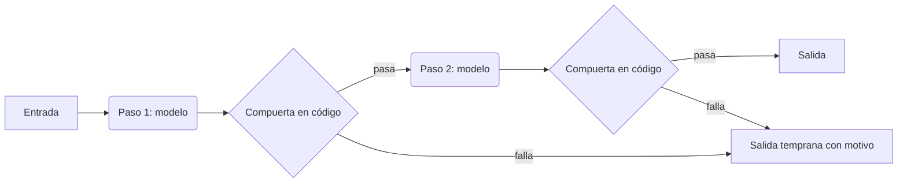

El orden lo fija el programa. Las compuertas son el mecanismo de control: validan antes de gastar el paso siguiente.

### 1.2 Router

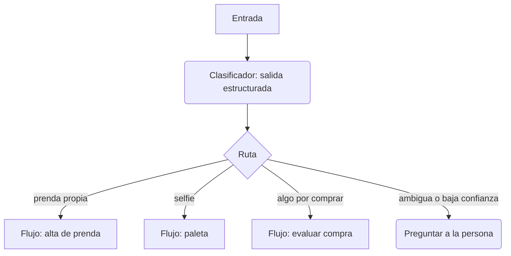

Mecanismo de control: la ruta es un valor de un conjunto cerrado; la rama por defecto es preguntar, nunca adivinar.

### 1.3 Paralelización y map-reduce

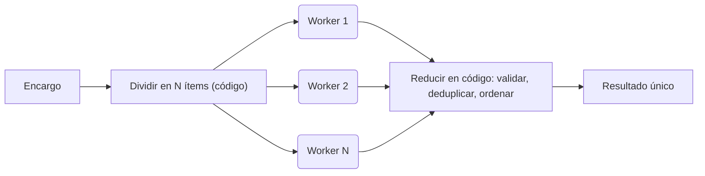

Mecanismo de control: cada worker tiene su propio tope y su propio fallo; la reducción tolera resultados faltantes y no comparte estado mutable entre ramas.

### 1.4 Orchestrator-workers y supervisor

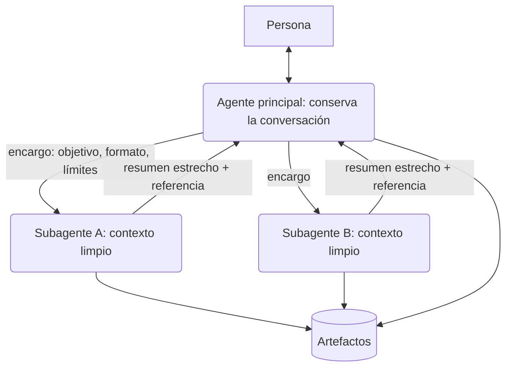

Solo el agente principal habla con la persona. El subagente recibe **solo** el encargo y devuelve **solo** un resumen; lo voluminoso queda en artefactos. En *orchestrator-workers* las subtareas se deciden dinámicamente; en *supervisor* los especialistas son fijos.

### 1.5 Handoff

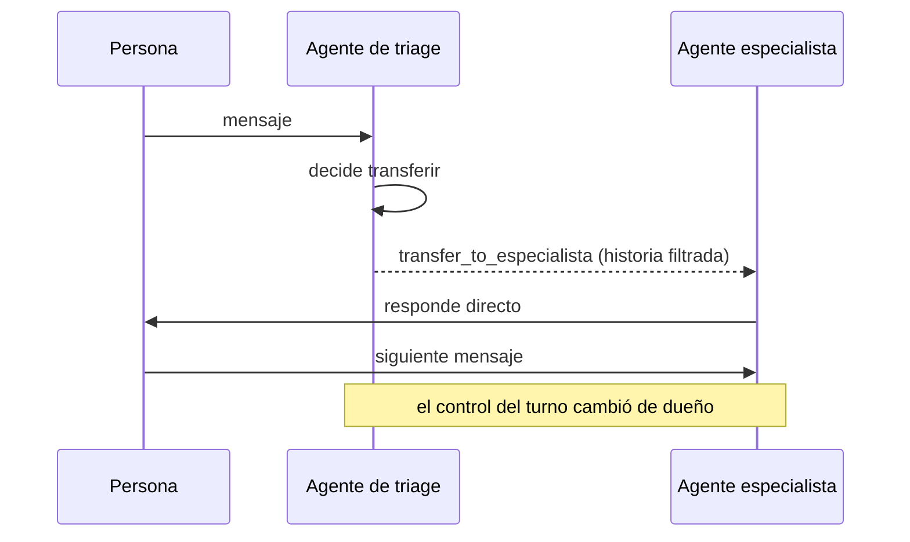

Diferencia clave con 1.4: aquí el especialista responde a la persona y se queda con el turno.

### 1.6 Planner / Executor con replanificación

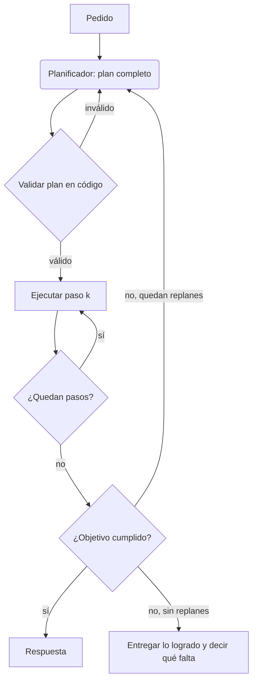

Mecanismos de control: validación del plan antes de ejecutar, y tope de replanificaciones.

### 1.7 Evaluator-optimizer

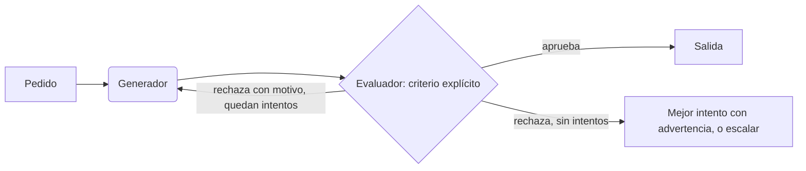

El evaluador puede ser código (preferido cuando hay regla), un modelo, o una persona. Sin una señal externa al generador, el loop no mejora (`B` §3.11).

### 1.8 Tool loop (ReAct)

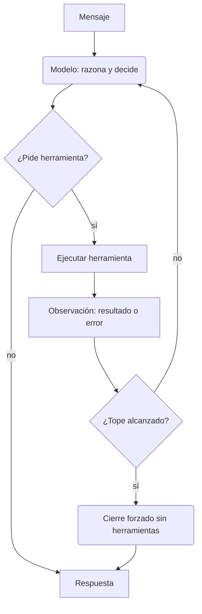

Es el loop actual de `runStylistTurn()`. La sección 2 muestra lo que lo rodea.

## 2. Anatomía de un harness

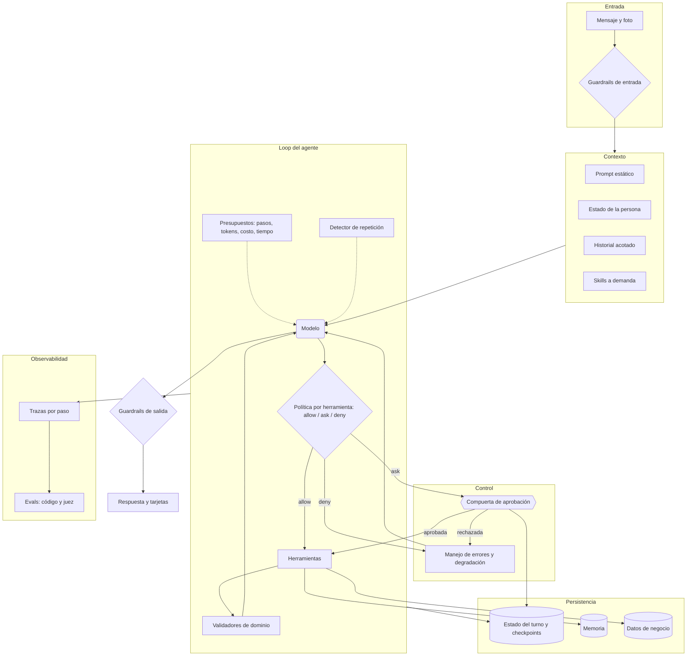

Cada caja corresponde a un componente de la tabla de `A2` §11.

## 3. Ciclo de ejecución con salidas y reintentos

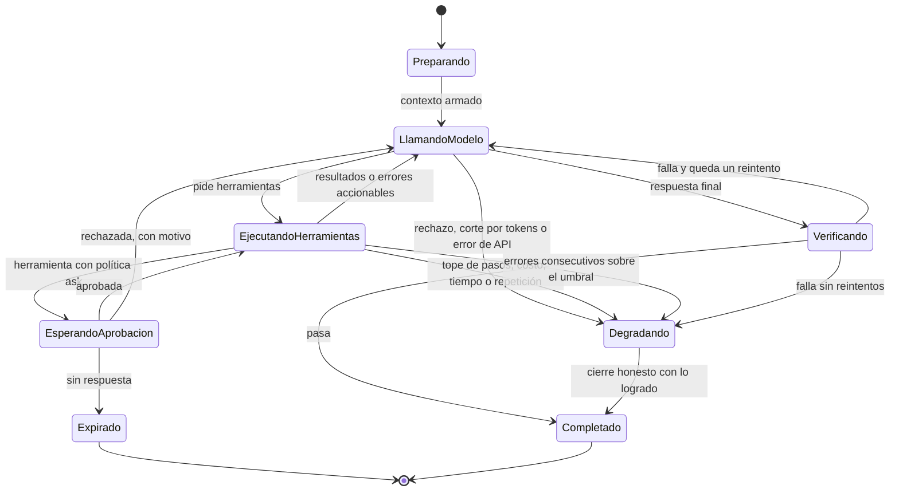

Lectura: todo camino termina en `Completado` o `Expirado`; no existe un estado sin salida. `Degradando` no es un error visible para la persona: es una respuesta honesta con lo que se logró y lo que faltó. Cada transición es un punto natural de checkpoint y de registro en la traza.

Motivos de término que conviene registrar: `normal`, `tope_pasos`, `tope_costo`, `tope_tiempo`, `repeticion`, `errores_consecutivos`, `rechazo_modelo`, `corte_tokens`, `aprobacion_rechazada`, `aprobacion_expirada`, `error_api`.

## 4. Human-in-the-loop con checkpoint

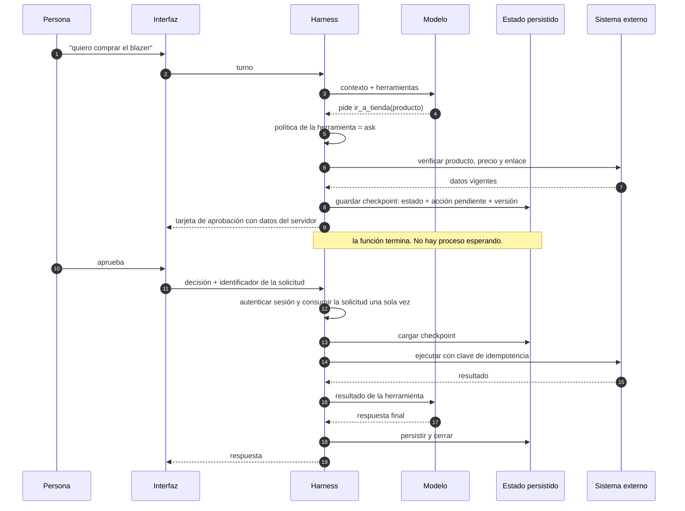

Puntos de control: (5) la política vive en código, no en el prompt; (6) la tarjeta muestra datos leídos por el servidor, no texto del modelo; (8) el estado incluye la versión del código; (12) se autentica a quien aprueba y la solicitud se consume de forma atómica; (14) la acción lleva clave de idempotencia. Si la persona rechaza, el modelo recibe el rechazo como resultado de la herramienta y sigue conversando. Si nadie responde, la solicitud expira.

## 5. Arquitecturas candidatas para el producto

Tres candidatas dibujadas con los mismos elementos para compararlas. Todas comparten los datos (Supabase con RLS), las funciones de visión y el validador de outfit.

### 5.1 Candidata A — Agente único con harness reforzado

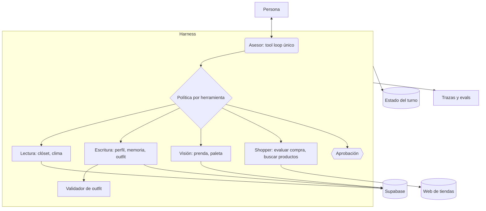

Todo sigue en un loop. Lo nuevo respecto de hoy es el harness: política, aprobación, estado del turno, presupuestos, detector de repetición, trazas y evals. El shopper son herramientas del mismo agente (como define DP-18).

### 5.2 Candidata B — Agente único + flujos deterministas + buscador aislado

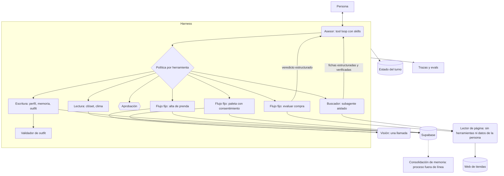

Un solo asesor que conversa y compone. Los procesos con pasos conocidos salen del loop y se vuelven flujos fijos que el asesor invoca como una herramienta. Lo que lee la web queda aislado: sin datos de la persona y sin herramientas de escritura. Es la candidata A más tres separaciones.

### 5.3 Candidata C — Supervisor con especialistas

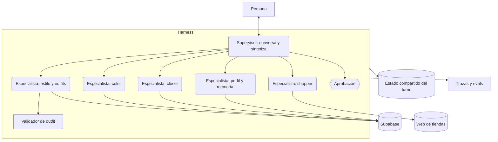

Un supervisor coordina cinco especialistas con su propio prompt y herramientas. Cada especialista necesita que el supervisor le pase el contexto de los otros (el de estilo necesita paleta, clóset y perfil).

### 5.4 Comparación

| Criterio | A — Agente único + harness | B — Agente + flujos + buscador aislado | C — Supervisor + especialistas |
|---|---|---|---|
| Patrón base (`B`) | Tool loop | Tool loop + chaining + orchestrator-workers acotado | Supervisor |
| Agentes (loops con modelo) | 1 | 1 + 1 subagente | 6 |
| Llamadas por turno típico de outfit | 2–3 | 2–3 | 4–8 (estimación) |
| Costo relativo | 1× | ~1× en asesoría; mayor solo al buscar | 3–10× según la evidencia de `A1` §2.2 |
| Coherencia del outfit | Alta: todo el contexto en una ventana | Alta | Riesgo: el contexto se reparte y se resume |
| Voz única (DP-17, DP-18) | Sí | Sí | Sí, si el supervisor reescribe todo |
| Aislamiento de contenido web | No: las páginas entran a la ventana con datos y permisos | **Sí** | Parcial: depende de las herramientas del shopper |
| Regla de dos (`A2` §9.1) | No la cumple con búsqueda web | La cumple por diseño | Depende |
| Predictibilidad de procesos fijos | Media: el modelo decide cada paso | Alta: pasos en código | Media |
| Complejidad de construir | Baja: agregar componentes al loop actual | Media: tres flujos y un subagente | Alta: contratos entre seis agentes |
| Facilidad de evaluar | Alta: un sistema | Alta: cada flujo se prueba solo | Baja: evals locales engañosas (`A1` §3.3) |
| Cambio respecto de la base actual | Incremental | Incremental en dos etapas | Reescritura |
| Riesgo principal | Prompt y herramientas crecen; inyección desde la web | Definir bien el contrato del buscador | Costo, latencia y pérdida de contexto |
| Cuándo tendría sentido | Mientras no haya búsqueda web | Al incorporar el personal shopper con web | Solo con evidencia de que el prompt único se degrada |

**[REC]** Lectura: A y B no son alternativas excluyentes sino etapas; B es A más las separaciones que la investigación justifica (procesos fijos fuera del loop, contenido no confiable aislado). C queda documentada como referencia y con su gatillo explícito. La hipótesis y sus preguntas abiertas están en `E`.

## 6. Mapa de capacidades y estado compartido

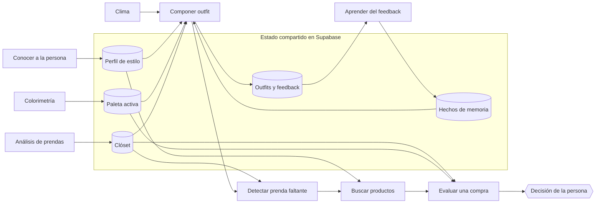

Lectura: **componer outfit** es el nodo que consume todo el estado; por eso no se parte. **Buscar productos** solo necesita un encargo derivado (categoría, color, presupuesto); por eso se puede aislar. **Colorimetría** y **análisis de prendas** escriben estado una vez y después son datos; por eso son funciones y no agentes. El criterio completo está en `E` §2.

## 7. Árbol de decisión: ¿agente, flujo, función o código?

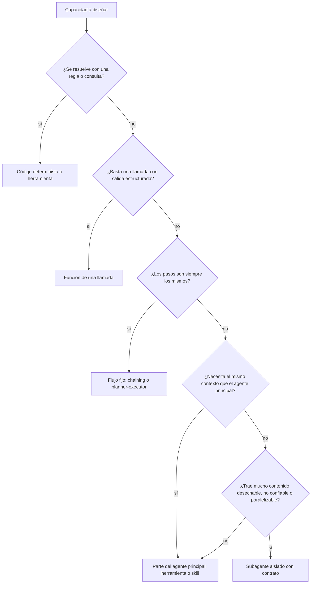

Este árbol es el criterio que `E` aplica a cada capacidad del producto.
