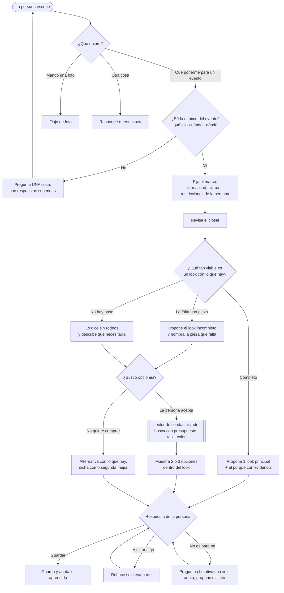

# Cómo piensa el asesor — borrador v0 para iterar

**Estado:** borrador de trabajo, 2026-11-14. **Nada de esto está decidido**: es el punto de partida para que Felipe lo
corrija. Cada pregunta marcada `P-xx` es una decisión tuya. Lo que cierres aquí pasa a `DECISION_LOG.md`, al criterio
del asesor y al banco de pruebas.

Se apoya en las bases fijas (`PLAN_GENERAL.md` §3), en las decisiones DT-18 a DT-20 y en la investigación
(`docs/investigacion-agentes/`, documento `E`). Alcance de este borrador: **solo el caso de uso que manda**.

## 1. El recorrido como decisiones

## 2. Qué es de quién

| Paso | Lo resuelve | Por qué |
|---|---|---|
| Entender qué quiere la persona, conversar, explicar | **El asesor** (modelo) | Es lo único donde el camino no se puede fijar de antemano |
| Qué datos mínimos faltan del evento | **Regla en código** que el asesor consulta | Es una lista comprobable; no debe depender del humor del modelo |
| Clima y fecha | **Herramienta** | Dato externo |
| Qué prendas existen y están disponibles | **Herramienta** | Dato de la persona |
| ¿El look es válido? (composición, prendas reales) | **Validador en código** | La verificación externa mejora; la autocrítica del modelo no |
| ¿Qué tan viable es el clóset para esta ocasión? | **Por definir (P-04)** | Es el punto donde se decide si se sugiere comprar |
| Buscar en tiendas | **Subagente aislado** (DT-18) | No ve datos privados; lo que lee es dato, no instrucción |
| Ir a la tienda | **La persona** | Nunca el asesor (BF-06) |
| Guardar lo aprendido | **Herramienta**, visible y borrable | BF-08 |

## 3. Las decisiones que te tocan

| # | Pregunta | Mi propuesta de partida | Lo que cambia si eliges distinto |
|---|---|---|---|
| **P-01** | ¿Cuánto pregunta antes de proponer? | Máximo **dos** preguntas. Si falta algo menor, propone igual y dice qué supuso | Más preguntas = mejor acierto pero se siente interrogatorio |
| **P-02** | ¿Qué es "lo mínimo" de un evento? | Tipo de evento, día y si es de día o de noche. Lugar y código de vestir solo si la persona los menciona o el evento lo exige (matrimonio) | Define la regla en código |
| **P-03** | ¿Cuántos looks propone de entrada? | **Uno**, con convicción, y ofrece "ver otra opción" | Tres opciones delegan la decisión en la persona, que es lo que vino a evitar |
| **P-04** | ¿Cuándo dice que el clóset no alcanza? | Cuando falta una categoría base, o cuando ninguna combinación llega a la formalidad del evento. **Antes** de sugerir comprar, muestra lo mejor que se puede armar | Es la frontera entre asesor y vendedor |
| **P-05** | ¿Ofrece buscar opciones o espera a que se lo pidan? | **Ofrece una vez**, con el motivo ("te faltan zapatos formales; ¿te busco?"). No busca sin un sí | Buscar solo es más rápido pero gasta y empuja a comprar |
| **P-06** | ¿Qué necesita saber para buscar? | Presupuesto para esa pieza y talla. Si no los tiene, los pregunta en ese momento, no antes | Define qué pide el onboarding y qué no |
| **P-07** | ¿Cuántas opciones de compra muestra? | **Tres como máximo**, de tiendas distintas si se puede, ordenadas por qué tan bien completan el look, no por precio | — |
| **P-08** | ¿Qué hace si no encuentra nada bueno? | Lo dice, describe qué buscar y no rellena con opciones mediocres | Protege la confianza |
| **P-09** | ¿Cuándo recomienda NO comprar? | Si ya tienes algo equivalente, si la pieza sirve para un solo uso y es cara para tu presupuesto, o si el evento no lo amerita | Es tu diferenciador frente a un vendedor |
| **P-10** | ¿Qué pesa más cuando chocan tu gusto, tu paleta y el código del evento? | Evento > comodidad declarada > gusto > paleta. La paleta orienta, no manda | Cambia casi todas las propuestas |
| **P-11** | ¿Cómo explica el porqué? | Tres líneas: por qué sirve para el evento, por qué te favorece, y un detalle de cómo llevarlo. Con evidencia tuya (clima, paleta, una prenda tuya) | — |
| **P-12** | ¿Qué anota de un rechazo? | Solo si diste un motivo, y como regla acotada ("no usa tacos en eventos de día"), no general ("no le gustan los tacos") | Memoria que generaliza de más arruina propuestas futuras |
| **P-13** | ¿Qué tono tiene? | Directo y seguro, como una amiga que sabe: recomienda, no enumera. Sin adulación | Define la voz |
| **P-14** | ¿Tiene nombre y personalidad propia? | Sin nombre de persona por ahora; "tu asesor" | Marca (A-05) |

## 4. Lo que el caso de uso exige y hoy no existe

- El **lector de tiendas** y su contrato (qué recibe, qué devuelve, qué tiendas).
- La **tarjeta de opciones de compra** en el contrato de eventos.
- La **regla de viabilidad** del clóset (P-04).
- **Fecha y lugar del evento** como datos del turno (el clima hoy solo mira la ciudad del perfil).
- **Rehacer una parte del look** sin rehacerlo entero.
- El **estado del turno** guardado, para pausar en "¿te busco opciones?" y reanudar (DT-19).
- **Trazas** por paso en Supabase (DT-20) y el **banco de pruebas** con este recorrido.

## 5. Cómo iteramos

1. Lees la sección 3 y respondes por número: "P-01 ok", "P-03: prefiero dos", "P-10: la paleta arriba del gusto".
2. Cada respuesta se convierte en una regla escrita del criterio y en dos o tres conversaciones de prueba.
3. Corro el banco de pruebas contra Claude real y te muestro dónde el asesor no hizo lo que decidiste.
4. Ajustamos la regla o el criterio, no el caso.
