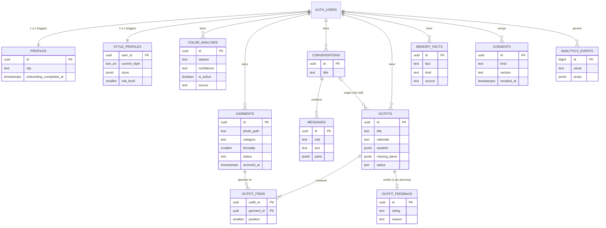
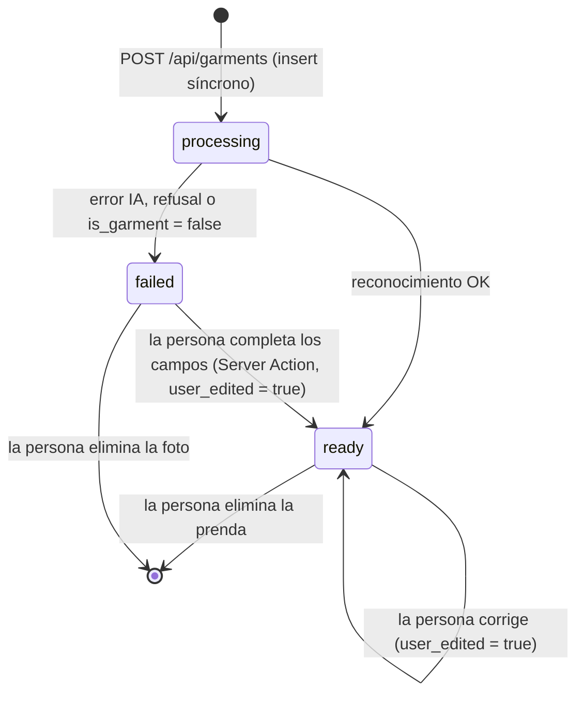
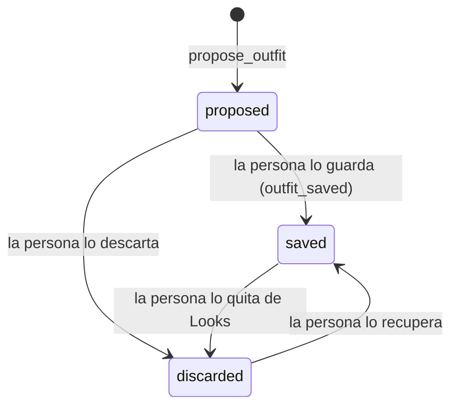

# DATA_MODEL — AI Personal Stylist

> Explica el modelo de datos. **No lo duplica**: la fuente de verdad es
> `web/supabase/migrations/20261114000000_esquema_inicial.sql` (si este documento y el SQL difieren, gana el SQL y se corrige este).
> Uso de las tablas por el agente: `AGENT_ARCHITECTURE.md`. Contratos API y Storage: `TECHNICAL_ARCHITECTURE.md`.
> Pruebas de RLS: `QA_STRATEGY.md` §4.

Versión 0.1 — 2026-11-14.

---

## 1. Principios

1. **Toda tabla de persona lleva `user_id` y RLS `auth.uid() = user_id`**; sin service role (DT-02).
2. **Borrado en cascada desde `auth.users`**: si la cuenta se elimina, todo lo suyo cae.
3. **Postgres valida lo que puede validar solo** (enums por `check`, rangos, una paleta activa); **las reglas que dependen de varias filas
   o del dominio** (composición de outfit) se validan en el servidor, en `lib/domain`, con tests.
4. **Texto de dominio en español, nombres de tablas y columnas en inglés**; vocabularios cerrados por `check` donde el producto ya los fijó.
5. Migraciones idempotentes, aplicadas por Felipe (DT-14).

---

## 2. Diagrama entidad-relación

Todas las tablas hijas llevan además su propio `user_id` (omitido en el diagrama por claridad), que es lo que usa RLS.

---

## 3. Entidades

### `profiles` — RF-01, RF-03, RF-13
Una fila por persona, creada por el trigger `handle_new_user` al registrarse.

| Campo no obvio | Regla |
|---|---|
| `id` | Es el `auth.users.id` (no hay `user_id`); la política usa `auth.uid() = id`. |
| `city` | Default `'Santiago'`; la usa `get_weather` (DT-11, S-06). |
| `onboarding_completed_at` | Null hasta terminar `/bienvenida`; `proxy.ts`/layout decide si redirige al onboarding. |

### `style_profiles` — RF-03, RF-04 · memoria capa 1 (DT-07)
Perfil de imagen estructurado; una fila por persona, creada por el mismo trigger con todo vacío.

| Campo no obvio | Regla |
|---|---|
| `clothing_sections` | `mujer` / `hombre` / `unisex`; reemplaza segmentar por género (DP-13). |
| `current_style`, `aspirational_style`, `occasions`, `fit_preferences`, `comfort_constraints`, `colors_disliked` | Arreglos de etiquetas que vienen de los chips del onboarding; texto libre hoy (ver `AGENT_ARCHITECTURE.md` O-A2). |
| `sizes` | Tallas por tipo (`{"top":"M"}`); **no medidas** (DP-12). |
| `budget_*_clp` | Enteros ≥ 0 o null; insumo de V1.1. |
| `risk_level` | 1 seguro · 2 · 3 atrevido. |

### `color_analyses` — RF-05 (DP-05)
Paleta preliminar. Historial de análisis; **una sola activa** por persona (índice único parcial `color_analyses_one_active`).

| Campo no obvio | Regla |
|---|---|
| `photo_path` | Ruta de la selfie; null si la paleta se eligió a mano (`source = 'manual'`) o si la selfie se borró. |
| `season`, `undertone`, `contrast`, `confidence` | Vocabularios cerrados por `check` (sin tildes: `otono`, `calido`, `frio`). |
| `lighting_ok` | `false` dispara el aviso de iluminación en la UI. |
| `recommended`, `neutrals`, `avoid` | `[{ name, hex }]`; sin `check` de forma: la valida zod antes del insert. |
| `is_active` | Activar una nueva = desactivar la anterior + insertar (ver O-D3). |

### `garments` — RF-06, RF-07
Clóset digital; una foto = una prenda (DP-06).

| Campo no obvio | Regla |
|---|---|
| `photo_path` | `{user_id}/garments/{uuid}.jpg` (DT-04). Obligatorio. |
| `category` | Cerrado: `top`, `bottom`, `dress`, `outerwear`, `shoes`, `bag`, `accessory`. Default `top` (ver O-D8). |
| `colors` | `[{ name, hex }]`, validado con zod. |
| `formality` | 1 deportivo … 5 gala (check). |
| `status` | `processing` → `ready` \| `failed` (§6). |
| `user_edited` | `true` cuando la persona corrige lo reconocido; insumo para medir S-01. |
| `archived_at` | Archivado lógico (RF-07): fuera de `get_closet`, sigue visible en outfits viejos. |

### `conversations` y `messages` — RF-08 · memoria capa 3
| Campo no obvio | Regla |
|---|---|
| `conversations.title` | Vacío al crear; se completa con un resumen corto del primer mensaje (sin IA extra en el MVP). |
| `messages.role` | Solo `user` / `assistant`; los bloques de herramientas y de pensamiento no se persisten (`AGENT_ARCHITECTURE.md` §6). |
| `messages.text` | Texto visible del turno. |
| `messages.parts` | Referencias estructuradas: `{ type: 'outfit', outfit_id }`, `{ type: 'memory', fact }`, `{ type: 'image', path }` (RF-16). |

### `outfits` y `outfit_items` — RF-09, RF-10, RF-11, RF-12 (DP-02)
| Campo no obvio | Regla |
|---|---|
| `outfits.conversation_id` | Conversación de origen; `set null` si se borra la conversación (el outfit guardado sobrevive). |
| `outfits.rationale` | El porqué (DP-11); `propose_outfit` lo exige no vacío. |
| `outfits.weather` | Lo adjunta el servidor desde `get_weather`, nunca el modelo. |
| `outfits.missing_piece` | `{ category, description, why }` (DP-07, RF-12). |
| `outfits.status` | `proposed` → `saved` \| `discarded` (§6). |
| `outfit_items.position` | Orden de capas para la tarjeta (RF-10). |
| `outfit_items` PK | `(outfit_id, garment_id)`: una prenda no se repite en un outfit. |

### `outfit_feedback` — RF-11
Una calificación por persona y outfit (`unique (user_id, outfit_id)`); se cambia con upsert. `rating`: `love` / `ok` / `no`.
`reason` con texto alimenta la memoria (`AGENT_ARCHITECTURE.md` §8). Outfit útil para la North Star = `saved` o feedback `love`/`ok` (kernel).

### `memory_facts` — RF-02, RF-08, RF-11 · memoria capa 2
| Campo no obvio | Regla |
|---|---|
| `fact` | 3 a 280 caracteres (check). |
| `kind` | `preference`, `dislike`, `context`, `fit`. |
| `source` | `onboarding`, `chat`, `feedback`: de dónde salió; visible para la persona en `/yo`. |

### `consents` — RF-02
Consentimiento granular y versionado: `kind` en `terms`, `photo_processing`, `face_photo`; `version` del texto aceptado;
`revoked_at` null = vigente. Una fila por aceptación (historial). Vigente = la más reciente de su `kind` sin `revoked_at`.

### `analytics_events` — RF-15 (DT-12)
Eventos de producto y `ai_usage`. Solo `insert` propio; **sin lectura desde el cliente** (sin política `SELECT`).
`props` nunca contiene texto de mensajes, hechos ni nombres de prendas. `id` identidad `bigint`.

---

## 4. Invariantes

| Invariante | Dónde se garantiza |
|---|---|
| Cada fila de persona pertenece a `auth.uid()` | RLS (`using` + `with check`) |
| Una sola paleta activa por persona | Índice único parcial (SQL) + activación ordenada/atómica (O-D3) |
| Composición válida de outfit (top+bottom o dress; máx. 1 calzado y 1 abrigo; reglas extra propuestas) | `lib/domain/outfit-rules.ts` en `propose_outfit` (servidor), no en la base |
| Las prendas de un outfit son de la misma persona y están activas al proponer | Servidor (`propose_outfit`); **la base no lo impide** (O-D4) |
| Una prenda no se repite en un outfit | PK de `outfit_items` |
| Un feedback por outfit y persona | `unique (user_id, outfit_id)` |
| Hecho de memoria de 3 a 280 caracteres | `check` |
| Vocabularios de categoría, formalidad, estación, subtono, contraste, confianza, rating, kind, source, status | `check` |
| Fotos solo en la carpeta propia | Políticas de `storage.objects` + validación de ruta en el servidor |
| `updated_at` al día en `profiles`, `style_profiles`, `garments`, `conversations` | Trigger `touch_updated_at` |

---

## 5. Política RLS

| Tabla | Política | Operaciones |
|---|---|---|
| `profiles` | `profiles_own`: `auth.uid() = id` | todas, rol `authenticated` |
| `style_profiles`, `color_analyses`, `garments`, `conversations`, `messages`, `outfits`, `outfit_items`, `outfit_feedback`, `memory_facts`, `consents` | `<tabla>_own`: `auth.uid() = user_id` | todas, rol `authenticated` |
| `analytics_events` | `analytics_events_insert_own` | solo `insert` |
| `storage.objects` (`user-media`) | `select`/`insert`/`delete` si la primera carpeta es `auth.uid()` | sin `update` (no hay upsert de fotos) |

El rol `anon` no tiene políticas: no lee ni escribe nada. Las consultas usan `(select auth.uid())` para que Postgres lo evalúe una vez por consulta.

---

## 6. Ciclo de vida y estados

### `garments.status`

`archived_at` es ortogonal al estado: archivar/restaurar no cambia `status`. Una prenda `processing` que quedó así (la función se cortó)
se trata como `failed` en la UI si tiene más de unos minutos (valor a fijar en código). `get_closet` solo ve `ready` sin `archived_at`.

### `outfits.status`

El feedback (`outfit_feedback`) es independiente del estado. Los outfits `proposed` no se borran solos (sin retención automática en el MVP).

---

## 7. Storage

Bucket privado `user-media` (5 MB por objeto; `image/jpeg`, `image/png`, `image/webp`):

| Ruta | Quién la referencia | Se borra cuando |
|---|---|---|
| `{user_id}/garments/{uuid}.jpg` | `garments.photo_path` | La persona elimina la prenda (Server Action) o borra sus datos |
| `{user_id}/selfies/{uuid}.jpg` | `color_analyses.photo_path` | La persona borra la selfie o sus datos (retención: `TECHNICAL_ARCHITECTURE.md` O-T4) |
| `{user_id}/chat/{uuid}.jpg` | `messages.parts[{type:'image'}]` (RF-16, no hoy) | La persona borra sus datos |

La base no sabe si un objeto existe: una ruta en una fila no garantiza el archivo ni al revés (huérfanos aceptados en el piloto).

---

## 8. Derecho de borrado

"Borrar mis datos" (RF-02) en tres pasos, en este orden (`TECHNICAL_ARCHITECTURE.md` §9.6):

1. **Storage** (cliente, con su sesión): listar y borrar todo `user-media/{uid}/`.
2. **`delete_my_data()`** (RPC `security invoker`): borra `outfits` (cae `outfit_items` y `outfit_feedback`), `conversations` (cae `messages`),
   `garments`, `color_analyses`, `memory_facts`, `consents`; vacía `style_profiles` y `display_name`/`onboarding_completed_at` de `profiles`.
3. Cerrar sesión.

Lo que **no** borra hoy: la cuenta en `auth.users` (email), `profiles.city`, y los `analytics_events` (O-D1). Eliminar la cuenta completa
requiere una operación con privilegios de administración que DT-02 no permite en el MVP: hoy se haría a mano desde el panel de Supabase
a pedido de la persona; decidir el mecanismo antes de abrir a testers (A-02).

---

## 9. Entidades diferidas (bocetos, no se migran hoy)

| Entidad | Versión | Para qué | Boceto |
|---|---|---|---|
| `wear_log` | V2 (RF-21) | Registro de uso, prendas sin uso, costo por uso | `id`, `user_id`, `garment_id` → garments, `outfit_id?` → outfits, `worn_on date`, `created_at`; `unique (user_id, garment_id, worn_on)`. Costo por uso necesita además `garments.purchase_price_clp`. |
| `products` | V1.1 (caché efímera de resultados citados) → V2 (catálogo por feeds, RF-24) | Producto de retailer con precio y fecha | `id`, `source` (`user_link` \| `web_search` \| `feed`), `retailer`, `url`, `title`, `category`, `colors jsonb`, `price_clp`, `currency`, `fetched_at`, `feed_id?`. Sin datos de persona; RLS de solo lectura para `authenticated`. Por DT-09, en V1.1 solo se guarda lo citado en una recomendación, con marca de tiempo; nunca catálogo masivo sin acuerdo. |
| `product_recommendations` | V1.1 (RF-17, RF-18) | Qué producto se recomendó a quién, dentro de qué outfit (DP-02) y con qué revelación comercial (DP-10) | `id`, `user_id`, `product_id`, `outfit_id?`, `conversation_id?`, `reason`, `price_at_recommendation_clp`, `affiliate boolean`, `clicked_at?`, `created_at`. |
| `price_alerts` | V2 | Avisar baja de precio o reposición | `id`, `user_id`, `product_id`, `target_price_clp?`, `status` (`active` \| `triggered` \| `cancelled`), `last_checked_at`, `created_at`. Requiere un proceso programado y push (DT-10). |
| `trips` / `plans` | V2 (RF-20) | Planificación semanal y de viajes | `id`, `user_id`, `kind`, `starts_on`, `ends_on`, `destination?`, y una tabla puente `plan_outfits (plan_id, outfit_id, day)`. |

---

## Observaciones para el integrador

Defectos o vacíos del SQL (no se editó el SQL):

- **O-D1** `delete_my_data()` no borra `analytics_events` (no hay política `delete` y la función es `security invoker`), ni la cuenta de `auth.users`, ni `profiles.city`. "Borrar todo" es parcial; además borra `consents` mientras la cuenta sigue viva, con lo que la persona queda usando la app sin registro de términos aceptados.
- **O-D2** `analytics_events` no tiene política `SELECT` ni índice por `user_id`: con la sesión no se puede calcular el uso diario de IA por persona para el rate limiting (DT-02 impide el service role). Opciones: tabla `ai_usage_daily` con `select` propio, o una RPC `security definer` que devuelva solo el total del día de `auth.uid()`.
- **O-D3** Activar una paleta son dos sentencias (desactivar + insertar) con un índice único parcial: desde `supabase-js` no es atómico y una falla deja a la persona sin paleta activa. Propongo una RPC `activate_color_analysis(...)`.
- **O-D4** **Referencias cruzadas entre personas**: las políticas solo validan el `user_id` de la fila, y las FK se verifican sin RLS. Una persona que conozca un UUID ajeno podría insertar `outfit_items` con un `garment_id` de otra, `outfit_feedback` sobre un outfit ajeno, `messages` en una conversación ajena u `outfits.conversation_id` ajeno. El servidor lo impide en `propose_outfit`, pero el cliente tiene acceso directo a las tablas con su sesión. Arreglo: `unique (id, user_id)` en las tablas padre y FK compuestas `(x_id, user_id)`, o `with check` con `exists (...)`. Además crear `outfits` + `outfit_items` son dos inserts no atómicos: propongo RPC `create_outfit`.
- **O-D5** `analytics_events` acepta inserts directos del cliente con cualquier `name` y `props`: una persona puede inflar o falsear eventos (incluido `ai_usage`). Aceptable en el piloto (S-07); para métricas confiables, insertar solo desde el servidor y restringir `name` con un `check`.
- **O-D6** `outfit_items.garment_id ... on delete cascade`: eliminar una prenda la saca en silencio de outfits guardados, que pueden quedar inválidos (sin parte inferior). Recomiendo que la UI ofrezca archivar antes que eliminar y avise cuántos looks afecta.
- **O-D7** No se guarda el resultado original del reconocimiento (ni `confidence`): cuando la persona corrige, se pierde lo que dijo la IA y **no se puede medir S-01 (acuerdo por campo) con datos del piloto**. Propongo `garments.ai_recognition jsonb` (snapshot inmutable de `describeGarment`).
- **O-D8** `garments.category` tiene default `'top'`: una prenda `failed` aparece como `top` con nombre vacío en la galería. Preferible permitir null mientras esté en `processing`/`failed`, o que la UI lo trate como "sin categoría".
- **O-D9** Faltan índices para cascadas y búsquedas: `outfit_items (garment_id)`, `outfit_feedback (outfit_id)`, `analytics_events (user_id, created_at)`. Irrelevante a escala de piloto; anotarlo para `scale-patterns.md`.
- **O-D10** `consents` no impide dos consentimientos vigentes del mismo `kind` ni define cómo se revoca; el versionado completo queda fuera de hoy (kernel).
- **O-D11** `outfits` no tiene `updated_at` ni `saved_at`: la fecha en que un outfit se volvió "útil" solo existe en `analytics_events` (`outfit_saved`). Si la North Star se calcula desde tablas de dominio, conviene `saved_at`.
- **O-D12** Las políticas de Storage no restringen el segundo segmento (`garments|selfies|chat`) ni la extensión; lo valida solo el servidor al recibir la ruta.
