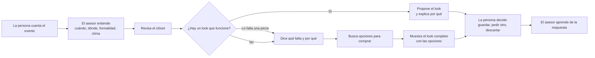

# Plan general — AI Personal Stylist

**Versión 0.1 · 2026-11-14 · acordado con Felipe.** Ordena los frentes de trabajo y fija las bases de la arquitectura
del asesor que no cambian, pase lo que pase con cómo decidamos que piense.

## 1. El caso de uso que manda

> **"Quiero saber qué ponerme el fin de semana para un evento. Y si en mi clóset no hay algo que me sirva, que me busque opciones."**

Todo lo que se construye se juzga contra ese recorrido:

Lo que no sirve a este recorrido espera.

## 2. Los frentes de trabajo

| Frente | Quién | Qué produce | Dónde vive |
|---|---|---|---|
| **1. Cómo piensa el asesor** | **Felipe**, en la app de Claude | El razonamiento del asesor: qué decide, en qué orden, con qué criterio y con qué límites | Llega a este repo como fichas de decisión y criterio |
| **2. Bases fijas del asesor** | Esta sesión | El armazón que no cambia (§3) y que sostiene cualquier forma de pensar | `web/src/lib/agent`, `lib/ai`, este documento |
| **3. Interfaz base** | Esta sesión, con subagentes | La conversación usable de punta a punta contra el asesor simulado | `web/src/app`, `web/src/components` |
| **4. Equipo de bots** | Esta sesión lo arma; después trabaja solo | Evolución de la interfaz, historia por historia, con merge propio | OpenMausBot · `agentes/` |
| **5. Investigación de arquitectura de agentes** | Sesión independiente | Base de conocimiento: patrones, harness, LangGraph y alternativas, hipótesis | `docs/investigacion-agentes/` |
| **6. Referentes de interfaz conversacional** | Sesión independiente | Patrones de diseño aplicables al hilo | `docs/producto/research/` |

**Cómo se juntan:** el frente 1 y el 5 definen *cómo piensa* el asesor; el frente 2 garantiza que, sea cual sea esa
forma, la interfaz y los datos no se rompan. Por eso los frentes 3 y 4 pueden avanzar hoy sin esperar a los otros.

## 3. Bases fijas de la arquitectura del asesor

Son los invariantes. No dependen de si el asesor termina siendo un agente o varios, ni del framework, ni del modelo.
Cambiar una exige una decisión explícita en `DECISION_LOG.md`.

| ID | Base fija | Por qué no se negocia | Estado |
|---|---|---|---|
| **BF-01** | **Una sola conversación.** La persona habla con un asesor; por detrás puede haber uno o varios componentes, pero nunca lo nota. | Es la experiencia (DP-17, DP-18) | Hecho |
| **BF-02** | **Contrato de eventos entre el asesor y la interfaz.** El asesor emite eventos tipados (texto, estado de herramienta, look, prenda, paleta, respuestas sugeridas, memoria, error); la interfaz solo los pinta. | Permite cambiar el cerebro sin tocar la interfaz, y al revés | Hecho (`lib/domain/types.ts`) |
| **BF-03** | **El modelo propone, el servidor dispone.** Todo lo que tiene efecto (crear un look, agregar una prenda, guardar el perfil, recordar algo) pasa por una herramienta con esquema estricto y validación determinista en el servidor. El modelo nunca escribe directo en la base. | Evita prendas inventadas y estados inválidos | Hecho |
| **BF-04** | **Los resultados son objetos, no texto.** Un look, una prenda, una paleta o una opción de compra son datos estructurados que se guardan, se miden y se muestran como tarjetas. | La unidad de valor es el outfit (DP-02) | Hecho, salvo opciones de compra |
| **BF-05** | **Identidad y mínimo privilegio.** Toda herramienta corre con la sesión de la persona y sus permisos (RLS). Sin llave maestra. | Datos personales y fotos | Hecho |
| **BF-06** | **Lo irreversible lo decide la persona.** El asesor nunca compra ni paga; ir a una tienda es un clic de la persona; borrar datos pide confirmación. | Regla obligatoria (DP-09) | Hecho |
| **BF-07** | **Percibir y razonar están separados.** Reconocer una prenda o leer colores de una foto son funciones de salida estructurada con un modelo rápido; el criterio de estilo es otra capa. | Costo, velocidad y posibilidad de medir cada parte | Hecho |
| **BF-08** | **Memoria en capas, visible y borrable.** Perfil estructurado, hechos que el asesor aprende e historial. La persona ve lo que el asesor sabe y lo puede borrar. | Confianza y personalización | Hecho; falta la vista |
| **BF-09** | **Lo externo es dato, no instrucción.** Fotos, links, páginas de tiendas y resultados de búsqueda nunca dan órdenes al asesor. | Seguridad | En el prompt; falta probarlo |
| **BF-10** | **Ciclo acotado.** Topes de pasos por turno, de tokens, de tiempo y de mensajes por día; el turno siempre termina con algo útil para la persona. | Costo y control | Hecho en parte (pasos, mensajes) |
| **BF-11** | **Nada sin medida.** Cada regla de comportamiento tiene un caso de prueba; cada turno deja traza de herramientas, tokens y tiempo. | Sin esto no se puede mejorar | **Pendiente** |
| **BF-12** | **Asesor simulado obligatorio.** Un doble determinista que emite los mismos eventos, para interfaz, tests y equipo, sin clave ni gasto. | Habilita los frentes 3 y 4 | Hecho; en verificación |
| **BF-13** | **El criterio vive en archivos, no en el código.** Lo que el asesor sabe de estilo, color y compra está en documentos versionados que Felipe puede leer y corregir. | El criterio es tuyo, no del programador | **Pendiente** (hoy está en el prompt) |
| **BF-14** | **Proveedor y modelo aislados.** Modelo y esfuerzo por configuración; las llamadas a la IA en una sola capa. | Poder cambiar con datos | Hecho |

### Lo que queda deliberadamente abierto

| Abierto | Lo define |
|---|---|
| Cómo razona el asesor: qué decide, en qué orden, con qué prioridad | Frente 1 (Felipe) |
| Un agente o varios; grafo de estados o ciclo simple; puntos de control y reanudación | Frente 5 (investigación) + decisión de Felipe |
| Framework: construir sobre la API de Claude, LangGraph u otro | Frente 5 |
| Modelo y nivel de esfuerzo por tarea | Banco de pruebas |
| Tiendas donde busca y forma de acceso a catálogos | Felipe (A-01) |

## 4. Qué le falta a la base para cubrir el caso de uso

| Paso del recorrido | Hoy | Falta |
|---|---|---|
| Entender el evento | El asesor conversa y consulta el clima de la ciudad del perfil | Clima de otra ciudad; fecha del evento como dato |
| Revisar el clóset | Herramienta que lista prendas | — |
| Proponer el look con su porqué | Herramienta con validación de composición | Probarlo con Claude real |
| Decir qué falta | Campo "prenda faltante" dentro del look | Qué hacer cuando no hay look posible |
| **Buscar opciones para comprar** | **No existe** | Herramienta de búsqueda, tarjeta de opciones, tiendas |
| Aprender de la respuesta | El rechazo con motivo se guarda como memoria | Medir que de verdad cambie la siguiente propuesta |

## 5. Orden

| # | Qué | Frente | Depende de |
|---|---|---|---|
| 1 | Conversación y "Tu espacio" usables con el asesor simulado | 3 | — (en curso) |
| 2 | Equipo de bots preparado e instalado | 4 | Base en `main` |
| 3 | Prueba de la base con Claude real | 2 | Clave de Anthropic válida |
| 4 | Búsqueda de opciones de compra: herramienta, evento y asesor simulado | 2 | Lista de tiendas |
| 5 | Tarjeta de opciones de compra | 4 (equipo) | Paso 4 |
| 6 | Criterio en archivos y banco de pruebas | 1 + 2 | Tus fichas de decisión; conclusiones de la investigación |
| 7 | Decisión de arquitectura del asesor | 1 + 5 | Investigación terminada |

## 6. Decisiones abiertas de Felipe

| # | Decisión |
|---|---|
| 1 | Clave de Anthropic válida (`sk-ant-api03-…`) |
| 2 | Lista de tiendas donde el asesor busca opciones |
| 3 | Revisar y encender el equipo de bots cuando esté instalado |
| 4 | Revisión visual de la conversación |
