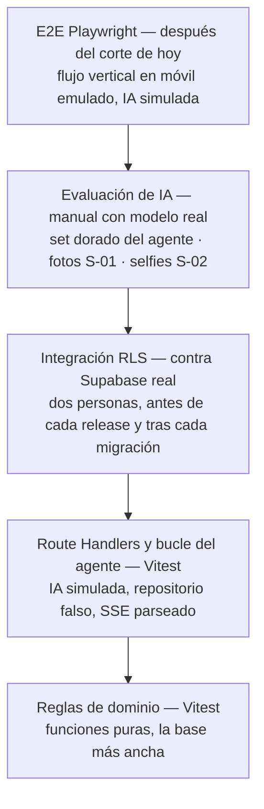

# QA_STRATEGY — AI Personal Stylist

> Documento dueño de la estrategia de calidad. Contratos que se prueban: `TECHNICAL_ARCHITECTURE.md` (API, SSE, seguridad),
> `AGENT_ARCHITECTURE.md` (herramientas, bucle, set dorado §13), `DATA_MODEL.md` (invariantes, RLS). Criterios de aceptación
> por historia: `PRODUCT_BACKLOG.md`. Alcance por versión y NFR: `DTR_AI_PERSONAL_STYLIST.md`.

Versión 0.1 — 2026-11-14.

---

## 1. Principios

1. **Proporcional a un piloto de decenas de personas** (S-07): se prueba a fondo lo que, si falla, expone datos de otra persona,
   rompe la unidad de valor (el outfit) o gasta dinero sin control. Lo demás se cubre con humo manual.
2. **Enforcement sobre prosa**: cada regla importante tiene un test o un gate que la sostiene (estándar del toolkit).
3. **TDD para reglas de negocio y API routes; no para componentes de UI** (estándar del stack).
4. **Sin red en los tests automáticos**: `AI_MODE=mock`, Open-Meteo y Supabase simulados en unitarios; la base real solo en las pruebas de RLS.
5. **No se afirma calidad de IA sin medirla** con un set etiquetado (S-01, S-02, `AGENT_ARCHITECTURE.md` §13).

---

## 2. Pirámide

### 2.1 Unitarios de dominio (TDD, Vitest)

| Módulo | Qué se prueba |
|---|---|
| `lib/domain/outfit-rules.ts` | Cada regla de `AGENT_ARCHITECTURE.md` §4.3: top+bottom válido, dress válido, sin parte inferior, 2 calzados, 2 abrigos, ids repetidos, prenda ajena o archivada, límites de cantidad; mensajes de error legibles. |
| `lib/domain/storage-path.ts` | Ruta propia válida; `uid` ajeno; `kind` equivocado; `..`, barras extra, extensión distinta, mayúsculas, string vacío. |
| `lib/domain/dates.ts` | `fmtDateOnly` sin desfase en `America/Santiago`; "mañana" y "el sábado" a fecha correcta; límite de 7 días de `get_weather`. |
| `lib/agent/context.ts` | Determinismo: mismo input → mismos bytes (orden de claves y listas); sin paleta; sin memoria; sin hora del reloj. |
| `lib/agent/history.ts` | Ventana de 20; representación de outfits como texto; alternancia de roles válida. |
| `lib/integrations/open-meteo.ts` | Parseo de respuesta, código de tiempo → resumen en español, ciudad fuera de la tabla, timeout → error controlado. |
| Esquemas zod | Entradas de los 3 endpoints, de las 4 herramientas y salidas de visión (hex, largos, enums). |
| `lib/analytics/track.ts` | Nunca lanza aunque el insert falle. |
| Herramienta `remember` | Deduplicación por normalización, tope por turno, tope total, largo 3–280. |

### 2.2 Route Handlers y agente (TDD, Vitest con IA simulada)

Se invoca el handler exportado con un `Request` construido en el test, una sesión falsa y un repositorio en memoria; el modelo es el
proveedor simulado o un **guion de stream** (secuencia de eventos de la API grabada a mano) para casos de borde.

| Endpoint / pieza | Casos mínimos |
|---|---|
| `POST /api/garments` | 401 sin sesión · 400 cuerpo inválido · 413 cuerpo grande · 403 ruta ajena y `kind` equivocado · 404 foto inexistente · 201 `ready` con campos · 201 `failed` por error de IA, por `refusal` y por `is_garment = false` · la fila `processing` existe antes de llamar a la IA · `garment_added` y `ai_usage` registrados. |
| `POST /api/color-analysis` | 401 · 403 sin consentimiento `face_photo` · 422 sin rostro (sin fila) · 201 desactiva la anterior y deja exactamente una activa · `lighting_ok = false` se guarda · 503 ante error de IA. |
| `POST /api/chat` | 401 · 400 · 404 conversación ajena · 400 con `image_path` mientras RF-16 esté apagado · primer evento `conversation` · exactamente un terminal · `outfit` entre `tool start` y `tool end` de `propose_outfit` · mensaje de la persona persistido antes del stream · mensaje del asesor con `parts` · error de API → evento `error` y mensaje de la persona conservado. |
| Bucle del agente | Herramientas en paralelo con resultados en un solo mensaje · `is_error` cuando `propose_outfit` rechaza y el modelo corrige · tope de 6 iteraciones + cierre con `tool_choice: none` · `refusal` no ejecuta herramientas · `max_tokens` con `tool_use` no ejecuta · input inválido de herramienta → `is_error` · el contenido del asistente se reenvía sin modificar dentro del turno. |
| Prompt y herramientas (gates) | El system prompt es una constante sin interpolación (test que falla si contiene la fecha de hoy o si cambia sin actualizar su hash) · herramientas ordenadas por nombre, `strict: true`, `additionalProperties: false` en todo objeto. |

### 2.3 Qué NO se testea unitariamente

- Componentes de UI y estilos (se cubren con humo manual, revisión visual de Felipe y E2E posterior).
- Supabase, el SDK de Anthropic, Next.js o Open-Meteo en sí (se confía en ellos; se prueba **nuestro uso** con dobles).
- La **calidad** de las respuestas del modelo (es evaluación, §5, no test unitario).
- `src/proxy.ts` y redirecciones (humo manual hoy; E2E después).

### 2.4 E2E con Playwright (después del corte de hoy)

Viewport móvil (iPhone y Android medianos), `AI_MODE=mock`, base de desarrollo, una persona nueva por corrida:
registro → onboarding → selfie simulada → 3 prendas → primer outfit → chat → guardar → feedback → Looks/Clóset/Yo → borrar mis datos.
Se suma al CI cuando sea estable; mientras tanto se corre antes de cada release.

### 2.5 Gates de decisiones (tests que protegen reglas del stack)

| Gate | Falla si… |
|---|---|
| `tokens-inexistentes` (copiado de LN) | Una clase de color de Tailwind no genera CSS. |
| Contraste AA de tokens | Un par texto/fondo declarado en `@theme` baja de 4,5:1 (3:1 en texto grande y componentes). |
| Sin `middleware.ts` | Existe `src/middleware.ts`. |
| Sin `force-dynamic` | Aparece `dynamic = "force-dynamic"` con `cacheComponents: true` (`TECHNICAL_ARCHITECTURE.md` O-T1). |
| Sin fire-and-forget | `grep "void (async"` en `src/app/api/` encuentra algo. |
| Secreto en cliente | Alguna variable `NEXT_PUBLIC_*` contiene `ANTHROPIC` o la clave se importa desde un archivo de cliente. |

---

## 3. Gates de integración

| Gate | Qué corre | Dónde |
|---|---|---|
| `npm run verify` | `lint` + `typecheck` (`tsc --noEmit`) + `vitest run` | Local antes de pedir revisión |
| `pre-push` (`.githooks/pre-push`) | `npm run verify`; bloquea push directo a `main` salvo docs | Local |
| CI (`.github/workflows/ci.yml`) | `npm ci && npm run verify` con `AI_MODE=mock`, sin claves | Cada PR y push a `main` |
| PR | Sección `## Humo` cuando se estrena integración externa (ruta de API, Storage, migración) | GitHub |
| Revisión visual | Felipe en el Preview antes de mergear UI | Vercel Preview |
| Migración | Aplicada por Felipe antes del merge + pruebas de RLS (§4) | Supabase |

---

## 4. Pruebas de RLS (dos personas)

Script de integración (`tests/rls/*.test.ts`, excluido de `npm test` por defecto, se corre con `npm run test:rls`) contra un proyecto
Supabase de prueba o Supabase local, con dos cuentas creadas para la prueba (A y B) y el cliente con clave publicable, nunca service role.
Se corre **tras cada migración y antes de cada release**; no en CI mientras CI no tenga una base desechable.

| # | Caso | Esperado |
|---|---|---|
| 1 | B hace `select` de cada tabla de persona | 0 filas de A |
| 2 | B hace `insert` con `user_id = A` en cada tabla | Rechazado (42501) |
| 3 | B hace `update`/`delete` sobre filas de A por `id` | 0 filas afectadas |
| 4 | `anon` hace `select`/`insert` en cualquier tabla | Rechazado o 0 filas |
| 5 | B hace `select` de `analytics_events` (incluidas las propias) | 0 filas (sin política `SELECT`) |
| 6 | B descarga `user-media/{A}/garments/x.jpg` o firma una URL de esa ruta | Rechazado |
| 7 | B sube a `user-media/{A}/…` | Rechazado |
| 8 | B llama `delete_my_data()` | Solo desaparecen datos de B; A intacta |
| 9 | Segunda paleta activa para A por `insert` directo | Rechazado por el índice único |
| 10 | B inserta `outfit_items` con su `user_id` y un `garment_id` de A | **Hoy pasa** (defecto `DATA_MODEL.md` O-D4). El test se escribe marcado como fallo esperado y se invierte cuando se corrija. |

---

## 5. Evaluación de la IA

### 5.1 Reconocimiento de prendas (S-01)

- **Set dorado**: 50 fotos reales caseras (no de catálogo), variadas en categoría, color, estampado, luz y fondo, etiquetadas a mano por
  una persona con el mismo esquema de `describeGarment`. Incluye 5 fotos que no son prendas y 3 con texto visible (etiquetas, carteles con instrucciones).
- **Acuerdo por campo**:

| Campo | Cómo se mide |
|---|---|
| `is_garment` | Exacto |
| `category` | Exacto |
| `subcategory` | Exacto tras normalizar (revisión humana para sinónimos) |
| Color principal | Mismo nombre de familia de color (revisión humana) |
| `pattern` | Exacto |
| `formality` | Exacto y a ±1 (se reportan ambos) |
| `seasons`, `occasions` | Coincidencia de conjuntos (Jaccard) |

- Se corre con `VISION_MODEL` y esfuerzo vigentes, y antes de cualquier cambio de modelo, esfuerzo o prompt de visión.
- En el piloto: tasa de `status = 'failed'` y de `user_edited = true` por campo (requiere guardar el reconocimiento original, `DATA_MODEL.md` O-D7).
- El umbral de "calidad suficiente" lo decide Felipe con los primeros resultados; este documento no fija uno sin datos.

### 5.2 Paleta preliminar (S-02)

Comparar `analyzeColor` contra el diagnóstico de 10 personas asesoradas por una profesional: acuerdo en estación y subtono, y si
`confidence` baja cuando hay desacuerdo. Casos fijos: luz artificial cálida, filtro, sin rostro, lentes de sol. Revisión humana del
`rationale` (sin certeza absoluta, sin rasgos innecesarios). Nunca se comunica la paleta como diagnóstico (DP-05).

### 5.3 Agente

Set dorado de 10 conversaciones + casos adversariales y de borde: `AGENT_ARCHITECTURE.md` §13 (dueño del contenido). Aquí, el proceso:

1. Se corre con modelo real antes de cambiar prompt, modelo, esfuerzo o herramientas, y antes de abrir a testers.
2. Verificación automática sobre la transcripción: herramientas llamadas, validez de outfits, ausencia de precios/tiendas/ofertas de compra.
3. Revisión humana con rúbrica 1–3 por criterio (porqué, tono DP-12, criterio de estilismo, honestidad ante clóset insuficiente).
4. Se guardan tasa de aprobación, tokens y latencia por caso para comparar versiones.

### 5.4 Revisión humana en el piloto

Felipe revisa semanalmente una muestra de conversaciones **con consentimiento de las personas** (A-02) y todos los outfits con feedback `no`.
Los hallazgos se convierten en nuevos casos del set dorado.

---

## 6. Humo manual del flujo vertical de hoy

Dispositivo: iPhone con Safari y un Android con Chrome. Producción o Preview según corresponda (en Preview, la IA es simulada).

| # | Paso | Resultado esperado |
|---|---|---|
| 1 | Abrir `/` sin sesión | Portada con la promesa y "Empezar". |
| 2 | Abrir `/asesor` sin sesión | Redirige a `/entrar`. |
| 3 | Crear cuenta con email y contraseña, aceptar términos | Sesión iniciada; llega a `/bienvenida`; evento `signup_completed`. |
| 4 | Completar el perfil con chips (saltar uno) | Avanza; el paso saltado no bloquea; `onboarding_step_completed`. |
| 5 | Aceptar consentimiento de rostro y subir selfie con luz natural | Paleta con estación, colores y nivel de confianza visibles; texto "orientativa". |
| 6 | Subir una selfie con luz artificial | Aviso de iluminación; confianza no alta. |
| 7 | Subir una foto sin rostro | Mensaje para tomar otra; no se crea paleta. |
| 8 | Agregar 3 prendas por foto (cámara y galería) | Cada una reconocida con categoría y color; se puede corregir y confirmar; aparecen en `/closet`. |
| 9 | Subir una foto que no es prenda | Queda para completar a mano o eliminar; no aparece en `get_closet`. |
| 10 | Pedir el primer outfit | Tarjeta con fotos reales, título, porqué y clima de la ciudad. |
| 11 | En `/asesor`, escribir "¿Qué me pongo mañana?" | Texto en streaming, indicador de "revisando tu clóset/clima", tarjeta de outfit. |
| 12 | Escribir "No me gustan los estampados de animal, recuérdalo" | Aviso "Anoté que…"; el hecho aparece en `/yo`. |
| 13 | Guardar el outfit y dar feedback "no" con una razón | Aparece en `/looks`; la razón aparece como hecho en `/yo`. |
| 14 | Recargar `/asesor` | El historial se mantiene. |
| 15 | Cortar la red a mitad de una respuesta | Mensaje de error claro; al volver la red, la conversación se recarga y se puede reintentar. |
| 16 | Filtrar `/closet` por categoría; archivar una prenda | El filtro funciona; la prenda archivada no se ofrece en outfits nuevos. |
| 17 | Borrar un hecho de memoria en `/yo` | Desaparece y el asesor deja de usarlo. |
| 18 | Instalar la PWA (Android: aviso; iOS: Compartir → Agregar a inicio) | Ícono, abre en modo standalone en `/asesor`; en iOS pide iniciar sesión de nuevo (esperado, DT-03). |
| 19 | Modo avión con la PWA abierta | Página "Necesitas conexión"; sin pantalla en blanco. |
| 20 | "Borrar mis datos" en `/yo` | Clóset, looks, paleta, memoria y conversaciones vacías; fotos borradas de Storage; sesión cerrada. |
| 21 | Con una segunda cuenta, pegar la URL `/closet/<id de la primera>` | No muestra la prenda (404). |

---

## 7. Accesibilidad (WCAG 2.2 AA)

| Tema | Criterio | Cómo se verifica |
|---|---|---|
| Contraste | 4,5:1 texto normal, 3:1 texto grande y componentes | Gate automático sobre tokens (§2.5) + revisión de estados (deshabilitado, foco, error) |
| Chat con streaming | Una región `aria-live="polite"` anuncia el mensaje del asesor **por frases o al terminar**, no cada fragmento; el estado de herramienta se anuncia una vez ("Revisando tu clóset"); `aria-busy` en el hilo mientras transmite | VoiceOver (iOS) y TalkBack (Android) en el humo |
| Tarjeta de outfit | Encabezado con el título; cada foto con texto alternativo "<nombre>, <categoría>"; botones Guardar/Descartar/Feedback con nombre accesible; el porqué legible como texto | Lector de pantalla |
| Foco | Tras enviar, el foco vuelve al campo; una tarjeta nueva no roba el foco; los diálogos (consentimiento, borrar datos) atrapan y devuelven el foco; foco visible siempre | Teclado y lector |
| Objetivos táctiles | ≥ 44×44 px en la barra inferior, chips y botones de la tarjeta | Revisión visual |
| Formularios | Etiquetas visibles, errores asociados al campo y anunciados | Lector de pantalla |
| Movimiento | `prefers-reduced-motion` respeta animaciones y el efecto de escritura | Ajuste del sistema |
| Idioma y zoom | `lang="es-CL"`; usable con texto al 200 % | Revisión visual |

Herramienta automática (axe vía Playwright) se suma con los E2E; no reemplaza la prueba con lector de pantalla.

---

## 8. Rendimiento móvil

Qué se mide (sin metas inventadas; los umbrales "buenos" de Core Web Vitals de Google son la referencia inicial: LCP ≤ 2,5 s, INP ≤ 200 ms, CLS ≤ 0,1):

| Medición | Dónde | Cómo |
|---|---|---|
| LCP, INP, CLS | `/`, `/asesor`, `/closet` | Lighthouse móvil con red 4G simulada y un Android de gama media real |
| Tiempo de compresión de foto en el cliente | `/closet/nueva` | Medición en dispositivo real con fotos de 12 MP |
| Tiempo al primer `text_delta` y al primer `outfit` | `/api/chat` | Logs del servidor (`AGENT_ARCHITECTURE.md` §11) |
| Tiempo de reconocimiento de prenda | `/api/garments` | Logs `duration_ms` |
| Peso de la galería | `/closet` con 30 prendas | Imágenes con tamaño explícito y carga diferida; sin saltos de layout |

Los resultados de la primera medición se registran como línea base en el DTR (dueño de NFR).

---

## 9. Checklist de seguridad y privacidad (por release)

- [ ] Ninguna ruta usa service role; no existe `SUPABASE_SERVICE_ROLE_KEY` en Vercel.
- [ ] Pruebas de RLS (§4) en verde (con el fallo esperado documentado de O-D4 hasta corregirlo).
- [ ] Los 3 endpoints devuelven 401 sin sesión y 403 con ruta de Storage ajena.
- [ ] Bucket `user-media` privado; ninguna URL pública; URLs firmadas con TTL corto.
- [ ] `ANTHROPIC_API_KEY` solo en servidor; build de cliente sin la clave (búsqueda en `.next/static`).
- [ ] Cabeceras de seguridad presentes (CSP, `nosniff`, `Referrer-Policy`, `Permissions-Policy`, `frame-ancestors`).
- [ ] Logs sin texto de mensajes, hechos, nombres de prendas, rutas completas ni URLs firmadas (muestra de Vercel Runtime Logs).
- [ ] `analytics_events.props` sin datos personales.
- [ ] Fotos sin EXIF tras la compresión (verificar una foto subida con un lector de EXIF).
- [ ] Consentimientos registrados antes de la primera foto y de la selfie.
- [ ] "Borrar mis datos" deja Storage y tablas vacías para esa persona (y se documenta lo que no borra, `DATA_MODEL.md` §8).
- [ ] Casos adversariales del agente aprobados (inyección por nombre de prenda/foto, compra, cuerpo, memoria sensible).
- [ ] Preview con `AI_MODE=mock` y guard de escritura activo (`TECHNICAL_ARCHITECTURE.md` §14).
- [ ] Tope de gasto mensual configurado en la consola de Anthropic (A-03).
- [ ] Antes de testers externos: revisión legal hecha (A-02, S-05).

---

## 10. Criterios de salida por versión

| Versión | Sale cuando… |
|---|---|
| **Hoy (corte 20:00)** | `npm run verify` en verde; tests de `outfit-rules`, `storage-path` y de los 3 Route Handlers con IA simulada; humo manual §6 pasos 1–14, 16, 18 y 20 en un dispositivo; sin service role; migración aplicada por Felipe. Lo no cubierto queda listado en el PR. |
| **Piloto interno (Felipe y cercanos que consienten)** | Humo completo §6 en iOS y Android; pruebas de RLS §4; set dorado del agente corrido una vez con modelo real y revisado; `ai_usage` registrando; tope de gasto activo (A-03). |
| **Piloto con testers externos** | Todo lo anterior + revisión legal (A-02) + mecanismo de borrado de cuenta definido (`DATA_MODEL.md` O-D1) + O-D4 corregido + accesibilidad §7 con lector de pantalla + E2E en verde. |
| **V1.1** | Set S-01 medido y aceptado por Felipe; A-01 aprobada antes de `search_products`; casos adversariales con contenido web; rate limiting por persona activo; E2E en CI. |
| **V2** | Evaluación que justifique cualquier subagente; pruebas del adaptador de WhatsApp contra el mismo set dorado; pruebas de carga según `scale-patterns.md`. |

---

## 11. Matriz de riesgos de calidad

| Riesgo | Probabilidad | Impacto | Mitigación de calidad |
|---|---|---|---|
| Una persona ve datos de otra | Baja | Crítico | RLS en todas las tablas, pruebas de dos personas (§4), validación de rutas, corrección de O-D4 antes de testers externos |
| Outfit con prendas inventadas o inválidas | Media | Alto | Validación en servidor con TDD; set dorado; regla "solo ids de get_closet" |
| Reconocimiento de prendas pobre (S-01) | Media | Alto | Set de 50 fotos, corrección manual siempre disponible, medición de `user_edited` |
| Paleta comunicada como certeza (S-02, DP-05) | Media | Medio | Rúbrica de revisión, texto fijo "orientativa", confianza visible |
| Comentario dañino sobre el cuerpo (DP-12) | Baja | Alto | Reglas del prompt, casos adversariales, revisión humana del piloto |
| Inyección de prompt por foto o nombre | Media | Medio | Casos adversariales; salida estructurada; herramientas sin efectos peligrosos |
| Costo de IA descontrolado (S-04) | Media | Medio | Límites por turno con tests del bucle, `ai_usage` por llamada, tope en consola |
| Stream SSE cortado o eventos fuera de orden | Media | Medio | Tests de invariantes del protocolo; humo con corte de red |
| Regresión de calidad tras cambiar prompt, modelo o esfuerzo | Media | Alto | Set dorado obligatorio antes de cada cambio |
| Inaccesible con lector de pantalla durante el streaming | Media | Medio | Región `aria-live` por frases; prueba con VoiceOver y TalkBack |
| Preview escribe en producción | Media | Medio | Guard por `VERCEL_ENV` probado en el humo de Preview |
| Rechazos falsos positivos de clasificadores | Baja | Medio | Tests del manejo de `refusal`; fallback del lado servidor en el agente |

---

## Observaciones para el integrador

- **O-Q1** Las pruebas de RLS necesitan una base desechable (Supabase local o proyecto de prueba) y cuentas de prueba creadas para eso; hoy no existe ninguna de las dos. Hasta entonces se corren a mano contra producción con dos cuentas de Felipe, lo que contradice que Preview/CI no escriban en producción.
- **O-Q2** La medición de S-01 en el piloto depende de guardar el reconocimiento original (`DATA_MODEL.md` O-D7); sin eso solo hay set dorado offline.
- **O-Q3** El caso 10 de RLS (O-D4) está escrito como "fallo esperado": decidir si se corrige antes del piloto interno o antes de testers externos (aquí se propone lo segundo).
- **O-Q4** La revisión humana de conversaciones del piloto (§5.4) requiere que el consentimiento lo cubra; hoy `consents.kind` no tiene un tipo para eso (A-02).
