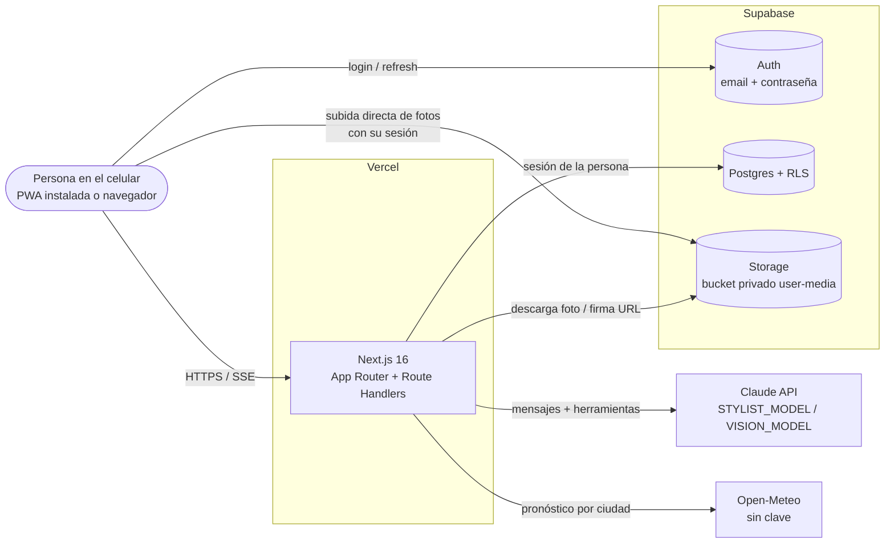
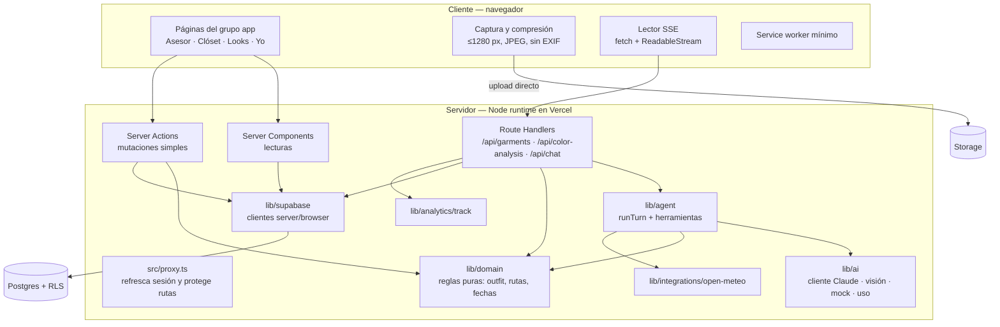

# TECHNICAL_ARCHITECTURE — AI Personal Stylist

> Documento dueño de: componentes, estructura de código, capa de datos, contratos API, protocolo SSE, integraciones,
> seguridad, privacidad técnica, almacenamiento, PWA, observabilidad, despliegue y evolución técnica.
> No repite: decisiones (`DECISION_LOG.md`), agente y herramientas (`AGENT_ARCHITECTURE.md`), entidades
> (`DATA_MODEL.md`), calidad (`QA_STRATEGY.md`), alcance y NFR (`DTR_AI_PERSONAL_STYLIST.md`).
>
> Convención de origen: **[INV]** investigación · **[PS]** conclusión de Product Strategy · decisión (DP/DT) ·
> supuesto (S-xx). Toda cifra de configuración marcada **(valor inicial)** es una elección de diseño para
> partir, no un benchmark: se ajusta con lo que se mida (§12).

Versión 0.1 — 2026-11-14.

---

## 1. Principios

1. **Un solo despliegue, un solo repo** (DT-01): Next.js 16 en `web/`, Supabase como backend gestionado, Vercel como hosting.
2. **La sesión de la persona es la credencial** (DT-02): toda lectura y escritura pasa por RLS con la sesión del usuario. No hay service role en el MVP.
3. **La IA vive solo en el servidor** (DT-05) y detrás de una interfaz que admite modo simulado (DT-13).
4. **El dato crítico se guarda síncrono; lo accesorio va en `after()`** (estándar del stack): la prenda, el mensaje y el outfit se escriben dentro del request; analítica y uso de IA después.
5. **El agente no conoce el canal** (DP-03): la PWA es un adaptador sobre `runTurn()`; WhatsApp (RF-25, V2) será otro.
6. **Fallar cerrado**: sin sesión → 401; ruta de Storage ajena → 403; variable de IA ausente fuera de `AI_MODE=mock` → error explícito al arrancar la ruta, nunca una llamada silenciosa.

---

## 2. Vista de contexto



Lo que **no** está en el contexto del MVP: catálogos de retailers, pasarelas de pago, WhatsApp, GA4, colas, base vectorial
(ver §15).

---

## 3. Vista de componentes



Regla de dependencias: `lib/domain` no importa nada de Next, Supabase ni del SDK (funciones puras, testeables con
Vitest sin mocks). `lib/agent` depende de `lib/ai`, `lib/domain` y de un repositorio de datos inyectado (para testear
con IA simulada y base falsa). Las páginas nunca llaman a sus propios Route Handlers desde el servidor.

---

## 4. Stack (razones en el DECISION_LOG)

| Pieza | Elección | Referencia |
|---|---|---|
| Framework | Next.js 16 App Router, `cacheComponents: true` (ya activo en `next.config.ts`) | DT-01 |
| Estilos | Tailwind v4 con tokens en `@theme` (`DESIGN.MD`, `UX_UI_SPEC.md`) | DT-01 |
| Auth | Supabase Auth email + contraseña; magic link en V1.1 | DT-03, RF-01, RF-19 |
| Datos | Postgres con RLS, sesión del usuario, sin service role | DT-02 |
| Fotos | Bucket privado `user-media`, URL firmada de corta duración | DT-04 |
| IA | `@anthropic-ai/sdk`, `STYLIST_MODEL` / `VISION_MODEL` por variable | DT-05, DT-06 |
| Agente | Un orquestador con herramientas, streaming SSE | DT-06, DT-08 |
| Clima | Open-Meteo por ciudad del perfil | DT-11 |
| Analítica | Tabla `analytics_events` escrita desde el servidor | DT-12 |
| Modo simulado | `AI_MODE=mock` | DT-13 |
| PWA | `manifest` + service worker mínimo | DT-10 |
| Validación | zod v4 en toda frontera (Route Handler, Server Action, herramienta) | [PS] |
| Tests | Vitest; Playwright después del corte de hoy | `QA_STRATEGY.md` |
| Runtime | Node 24, TypeScript ^5 | DT-01, gotcha TS 7 |

Gotchas del stack que aplican y cómo se respetan aquí:

- Interceptor en `src/proxy.ts` con `export function proxy()`. **Nunca** `middleware.ts`.
- Trabajo post-respuesta con `after()` de `next/server`. **Nunca** `void (async () => {})()`.
- Con `cacheComponents: true`, **no** se usa `export const dynamic = "force-dynamic"` (la guía de migración de Next 16
  pide quitarlo). Las lecturas de sesión van dentro de `<Suspense>` o la página declara `export const instant = false`
  (precedente Prendie). Ver Observación O-T1.
- Fechas `date` con `fmtDateOnly()` y `timestamptz` con `fmtDate()`, zona `America/Santiago`.
- Antes de escribir código de Next: leer `web/node_modules/next/dist/docs/` (lo exige `web/AGENTS.md`).

---

## 5. Estructura de carpetas de `web/src`

```
web/src/
  proxy.ts                         # refresca sesión (@supabase/ssr) y redirige rutas con sesión → /entrar
  app/
    layout.tsx                     # html lang="es-CL", fuentes, registro del service worker
    manifest.ts                    # manifest de la PWA (§11)
    globals.css                    # Tailwind v4 + @theme
    page.tsx                       # /            portada pública
    entrar/page.tsx                # /entrar      crear cuenta / iniciar sesión (Server Actions de auth)
    auth/confirm/route.ts          # confirmación de email si se activa (ver O-K3)
    (app)/
      layout.tsx                   # verifica sesión (defensa en profundidad además del proxy)
      bienvenida/page.tsx          # /bienvenida  onboarding, sin barra inferior
      (tabs)/
        layout.tsx                 # barra inferior Asesor · Clóset · Looks · Yo
        asesor/page.tsx            # /asesor
        closet/page.tsx            # /closet
        closet/nueva/page.tsx      # /closet/nueva
        closet/[id]/page.tsx       # /closet/[id]
        looks/page.tsx             # /looks
        yo/page.tsx                # /yo
        yo/paleta/page.tsx         # /yo/paleta
    api/
      garments/route.ts            # POST /api/garments
      color-analysis/route.ts      # POST /api/color-analysis
      chat/route.ts                # POST /api/chat (SSE)
  actions/                         # Server Actions por dominio: profile.ts, garments.ts, outfits.ts, memory.ts, privacy.ts
  lib/
    supabase/
      server.ts                    # createServerClient con cookies (lecturas y Route Handlers)
      browser.ts                   # createBrowserClient (subida a Storage, auth en cliente)
      proxy.ts                     # updateSession() usado por src/proxy.ts
    ai/
      client.ts                    # instancia única del SDK; lee env; falla cerrado
      config.ts                    # STYLIST_MODEL, STYLIST_EFFORT, VISION_MODEL, AI_MODE con defaults
      vision/describe-garment.ts   # describeGarment(image) — salida estructurada
      vision/analyze-color.ts      # analyzeColor(image) — salida estructurada
      mock/                        # proveedor simulado determinista (DT-13)
      usage.ts                     # normaliza usage → evento ai_usage
    agent/                         # detalle en AGENT_ARCHITECTURE.md
      run-turn.ts                  # bucle, mapeo a eventos, persistencia del turno
      system-prompt.ts             # prompt estático (constante, sin interpolaciones)
      context.ts                   # arma <contexto_persona> determinista
      history.ts                   # ventana de historial como texto
      tools/{get-closet,get-weather,propose-outfit,remember}.ts
    domain/
      outfit-rules.ts              # regla de composición (pura)
      storage-path.ts              # parse y validación de rutas de Storage (pura)
      palette.ts                   # tipos y normalización de paleta
      dates.ts                     # fmtDateOnly, fmtDate, hoy en America/Santiago
      dto.ts                       # GarmentDTO, OutfitDTO, AnalysisDTO
    integrations/open-meteo.ts     # pronóstico + tabla de ciudades
    http/
      sse.ts                       # escritor SSE tipado (§8)
      errors.ts                    # ApiError { status, code, message }
      validate.ts                  # helpers zod para Request
    analytics/track.ts             # track(name, props) — nunca lanza
    log.ts                         # logger JSON estructurado (§12)
  components/
    ui/                            # primitivas del sistema de diseño
    chat/                          # hilo, burbuja, indicador de herramienta, tarjeta de outfit en línea
    closet/  outfit/  onboarding/  palette/  privacy/
public/
  sw.js                            # service worker mínimo (§11)
  icons/                           # 192, 512, maskable, apple-touch-icon
```

---

## 6. Capa de datos: cuándo usar cada mecanismo

| Mecanismo | Se usa para | No se usa para | Reglas |
|---|---|---|---|
| **Server Components** | Leer: clóset, looks, perfil, paleta, memoria, historial de chat | Escribir | Cliente Supabase de servidor con cookies; RLS filtra. Lectura de sesión dentro de `<Suspense>` o `instant = false`. Nunca `select('*')` hacia el cliente: se mapea a DTO. |
| **Server Actions** | Mutaciones simples sin IA: editar perfil y chips, editar/archivar/favorita prenda, confirmar prenda reconocida, guardar o descartar outfit, feedback, borrar un hecho de memoria, corrección manual de paleta, registrar consentimiento, borrar mis datos | Llamadas a IA, streaming, cualquier cosa que tarde | zod en la entrada; `revalidatePath`/`updateTag` según corresponda; devuelven `{ ok } \| { error }` legible; eventos con `after()`. |
| **Route Handlers** (`runtime = 'nodejs'`) | Las tres operaciones de IA del kernel | Lecturas que una página puede hacer sola | Exigen sesión (401), validan con zod, devuelven el formato de error de §7.4. |
| **Cliente → Storage directo** | Subir la foto ya comprimida a `user-media/{user_id}/{kind}/{uuid}.jpg` | Leer fotos de otros; subir sin comprimir | Política de Storage limita a la carpeta propia; al servidor viaja solo la ruta. |
| **RPC Postgres** | `delete_my_data()`; recomendadas: activar paleta y crear outfit de forma atómica (O-D3, O-D4) | Lógica que dependa de la IA | `security invoker` mientras no haya razón para lo contrario. |

---

## 7. Contratos API

### 7.1 Reglas comunes a los tres endpoints

- Método `POST`, `Content-Type: application/json`. Cuerpo máximo **4 KB** (valor inicial): se rechaza antes de parsear con 413.
- Sesión obligatoria vía cookies de `@supabase/ssr`. Sin sesión → 401.
- Validación de rutas de Storage con `lib/domain/storage-path.ts`:
  `^(?<uid>[0-9a-f-]{36})/(?<kind>garments|selfies|chat)/(?<file>[0-9a-f-]{36})\.jpg$`. El `uid` debe ser el de la sesión
  y el `kind` el que corresponde al endpoint; si no → 403 `forbidden_path`. Nunca se concatena una ruta recibida sin parsearla.
- La foto se descarga desde Storage **con la sesión de la persona** (la política de Storage es la segunda barrera).
  Si no existe → 404 `photo_not_found`. Tamaño máximo del objeto: 5 MB (lo fija el bucket en el SQL).
- Llamadas a la IA con `timeout` explícito del SDK y `maxRetries` acotado (valores iniciales en cada endpoint).
- Respuesta de error, siempre JSON:

```json
{ "error": { "code": "forbidden_path", "message": "Esa foto no es tuya." } }
```

`message` está en español, sin detalles internos (ni stack, ni texto del modelo). `code` es estable para la UI y los tests.

| Código HTTP | `code` | Cuándo |
|---|---|---|
| 400 | `invalid_input` | zod rechazó el cuerpo |
| 401 | `unauthenticated` | sin sesión |
| 403 | `forbidden_path` | ruta de Storage de otra persona o de otro `kind` |
| 403 | `consent_required` | falta el consentimiento que la operación exige (§9.2) |
| 404 | `photo_not_found` / `conversation_not_found` | el recurso no existe o no es de la persona (RLS lo hace indistinguible, a propósito) |
| 413 | `payload_too_large` | cuerpo > 4 KB |
| 422 | `face_not_visible` | solo `/api/color-analysis` (§7.3) — propuesta, ver O-K1 |
| 429 | `rate_limited` | diseño de §9.5; no se implementa hoy |
| 503 | `ai_unavailable` | la IA falló tras reintentos y no hay degradación posible |
| 500 | `internal` | cualquier otra cosa; se loguea con `request_id` |

### 7.2 `POST /api/garments` (RF-06)

| Campo | Valor |
|---|---|
| Entrada | `{ "photo_path": "<uid>/garments/<uuid>.jpg" }` |
| Salida | `201 { "garment": GarmentDTO }` con `status: "ready"` y campos reconocidos, o `status: "failed"` |
| `maxDuration` | 60 s (valor inicial) |
| Timeout IA | 30 s, `maxRetries: 1` (valores iniciales) |

Flujo:

1. Sesión → zod → validar ruta (`kind = garments`).
2. **Insert síncrono** de `garments` con `photo_path` y `status: 'processing'` (la prenda existe aunque la IA falle).
3. Descargar la foto con la sesión; convertir a base64.
4. `describeGarment(image)` (`VISION_MODEL`, salida estructurada; contrato en `AGENT_ARCHITECTURE.md` §4.6).
5. Si `stop_reason` es `refusal`, hay error de API o `is_garment = false` → `update status = 'failed'` (la persona completa a mano o elimina la foto).
   Si no → `update` con los campos reconocidos y `status = 'ready'`. El reconocimiento **no** marca `user_edited`.
6. Responder `201` con el DTO y `photo_url` firmada.
7. `after()`: `track('garment_added', { category, recognized })` y `track('ai_usage', …)`.

`GarmentDTO`:

```ts
{
  id: string; status: 'ready' | 'failed'; photo_url: string;
  name: string; category: 'top'|'bottom'|'dress'|'outerwear'|'shoes'|'bag'|'accessory'; subcategory: string;
  colors: { name: string; hex: string }[]; pattern: string; material: string;
  seasons: string[]; occasions: string[]; formality: 1|2|3|4|5;
  favorite: boolean; user_edited: boolean
}
```

La confirmación o corrección posterior es una Server Action (`garment_edited`), no este endpoint. `confidence` del reconocimiento
no se persiste (no hay columna): solo se usa para decidir si la UI resalta campos a revisar. Ver O-D7.

### 7.3 `POST /api/color-analysis` (RF-05)

| Campo | Valor |
|---|---|
| Entrada | `{ "photo_path": "<uid>/selfies/<uuid>.jpg" }` |
| Salida | `201 { "analysis": AnalysisDTO }` y la anterior queda inactiva |
| Precondición | consentimiento `face_photo` vigente; si no → 403 `consent_required` |
| `maxDuration` | 60 s (valor inicial) · Timeout IA 30 s, `maxRetries: 1` |

Flujo: sesión → zod → ruta (`kind = selfies`) → consentimiento → descargar → `analyzeColor(image)` →
si `is_face_visible = false` → **422 `face_not_visible`** sin crear fila (la UI pide otra foto) →
si `refusal` o error → 503 `ai_unavailable` y la UI ofrece **elegir la paleta a mano** (Server Action, `source = 'manual'`) →
si no, desactivar la paleta activa e insertar la nueva con `source = 'ai'` (idealmente en una RPC atómica, O-D3) →
`201` → `after()`: `color_analysis_completed { confidence }`, `ai_usage`.

`lighting_ok = false` **no** es error: se guarda y la UI muestra el aviso de iluminación (RF-05). `confidence` siempre visible.

`AnalysisDTO`: `{ id, season, undertone, contrast, confidence, lighting_ok, recommended, neutrals, avoid, rationale, source, created_at }`.
La selfie no se devuelve como URL en la respuesta (minimización; la UI no la necesita para pintar la paleta).

### 7.4 `POST /api/chat` (RF-08, RF-09, RF-10, RF-11, RF-12, RF-13)

| Campo | Valor |
|---|---|
| Entrada | `{ "conversation_id"?: uuid, "text": string, "image_path"?: "<uid>/chat/<uuid>.jpg" }` |
| `text` | 1 a 2.000 caracteres tras `trim()` (valor inicial) |
| `image_path` | Reservado para RF-16. **Hasta que RF-16 se active**, si viene → 400 `invalid_input` con mensaje "Todavía no puedo ver fotos en el chat". |
| Salida OK | `200`, `Content-Type: text/event-stream; charset=utf-8` |
| Salida error previa al stream | JSON de §7.1 (400, 401, 404 `conversation_not_found`, 413, 429) |
| `maxDuration` | 300 s (valor inicial; confirmar contra el límite del plan de Vercel) |

Flujo:

1. Sesión → zod → si viene `conversation_id`, verificar que existe (RLS) o 404; si no viene, crear `conversations`.
2. **Insert síncrono** del mensaje de la persona en `messages` (`role = 'user'`).
3. Abrir el stream y emitir `conversation { id }` como primer evento (también si la conversación ya existía).
4. `runTurn()` (`AGENT_ARCHITECTURE.md` §7): arma contexto e historial, corre el bucle, emite eventos.
5. Al terminar: **insert síncrono** del mensaje del asesor (`text` concatenado + `parts` con los outfits y hechos), `update conversations.updated_at`, emitir `done { message_id }`, cerrar.
6. `after()`: `chat_message_sent`, un `ai_usage` por llamada al modelo, `outfit_proposed` por cada outfit, `memory_added` por cada hecho.

Desconexión del cliente: `request.signal` aborta el stream del SDK; lo ya generado se persiste con el texto parcial
(para que el historial no mienta) y no se emite `done`. Un solo turno activo por conversación: la UI deshabilita el envío
mientras el stream está abierto; el servidor no lo bloquea hoy (riesgo bajo con S-07).

---

## 8. Protocolo SSE de `/api/chat`

Encuadre por evento (UTF-8, una línea `data` con JSON compacto):

```
event: text_delta
data: {"text":"Para mañana te propongo"}

```

| Evento | `data` | Cuándo | Cuántas veces |
|---|---|---|---|
| `conversation` | `{ id }` | Primero, siempre | 1 |
| `text_delta` | `{ text }` | Cada fragmento de texto visible del asesor | 0..n |
| `tool` | `{ name, status: 'start' \| 'end' }` | Al empezar y terminar cada herramienta | 0..2 por herramienta |
| `outfit` | `{ outfit: OutfitDTO }` | Cuando `propose_outfit` persistió con éxito | 0..n |
| `memory` | `{ fact }` | Cuando `remember` insertó un hecho | 0..n |
| `done` | `{ message_id }` | Terminal feliz; el mensaje ya está persistido | 0..1 |
| `error` | `{ message }` | Terminal con falla; `message` en español, apto para mostrar | 0..1 |

Invariantes: exactamente un evento terminal (`done` o `error`) salvo desconexión del cliente; ningún evento después del terminal;
`outfit` siempre llega después del `tool { name: 'propose_outfit', status: 'start' }` que lo produjo y antes de su `end`.
`OutfitDTO` es el del kernel: `{ id, title, occasion, rationale, status, weather?, missing_piece?, items: [{ garment_id, name, category, photo_url }] }`.

Detalles de transporte:

- Cabeceras: `Cache-Control: no-cache, no-transform`, `X-Accel-Buffering: no`.
- Comentario de latido `: ping` cada 15 s (valor inicial) mientras el modelo piensa o una herramienta corre, para que
  ningún intermediario cierre la conexión inactiva. El cliente ignora comentarios.
- Cliente: `fetch` + `ReadableStream` + parser propio (`EventSource` no admite `POST`). Si el stream se corta sin evento terminal,
  la UI recarga la conversación desde la base (el mensaje de la persona ya está guardado) y ofrece reintentar.
- iOS suspende pestañas en segundo plano: al volver, la UI recarga desde la base en vez de confiar en el stream.

---

## 9. Servicios e integraciones

### 9.1 Modo de falla y degradación

| Servicio | Uso | Falla | Degradación |
|---|---|---|---|
| Supabase Auth | Registro, login, refresh en `proxy.ts` | Caída o límite de correos del SMTP por defecto (DT-03) | Pantalla de error con reintento; sin login no hay app. El SMTP propio llega en V1.1 (RF-19). |
| Supabase Postgres | Todo el estado | Error de red o RLS (42501) | Route Handler → 500 con `request_id`; en el chat → `error`. Un 42501 es un bug: se loguea como tal. |
| Supabase Storage | Fotos | Falla de subida | La UI reintenta antes de llamar a la API; sin ruta no hay llamada. |
| | | Falla al firmar URL | El DTO sale con `photo_url` vacío y la UI muestra un marcador con el nombre de la prenda. |
| Claude API — agente | `/api/chat` | 429/5xx/529 tras reintentos del SDK | `error { message: "El asesor no está disponible ahora. Intenta en un rato." }`. El mensaje de la persona queda guardado. |
| | | `stop_reason: refusal` | Fallback del lado servidor (beta `server-side-fallback-2026-07-01`, `fallbacks: "default"`); si toda la cadena rechaza, respuesta amable sin herramientas (`AGENT_ARCHITECTURE.md` §7.3). |
| Claude API — visión | `describeGarment`, `analyzeColor` | Error o `refusal` (Haiku 5.5 **no** tiene fallback del lado servidor) | Prenda → `status: 'failed'` y corrección manual. Paleta → 503 y elección manual. |
| Open-Meteo | `get_weather` | Timeout (5 s, valor inicial) o 5xx | La herramienta devuelve `is_error` y el agente recomienda sin clima, diciéndolo (RF-13). |

### 9.2 Supabase

- **Auth**: email + contraseña (RF-01). Site URL y Redirect URLs por entorno (§14). Si se activa la confirmación de email
  hace falta `auth/confirm/route.ts` (no está en las rutas del kernel, O-K3).
- **Clientes**: `@supabase/ssr` con la clave publicable (`NEXT_PUBLIC_SUPABASE_PUBLISHABLE_KEY`). No existe cliente con service role.
- **Consentimiento**: `consents` guarda `terms`, `photo_processing`, `face_photo` con versión. Hoy (alcance parcial de RF-02) la UI registra
  la aceptación con una versión fija; la Route Handler de paleta exige `face_photo` vigente. El versionado completo y la revocación son MVP posterior.

### 9.3 Claude API

- Instancia única del SDK en `lib/ai/client.ts`; `ANTHROPIC_API_KEY` solo en el servidor (nunca `NEXT_PUBLIC_`).
- Modelos por variable: `STYLIST_MODEL` (default `claude-opus-5-5`), `VISION_MODEL` (default `claude-haiku-5-5`), esfuerzo del agente `STYLIST_EFFORT` (default `low`; la API usa `medium` si no se envía, así que **siempre se envía**).
- Reglas de la API que el código respeta (detalle de uso en `AGENT_ARCHITECTURE.md`): sin prefill; `tool_choice` forzado da 400 en Opus 5.5 (se guía por prompt y se usa `strict: true`); el pensamiento no se desactiva en Opus 5.5 (se controla con `output_config.effort`); se lee el contenido por `type` de bloque y se revisa `stop_reason` (incluido `refusal`) antes de leer.
- Visión: imagen en base64 descargada con la sesión (no se pasa una URL firmada al proveedor: evita que un enlace de la foto viaje fuera).
- Salida estructurada de visión con `output_config.format` vía `messages.parse()` y esquema zod (`AGENT_ARCHITECTURE.md` §4.6).

### 9.4 Open-Meteo

- `lib/integrations/open-meteo.ts`: tabla fija de ciudades chilenas del piloto con lat/lon y zona horaria (evita ambigüedad de geocodificación);
  si la ciudad del perfil no está en la tabla, se usa la API de geocodificación de Open-Meteo con `country_code=CL` y se toma el primer resultado.
- Pronóstico diario (mín, máx, probabilidad/suma de lluvia, código de tiempo → resumen en español), hasta 7 días (contrato de `get_weather`).
- Caché de respuesta con `use cache` y vida corta (valor inicial: 1 h) por ciudad y fecha. Sin geolocalización del dispositivo (DT-11).

### 9.5 Seguridad y permisos

| Capa | Medida |
|---|---|
| Datos | RLS `auth.uid() = user_id` en toda tabla (detalle y defectos en `DATA_MODEL.md` §5 y sus observaciones). |
| Rutas | `src/proxy.ts` redirige rutas con sesión a `/entrar`; el layout de `(app)` vuelve a verificar (defensa en profundidad). |
| Storage | Bucket privado; políticas por carpeta `{user_id}`; el servidor valida `kind` y dueño de la ruta (§7.1); MIME y 5 MB limitados por el bucket. |
| URLs firmadas | Generadas en el servidor, TTL corto (valor inicial: 15 min); nunca se persisten ni se cachean en el service worker. |
| Herramientas del agente | Nunca reciben `user_id` como parámetro: lo toman de la sesión. Ninguna borra, compra ni envía nada (`AGENT_ARCHITECTURE.md` §10). |
| Cabeceras (`next.config.ts` → `headers()`) | `Content-Security-Policy` con `default-src 'self'`, `img-src 'self' blob: data: <supabase-url>`, `connect-src 'self' <supabase-url>`, `frame-ancestors 'none'`; `X-Content-Type-Options: nosniff`; `Referrer-Policy: strict-origin-when-cross-origin`; `Permissions-Policy: camera=(self), geolocation=()`. HSTS lo pone Vercel. |
| Secretos | Solo en variables de Vercel; `.env.local.example` sin valores. Nunca en prompts, logs ni respuestas. |
| Contenido del modelo | Se renderiza como texto (Markdown sin HTML). Sin enlaces en el MVP. |
| Rate limiting por persona (diseño, no hoy) | Contadores diarios por persona: turnos de chat, llamadas de visión y tokens de entrada+salida. Al superar el tope → 429 `rate_limited` antes de llamar a la IA. Requiere una tabla o RPC legible con la sesión (O-D2). Topes a fijar con datos de la primera semana (A-03, S-04). |
| Límite de costo de IA | Hoy: tope de gasto mensual en la consola de Anthropic (A-03), `max_tokens` por llamada, máx. 6 iteraciones por turno, ventana de historial acotada, texto ≤ 2.000 caracteres. Mañana: el tope diario por persona de arriba. |

### 9.6 Privacidad (técnica; no es asesoría legal)

S-05 y A-02 mandan: **revisión legal antes de invitar testers externos**. Lo que la arquitectura hace mientras tanto:

- **Minimización**: sin geolocalización (DT-11), sin medidas ni peso (DP-12), fotos sin EXIF y ≤ 1280 px (DT-04), selfie opcional,
  la selfie no se devuelve al cliente salvo que la persona la pida en `/yo/paleta`.
- **Consentimiento**: `terms` al crear cuenta, `photo_processing` antes de la primera foto, `face_photo` antes de la selfie (RF-02).
- **Terceros**: las fotos y el texto se envían a la Claude API para procesarse; la política de privacidad debe decirlo (A-02).
- **Logs**: nunca contenido de mensajes, fotos, rutas completas ni hechos de memoria; solo IDs, códigos y conteos (§12).
- **Retención** (propuesta, requiere decisión con A-02): conversaciones y fotos mientras la cuenta exista; selfie borrable desde `/yo/paleta`
  y candidata a borrarse tras el análisis (O-T4); `analytics_events` sin contenido personal en `props`.
- **Borrado** ("borrar mis datos", RF-02): (1) el cliente lista y borra sus objetos de `user-media/{uid}/` con su sesión;
  (2) llama a `delete_my_data()`; (3) cierra sesión. La cuenta de Auth y los `analytics_events` no se borran con esto (`DATA_MODEL.md` §8, O-D1).

### 9.7 Almacenamiento de imágenes

| Tema | Regla |
|---|---|
| Ruta | `user-media/{user_id}/{garments\|selfies\|chat}/{uuid}.jpg` (DT-04). UUID generado en el cliente con `crypto.randomUUID()`. |
| Compresión | En el cliente, antes de subir: lado mayor ≤ 1280 px, JPEG, re-codificado en canvas (elimina EXIF y convierte HEIC de iOS cuando el navegador lo decodifica). |
| Límites | 5 MB y `image/jpeg\|png\|webp` en el bucket; el cliente siempre sube `image/jpeg`. |
| Lectura | Solo por URL firmada generada en el servidor; TTL corto. |
| Borrado de una prenda | Server Action: borra la fila y luego el objeto. Si falla el objeto, queda huérfano: se acepta en el piloto y se lista en el runbook. |
| Huérfanos | Foto subida y nunca registrada (la persona abandonó). Se acepta hoy; V1.1: limpieza periódica (requiere un proceso con privilegios, decisión aparte). |

---

## 10. Variables de entorno

Las del kernel, sin agregar nuevas:

| Variable | Dónde | Default si falta | Nota |
|---|---|---|---|
| `NEXT_PUBLIC_SITE_URL` | cliente y servidor | — (obligatoria) | Redirects de Auth, `manifest`. |
| `NEXT_PUBLIC_SUPABASE_URL` | cliente y servidor | — (obligatoria) | |
| `NEXT_PUBLIC_SUPABASE_PUBLISHABLE_KEY` | cliente y servidor | — (obligatoria) | Clave publicable; RLS es la barrera. |
| `ANTHROPIC_API_KEY` | solo servidor | — | Obligatoria salvo `AI_MODE=mock`. |
| `STYLIST_MODEL` | servidor | `claude-opus-5-5` | DT-05 |
| `STYLIST_EFFORT` | servidor | `low` | Valores `low\|medium\|high\|xhigh\|max`; zod rechaza otro. |
| `VISION_MODEL` | servidor | `claude-haiku-5-5` | DT-05 |
| `AI_MODE` | servidor | `live` | `mock` en CI y en Preview (§14). |

`VERCEL_ENV` (la inyecta Vercel, no es una variable nuestra) se usa para el guard de Preview (§14). El runbook todavía lista
`SUPABASE_SERVICE_ROLE_KEY`, `ADMIN_EMAILS` y `RESEND_API_KEY` de la plantilla: contradicen DT-02 y el alcance (O-T2).

---

## 11. PWA (DT-10, RF-14)

- **Manifest** (`app/manifest.ts`): `name` y `short_name` provisionales "Estilo" (DP-15), `lang: "es-CL"`, `start_url: "/asesor"`,
  `scope: "/"`, `display: "standalone"`, `orientation: "portrait"`, `theme_color` y `background_color` desde los tokens de `DESIGN.MD`,
  íconos 192 y 512 más uno `maskable`.
- **Service worker mínimo** (`public/sw.js`, registrado en `layout.tsx` solo en producción): precache del shell (íconos, fuente, página
  `/offline`); navegación network-first con caída a `/offline` ("Necesitas conexión para hablar con tu asesor"). **Nunca** cachea
  `/api/*`, respuestas de Supabase ni URLs firmadas. Sin push ni datos offline (DT-10). Versión en el nombre del caché; al activar borra cachés viejos.
- **Gotchas de iOS**:
  - El almacenamiento de la PWA instalada es distinto al de Safari: la persona vuelve a iniciar sesión tras instalar (por eso DT-03 descarta el login anónimo). La UI lo avisa.
  - No existe `beforeinstallprompt`: instrucciones visibles "Compartir → Agregar a pantalla de inicio".
  - `apple-touch-icon` explícito y `viewport-fit=cover` con `env(safe-area-inset-*)` para la barra inferior.
  - Cámara con `<input type="file" accept="image/*" capture="environment">` (selfie: `capture="user"`); la galería entrega HEIC → la compresión en canvas lo resuelve.
  - Pestaña en segundo plano corta el stream SSE (§8).
- **Rendimiento móvil**: presupuesto y medición en `QA_STRATEGY.md` §8.

---

## 12. Observabilidad y analítica

### 12.1 Logs estructurados

`lib/log.ts` escribe una línea JSON por evento a stdout (Vercel Runtime Logs):

```json
{ "level": "info", "at": "2026-11-14T15:02:11.000Z", "request_id": "…", "route": "/api/chat",
  "event": "agent_turn_end", "user_id": "…", "duration_ms": 0, "iterations": 0,
  "stop_reason": "end_turn", "model": "claude-opus-5-5", "error_code": null }
```

Prohibido loguear: texto de mensajes, hechos de memoria, nombres de prendas, rutas de Storage completas, URLs firmadas, cabeceras de auth.
Errores de la API de Claude: se loguea la clase (`RateLimitError`, `APIError` + `status`) y el `request_id` del proveedor, no el mensaje del modelo.

### 12.2 Uso de IA

Un evento `ai_usage { route, model, input_tokens, output_tokens }` por **cada llamada** al modelo (no por turno), en `after()`.
Para medir caché y bucle se propone agregar a `props`: `cache_read_input_tokens`, `cache_creation_input_tokens`, `iteration`,
`stop_reason`, `duration_ms`, `fallback_used` (O-K4). Es la fuente para S-04 y A-03.

### 12.3 Analítica de producto

`track(name, props)` en `lib/analytics/track.ts`: insert en `analytics_events` con la sesión, en `after()`, nunca lanza.
Eventos y North Star: kernel (lista cerrada; el DTR define las métricas). Dónde se dispara cada uno:

| Evento | Dónde |
|---|---|
| `signup_completed` | Server Action de registro |
| `onboarding_step_completed {step}` / `onboarding_completed` | Server Actions de `/bienvenida` |
| `color_analysis_completed {confidence}` | `/api/color-analysis` |
| `garment_added {category, recognized}` | `/api/garments` |
| `garment_edited` | Server Action de prenda |
| `chat_message_sent` | `/api/chat` |
| `outfit_proposed {occasion, items}` | `propose_outfit` (vía `/api/chat`) |
| `outfit_saved` / `outfit_feedback {rating}` | Server Actions de outfit |
| `memory_added` | `remember` (vía `/api/chat`) |
| `ai_usage` | cada llamada al modelo |

GA4/GTM llega al abrir a público (DT-12). Errores de cliente: hoy solo consola + logs de servidor; un servicio de errores (Sentry u otro) se decide en V1.1.

---

## 13. Rendimiento y límites del turno

Valores iniciales, todos a confirmar con la medición de §12.2:

| Límite | Valor inicial | Dónde se aplica |
|---|---|---|
| Iteraciones de herramientas por turno | 6 (kernel) | `runTurn()` |
| Ventana de historial | últimos 20 mensajes | `lib/agent/history.ts` |
| Largo del texto de entrada | 2.000 caracteres | zod de `/api/chat` |
| `max_tokens` del agente | 16.000 (incluye pensamiento) | `runTurn()` |
| Prendas devueltas por `get_closet` | todas las activas; si superan 150, se resume por categoría | herramienta |

---

## 14. Despliegue

| Entorno | Rama | Base | IA | Notas |
|---|---|---|---|---|
| Production | `main` | Supabase de producción | `AI_MODE=live` | Migraciones aplicadas por Felipe antes del merge (DT-14). |
| Preview | toda rama con PR | **misma base de producción** | `AI_MODE=mock` | Ver abajo. |
| Development | local | producción o Supabase local | `mock` o `live` | Escrituras se verifican desde local. |

- Vercel con **Root Directory `web`**, Node 24, `npm ci && npm run build`. CI corre `npm run verify` con `AI_MODE=mock`.
- **Preview de solo lectura**: el patrón del toolkit (`preview_readonly`) supone service role, que aquí no existe; con la sesión de la persona,
  un Preview escribe en producción como esa persona. Mitigación de diseño: guard en código que, si `VERCEL_ENV === 'preview'`, hace que
  Server Actions y Route Handlers que escriben respondan 403 `preview_read_only`, y fuerza `AI_MODE=mock`. Alternativa más fuerte: un proyecto
  Supabase separado para Preview. Requiere decisión (O-T3).
- Supabase Auth: Site URL de producción; Redirect URLs con el dominio de producción y el patrón de Preview.
- **Migraciones**: archivos en `web/supabase/migrations/`; las aplica Felipe en el SQL Editor; ninguna sesión las aplica (DT-14).
  Expand/contract: una columna nueva se agrega antes de que el código la use; se elimina después de que el código deje de usarla.
- Rollback: `git revert <sha-del-squash>` o "Promote to Production" de un deploy anterior (`docs/tecnico/runbook.md`).

---

## 15. Camino de evolución

| Versión | Cambio técnico | Qué se reutiliza |
|---|---|---|
| **V1.1** | `evaluate_purchase` y `search_products` (RF-17, RF-18) como nuevas herramientas; búsqueda web del lado servidor con lista de dominios permitidos (DT-09, **A-01** primero). Magic link/OTP con Resend (RF-19). Rate limiting real por persona (§9.5). RF-16 foto en chat (`image_path`). Servicio de errores. GA4 al abrir. | `runTurn()`, protocolo SSE, DTO de outfit. |
| **V2** | **WhatsApp** (RF-25): un adaptador de canal (webhook) que autentica el número contra una cuenta, llama al mismo `runTurn()` y colapsa los eventos SSE en mensajes (texto + imagen de la tarjeta de outfit). Catálogo por feeds (RF-24): ingesta asíncrona y tablas `products` (`DATA_MODEL.md` §9). **Colas** para trabajo largo: reconocimiento de varias prendas por foto o video (DP-06), ingesta de feeds, recordatorios. Push para el hábito diario (DT-10). Planificación y registro de uso (RF-20, RF-21). Posible subagente Shopper (DT-06). | Mismas herramientas de clóset y outfit; la API del agente no conoce el canal (DP-03). |
| **V3** | Compra asistida con autorización explícita (RF-28, DP-09), try-on avanzado, LatAm, B2B2C. | — |

**Qué NO construir todavía** (y por qué): base vectorial (DT-07), multiagente (DT-06), colas, Redis o pooling (S-07: piloto de decenas),
datos offline y push (DT-10), service role y panel de administración (DT-02), GA4 (DT-12), scraping o almacenamiento de catálogos ajenos (DT-09),
generación de imágenes o try-on (DP-08), cualquier flujo de pago (DP-09).

---

## 16. Riesgos técnicos

| Riesgo | Impacto | Mitigación |
|---|---|---|
| Preview escribe en producción con la sesión de una persona | Datos de prueba en producción | Guard por `VERCEL_ENV` + `AI_MODE=mock`; decidir proyecto separado (O-T3). |
| Latencia del agente con pensamiento siempre activo en Opus 5.5 | Espera larga antes del primer texto | Esfuerzo `low` por defecto, eventos `tool` visibles, latido SSE; medir tiempo al primer `text_delta` (§12.2) y evaluar `medium` solo con datos. |
| Costo de inferencia no medido (S-04) | Gasto imprevisto | `ai_usage` por llamada desde el día 1, tope en consola (A-03), límites por turno (§13). |
| Rechazos falsos positivos de clasificadores | Turno sin respuesta | Fallback del lado servidor en el agente; en visión, degradación a manual. |
| Foto con instrucciones incrustadas (inyección) | El modelo obedece texto ajeno | Contenido de imágenes como dato; salida de visión estructurada con enums; herramientas sin efectos peligrosos (`AGENT_ARCHITECTURE.md` §10). |
| Stream cortado en iOS o por red | Respuesta perdida | Mensaje de la persona guardado antes; recarga desde la base; reintento. |
| `cacheComponents` y lectura de sesión | Build roto o páginas con datos ajenos cacheados | Lecturas de sesión en `<Suspense>`/`instant = false`; nunca `use cache` sobre datos de una persona sin `private`. |
| Huérfanos en Storage tras borrados parciales | Fotos que la persona cree borradas | Orden de borrado (Storage primero en "borrar mis datos"); lista en runbook; limpieza en V1.1. |
| Ley 21.719 y datos de rostro (S-05) | Exposición legal | A-02 antes de testers externos; consentimiento `face_photo`; selfie opcional y borrable. |

---

## Observaciones para el integrador

- **O-K1** El kernel define solo `201` para `/api/color-analysis`. Propongo `422 face_not_visible` sin crear fila cuando la foto no sirve; confirmar.
- **O-K2** `/api/garments` no distingue "no es una prenda" (`is_garment = false`) de "falló la IA": ambos terminan en `status: 'failed'`. La UI no puede dar un mensaje distinto sin un campo extra en el DTO o un código. Decidir si se agrega.
- **O-K3** Si Supabase Auth exige confirmación de email (default del proyecto), falta una ruta de callback (`/auth/confirm`) en la tabla de rutas del kernel. Alternativa: desactivar confirmación en el piloto (decisión de Felipe, toca A-02). El service worker también necesita una página `/offline` que no está en la tabla de rutas.
- **O-K4** `ai_usage` en el kernel no incluye tokens de caché, iteración, `stop_reason` ni uso de fallback; sin ellos no se puede validar S-04 ni el diseño de caché. Propongo ampliarlo en `props`.
- **O-K5** El evento SSE `error` solo lleva `message`; la UI no puede distinguir "reintenta" de "no reintentes" sin un `code`. Propongo `error { message, code? }` compatible hacia atrás.
- **O-T1** `stack-defaults.md` exige `force-dynamic` en páginas que leen la base, pero `next.config.ts` tiene `cacheComponents: true`, con el que la guía de Next 16 pide quitarlo (y Prendie lo prohíbe). Este documento sigue a Prendie; conviene corregir el estándar del toolkit.
- **O-T2** `docs/tecnico/runbook.md` y `estrategia-git-deploy.md` siguen siendo plantillas con `SUPABASE_SERVICE_ROLE_KEY`, `ADMIN_EMAILS` y `preview_readonly`, que contradicen DT-02. Hay que adaptarlos.
- **O-T3** "Preview de solo lectura" no es alcanzable con el patrón del toolkit sin service role. Decidir: guard por `VERCEL_ENV` (propuesto) o proyecto Supabase separado para Preview.
- **O-T4** Retención de la selfie: propongo borrarla tras el análisis por defecto (minimización, S-05), dejando `photo_path` en null. Requiere decisión de producto y legal (A-02).
- **O-T5** El rate limiting por persona y el tope diario de tokens no se pueden leer con la sesión porque `analytics_events` no tiene política `SELECT` (ver O-D2). Hoy el único freno real de costo es el tope de la consola (A-03).
