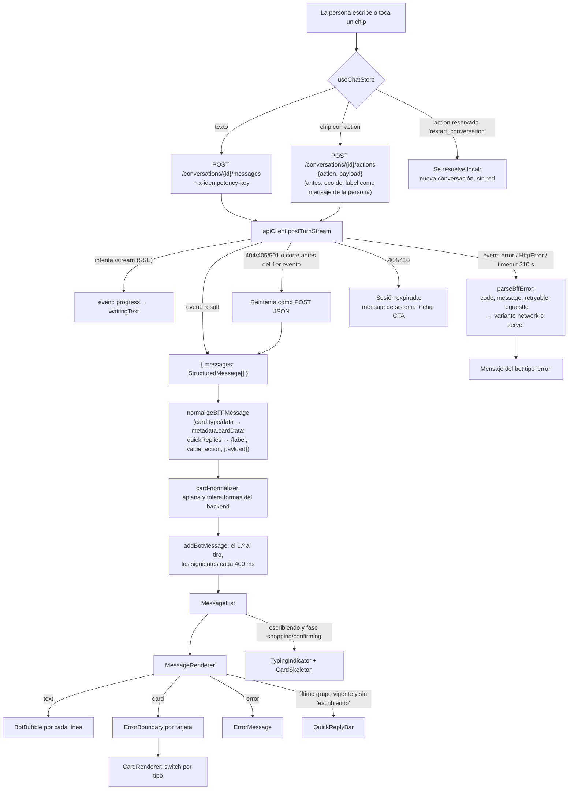

# OpenAir Webchat: mapa de reutilización para el hilo de Estilo

Investigación del 2026-11-14. Leí código y documentos de `/Users/pipoandre/Documents/openair-webchat` **sin
ejecutar nada** del repo de OpenAir: sin `npm`, sin scripts, sin abrir sus HTML y sin copiar archivos. Aquí no
hay código suyo pegado. Los patrones y contratos van descritos con palabras propias y, cuando hace falta, con
nombres de props o firmas.

**Marco de uso.** **DT-21** (`DECISION_LOG.md`) autoriza reutilizar código del SDK de OpenAir quitando todo lo
de tenant, consola e incrustación. Nunca se portan claves, configuración ni integraciones de clientes de
OpenAir, y cada pieza portada se anota en §9 de este documento. Según el dueño, este repo es la versión más
sólida del SDK.

**Convención.** **[LEÍ]** = lo vi en el código o en un documento del repo. **[INFIERO]** = lo deduzco y no lo
comprobé. Las rutas `src/...` son de OpenAir; las rutas `web/src/...` son nuestras. "Portar" significa copiar
la pieza y cambiarla. "Reimplementar" significa escribirla de nuevo con la idea.

---

## 1. Resumen en una pantalla

**Qué es.** Un repo Vite + React 19 que tiene **tres aplicaciones** con componentes compartidos:

- el widget de chat para pasajeros (`index.html` → `src/main.tsx`);
- una consola donde cada aerolínea configura su tenant (`consola.html` → `src/consola/`);
- un documento `/embed/` que vive dentro de un iframe, más un loader JS de menos de 5 KB (`src/sdk/`) para
  meter el chat en sitios ajenos.

También trae una hoja de comparación entre diseño y código (`src/comparacion/`) y una tubería que genera
`src/index.css` desde un sistema de diseño guardado en **otro** repo (`openair-brain`). [LEÍ]

**Cuánto es conversación.** De los **382 archivos de `src/`**, unos **245 (64 %)** son tenant, consola,
incrustación, hoja de comparación o marca por cliente. El widget conversacional ocupa unos **137 (36 %)**:

- ~60 genéricos de conversación: hilo, burbujas, compositor, errores, transporte, store, primitivos;
- ~65 propios de aerolínea: 12 tarjetas, 7 secciones, el normalizador, los mocks y los tipos de reserva y vuelo;
- ~12 de arranque y marca.

**Qué tan cerca está.** En lo visual y en el render del hilo está lejos. Ellos dibujan al asistente **con
burbuja y avatar**, no transmiten el texto en vivo y viven en un SPA incrustable con marca por cliente.
Nosotros dibujamos al asesor **sin burbuja**, recibimos el texto token a token por SSE y vivimos en Next.js App
Router con una sola marca. En lo que falta para el tramo "pieza faltante → opciones de compra" están cerca, y
ese código es portable:

- acciones estructuradas desde chips y tarjetas;
- lista de opciones con la elegida marcada y precio honesto;
- filas de detalle con enlaces seguros;
- aislamiento de fallos por tarjeta;
- pruebas de punta a punta con un backend simulado;
- chequeos automáticos del sistema de diseño.

Las piezas de presentación pura (`ErrorBoundary`, `DetailRows`, `money`, `safeUrl`, `transport`, `logger`,
`Modal`, `check-dead-classes`) casi no tienen dependencias y se llevan con cambios chicos. Las de orquestación
(`useChatStore`, `MessageList`, `MessageRenderer`, `apiClient`) asumen otro transporte y otra plataforma: ahí
nuestro `use-conversation.ts` ya está más avanzado, así que conviene tomar contratos y no código.

**Veredicto en una frase.** Vale la pena **portar unas diez piezas chicas de presentación, pruebas y tooling**
(la lista de opciones como base de la tarjeta de compra, `ErrorBoundary`, `DetailRows` + `safeUrl`, el arnés
de punta a punta y el detector de clases muertas son las de mayor retorno) y **reimplementar sus contratos de
acción, error e idempotencia** dentro de nuestro hilo. No conviene tomar su store, su render del hilo ni nada
de tenant.

---

## 2. Cómo funciona su hilo

### 2.1 El viaje de un mensaje

**Contrato con su backend** (`src/types/bff.ts`, `src/types/message.ts`) [LEÍ]:

- **No hay streaming de texto.** El turno llega entero al final, como un arreglo de mensajes. Si el servidor
  tiene `/stream`, lo único que llega en vivo son eventos `progress` con un texto de espera. El ritmo de
  conversación lo simula el cliente: suelta cada mensaje extra con 400 ms de desfase.
- **Forma de un mensaje.** `{ id, type: 'text'|'card'|'error'|'system', sender: 'bot'|'user', content,
  timestamp, metadata?: { vector, cardType, cardData, quickReplies } }`. El backend agrega tres campos de
  presentación: `groupId` (qué mensajes forman un turno), `phase` (`greeting`, `collecting`, `shopping`,
  `confirming`, `processing`, `completed`, `error_recovery`) y `showStepper`.
- **Doce tipos de tarjeta** en una unión discriminada `CardPayload = { type, data }`.
- **Forma de una respuesta rápida.** `{ label, value?, id?, action?, payload?, icon?, variant?, phase? }`. Si
  trae `action`, no se manda como texto: va a `/actions` con su `payload`, y el `label` aparece en el hilo como
  si lo hubiera dicho la persona.
- **`CardAction` declarado pero sin uso.** Las tarjetas declaran
  `{ id, label, variant, enabled, disabledReason?, requiresConfirmation?, confirmationMessage? }`, pero
  **ninguna lo dibuja**: las acciones viajan como respuestas rápidas. La única tarjeta con acción propia es la
  lista de opciones de vuelo (`select-flight`). [LEÍ]
- **Error del backend.** Llega como `{ error: { code, message, retryable, requestId } }`. `core_unavailable` y
  `core_timeout` se pintan como "sin conexión"; el resto, como "error del servidor".
- **Reintento seguro.** Cada envío lleva `x-idempotency-key`. Si el turno falló por timeout y la persona manda
  el mismo texto, o la misma acción con el mismo payload, se reutiliza la clave y el backend no duplica.
- **Sesión.** Vive en `sessionStorage` (id de conversación y mensajes) y se restaura al recargar.

**Carga, errores y accesibilidad** [LEÍ]:

- **Mientras espera.** Muestra tres puntos, o el texto de `progress` si llegó. Si el último mensaje del bot
  estaba en fase `shopping` o `confirming`, agrega debajo un **esqueleto de tarjeta** que anticipa lo que viene.
- **Fallo de una tarjeta.** Cada tarjeta vive en su propio `ErrorBoundary`: si se cae, aparece "No pudimos
  mostrar esta tarjeta" y el resto del hilo sigue.
- **Anuncios.** `role="log"` con `aria-live` sobre **toda** la lista, más otro `aria-live` en el indicador de
  espera. [INFIERO] El lector de pantalla puede repetir contenido.
- **Auto-scroll.** El hook recibe un arreglo nuevo en cada render, así que su efecto corre en todos los renders.
- **Compositor.** Enter envía. El botón de enviar no le roba el foco al campo, y el campo **nunca se
  deshabilita**.
- **Idiomas.** `i18next` con español e inglés, un namespace por tarjeta.
- **Reintento.** `ErrorMessage` sabe dibujar "Reintentar", pero el hilo nunca le pasa la función.

### 2.2 Lado a lado con nuestro hilo

| Tema | OpenAir | Estilo (hoy) |
|---|---|---|
| Transporte | JSON por turno; SSE opcional solo con `progress` y `result`; vuelve a JSON si falla | SSE con eventos tipados (`text_delta`, `tool`, `outfit`, `garment`, `palette`, `quick_replies`, `memory`, `done`, `error`) |
| Texto del asistente | Entero, partido por línea en burbujas | Token a token, sin burbuja |
| Qué está haciendo | Texto libre del servidor o tres puntos | Etiqueta por herramienta |
| Estado | zustand global + `sessionStorage` | Hook local + servidor como fuente de verdad (`router.refresh()`) |
| Acciones | Chip con `action` + `payload`, eco del label, acción local reservada | Chips de texto (simple o múltiple con "Listo"); las tarjetas mandan texto con `onAsk` |
| Errores | `{code, retryable, requestId}`; variantes red/servidor; sesión expirada con CTA | Texto listo para mostrar; mensaje marcado "no enviado" con reintento; límite diario detectado con regex |
| Reintento seguro | `x-idempotency-key` reutilizada | El servidor acepta `client_message_id`, **pero `use-conversation.ts` no lo manda** |
| Fallo de una tarjeta | `ErrorBoundary` por tarjeta | No existe |
| Anticipar la tarjeta | Esqueleto según la fase | No existe |
| Accesibilidad | `aria-live` sobre todo el log | Anuncio único al cerrar el turno |
| Detener | Solo al limpiar o salir | `stop()` disponible |
| Fotos y memoria | No | Sí |
| Pruebas | ~160 unitarias (`node:test`) + Playwright con backend simulado, Chromium y WebKit a 390 px | 11 unitarias (Vitest), sin punta a punta |

**Lo que resuelven ellos y nosotros no:** acciones estructuradas, aislamiento de tarjetas, esqueleto
anticipado, contrato de error con `retryable`, reintento idempotente cableado en el cliente, lista de opciones
con la elegida marcada, dinero sin ambigüedad, punta a punta con backend simulado y chequeos del sistema de
diseño.

**Lo que resolvemos nosotros y ellos no:** streaming real, estado por herramienta, estados del mensaje de la
persona, botón para detener, fotos, memoria visible, un solo anuncio por turno, separadores de día, ir al
último mensaje, reconciliación con el servidor y saludo idempotente.

---

## 3. Tabla de reutilización

Las recomendaciones son tres:

- **Portar** (adaptar la pieza): llevar el archivo con los cambios de §4. Queda anotado en §9.
- **Reimplementar** (adoptar el patrón): escribirlo de nuevo, porque portar costaría más que escribir.
- **Descartar.**

Esfuerzo: S son horas, M un par de días, L una semana o más.

| Pieza (ruta OpenAir) | Qué hace | Genérica o de aerolínea | Acoplamiento al tenant | Equivalente nuestro | Recomendación | Esf. | Qué ganaríamos |
|---|---|---|---|---|---|---|---|
| `src/components/organisms/FlightSearchResults.tsx` + `molecules/cards/FlightOptionCard.tsx` | Lista con encabezado "N opciones · ordenadas por precio". Cada opción es un botón con la elegida marcada y un precio que avisa si es anómalo | Aerolínea en el dato, genérica en la forma | Ninguno | No existe (paso 5 del plan) | **Portar** como `ShoppingOptions` + `ShoppingOptionCard` (ficha 4.1) | M | La tarjeta de opciones de compra con su estructura e interacción resueltas |
| `molecules/sections/DetailRows.tsx` + `lib/safeUrl.ts` | Filas etiqueta/valor. Una fila puede ser enlace externo, que solo se dibuja si es `https` | Genérica | Ninguno | No existe | **Portar** (ficha 4.2) | S | "Ver en la tienda" seguro por construcción (BF-09) y detalle de la opción |
| `organisms/ErrorBoundary.tsx` | Captura el fallo de render de una tarjeta, lo registra y muestra un aviso discreto | Genérica | Ninguno | No existe | **Portar** (ficha 4.3) | S | Una prenda o una opción con datos raros no rompe el hilo |
| `src/lib/money.ts` | Formatea montos: código ISO para monedas ambiguas, sin decimales en CLP | Genérica | Ninguno | `web/src/lib/format.ts` (solo CLP con `$`) | **Portar** solo si mostramos tiendas que cobran en otra moneda; si no, descartar | S | Ninguna confusión entre `$` pesos y dólares |
| `src/lib/http/transport.ts` | `fetch` con timeout (`AbortSignal.timeout` + `any`) y `HttpError` con `status`, `body` y `requestId` | Genérica | Ninguno | `postJson` en `web/src/lib/client/api.ts` | **Portar** (ficha 4.4) | S | Errores con forma y timeouts en las llamadas de clóset, paleta y compra |
| `src/lib/logger.ts` | Eventos con nombre; el detalle solo se muestra en desarrollo | Genérica | Ninguno | Sin verificar | **Portar** tal cual (19 líneas, sin dependencias) | S | Trazas sin datos personales en producción (BF-11) |
| `primitives/Modal.tsx` | Diálogo sobre `<dialog>` nativo con `showModal()`; el cierre pasa siempre por React | Genérica | Ninguno | Hoja "Tu espacio" (no verifiqué si usa `<dialog>`) | **Portar** si la hoja no usa `<dialog>` | S | Foco atrapado y fondo inerte sin escribir una trampa de foco |
| `atoms/CardSkeleton.tsx` | Esqueleto genérico de tarjeta | Genérica | Ninguno | `thread-skeleton.tsx` (cubre otro momento) | **Reimplementar** con la forma del look y de la lista de opciones; el suyo es genérico y usa `framer-motion` solo para aparecer | S | La forma de la tarjeta aparece antes de que llegue |
| `ErrorMessage.tsx` | Aviso con variante, código, "reintentable" e id de petición | Genérica | Ninguno | Bloque `role="alert"` en `AdvisorTurn` | **Reimplementar** solo la separación red/servidor; mostrar código e id choca con nuestra voz | S | Mensajes que dicen qué hacer según la causa |
| `parseBffError` (dentro del store) + `ErrorPayload` | Traduce el error a variante + `retryable` + `requestId` | Genérica | Ninguno | No existe | **Reimplementar** sobre nuestro evento `error` (ficha 4.6) | S | El "Reintentar" depende de `retryable` y no de una regex del texto |
| `src/stores/useChatStore.ts` | Orquesta conversación, turnos, acciones, errores, expiración y persistencia | Mixta | Bajo | `use-conversation.ts` | **Reimplementar** tres ideas (ficha 4.6): reutilizar la clave al reintentar, acción reservada que se resuelve local y sesión expirada con CTA. Descartar zustand y `sessionStorage` | M | Reintentos sin turnos duplicados y un canal para acciones locales |
| `src/lib/apiClient.ts` (`postTurnStream`) | Intenta SSE, vuelve a JSON, manda la clave de idempotencia | Genérica en la idea | **Alto**: clave de incrustación, origen del anfitrión, simulación de consola | `streamChat` | **Reimplementar** solo el timeout total del turno. Descartar la vuelta a JSON y los encabezados | S | Turnos que no quedan colgados |
| `organisms/MessageRenderer.tsx` + `QuickReplyBar.tsx` + `atoms/QuickReplyChip.tsx` | Elige burbuja, tarjeta o error; manda el chip a `action` o a texto | Genérica | Medio (el estilo del chip depende de la marca) | `AdvisorTurn` y `suggested-replies.tsx` (más completo) | **Reimplementar** el contrato `action` + `payload` (ficha 4.5) | M | "Ver otras opciones", "Cambiar solo los zapatos" y "Guardar look" como acciones medibles |
| `organisms/CardRenderer.tsx` | `switch` por tipo, `data-card-type` para pruebas, tipo desconocido no se dibuja y se avisa, recuerda la opción elegida | Mixta | Bajo | Mapeo fijo en `AdvisorTurn` | **Reimplementar** (son pocas líneas de idea) | S | Sumar tarjetas sin tocar el hilo y selectores estables para e2e |
| `organisms/MessageList.tsx` | Hilo, espera, esqueleto anticipado, respuestas rápidas solo del grupo vigente | Genérica | Ninguno | `thread.tsx` + `conversation.tsx` | **Reimplementar** solo el esqueleto anticipado (por herramienta, no por fase) | S | Ver qué viene mientras el asesor trabaja |
| `src/lib/card-normalizer.ts` | Aplana y tolera formas del backend y avisa claves inesperadas | De aerolínea | Bajo | `web/src/lib/chat/sse.ts` valida tipos | **Reimplementar** la idea **en el servidor** para los datos de tiendas, sin defaults silenciosos (§6) | M | Resultados de tiendas heterogéneos ya limpios al llegar al evento |
| `molecules/ChatInput/ChatInput.tsx` | Validación de largo con error visible; Enter envía; enviar no roba el foco | Genérica | Ninguno | `composer.tsx` (más completo) | **Reimplementar** dos detalles. Portar arrastraría `react-hook-form` | S | Teclado estable al enviar en el teléfono |
| `molecules/SummaryModal.tsx` | Resumen interno al cerrar: turnos, intención, herramientas, tokens, latencia y costo por modelo | Genérica (herramienta interna) | Bajo | No existe (BF-11 pendiente) | **Portar más adelante** como vista interna de traza, cuando exista la traza por turno | M | Ver costo y herramientas por turno con Claude real |
| `e2e/soporte/bff-chat.ts` + `e2e/playwright.config.ts` + `e2e/correr.ts` + `e2e/webchat/*.spec.ts` | Backend simulado sobre `page.route` con guion por turno, registro de lo que mandó el cliente, demoras y errores; WebKit a 390 px en contenedor | Genérica | Bajo (también simula la marca) | No existe | **Portar** el arnés y reescribir la parte de respuesta para SSE (ficha 4.7) | M | El recorrido "evento → look → pieza faltante → opciones" probado de punta a punta sin clave ni gasto |
| `scripts/check-dead-classes.mjs` | Tras compilar, busca clases de color que nombran un token inexistente | Genérica | Ninguno | Regla manual en `DESIGN.MD` §6 | **Portar** (ficha 4.8) | S | Automatiza el error que `DESIGN.MD` describe como silencioso |
| `scripts/test-runner.js` | En CI falla si hay pruebas saltadas fuera de una lista permitida | Genérica | Ninguno | Vitest | **Reimplementar** solo la regla (un chequeo de `.skip` o `forbidOnly`) | S | Nadie apaga una prueba en silencio |
| Matemática de contraste de `scripts/gen-design-tokens.mjs` | Funciones puras de luminancia y contraste WCAG | Genérica | Ninguno en esas funciones | Tabla escrita a mano en `DESIGN.MD` §1 | **Portar solo las funciones de contraste** para un script que verifique la tabla contra `globals.css` | S | Que la tabla de ratios no se desactualice |
| Resto de `gen-design-tokens.mjs` + `golden-vectors.json` + `tokens:check` | Genera `index.css` y deriva la marca de un solo color | Multi-cliente | **Alto** | `@theme` a mano | **Descartar** | — | — |
| `src/comparacion/*` + `docs/esfuerzos/refinamiento-componentes/herramientas/*` | Hoja autocontenida: componente real junto a su par del sistema, capturas, veredictos Bien / Mal / "Sistema atrás" por eje, guardados en JSON con commit | Genérica | Medio (compara dos tenants) | Maquetas en `docs/superpowers/mockups/` | **Portar más adelante** para el equipo de bots, sin la parte de tenants (build Vite aparte) | L | La revisión visual de Felipe en una página, con veredictos que se vuelven tickets |
| `ChatBubble/*`, `atoms/Avatar.tsx`, `atoms/TypingIndicator.tsx`, `hooks/useAutoScroll.ts` | Burbujas con avatar, tres puntos, scroll | Genérica | Bajo | Los nuestros ya son mejores o siguen otra regla de diseño | **Descartar** | — | — |
| `organisms/ChatHeader.tsx` | Nombre, acciones y avance por fases | Mixta | Bajo | Encabezado del hilo | **Descartar**: el avance por fases choca con `DESIGN.MD` (sin "paso X de Y") | — | — |
| `primitives/Button`, `Typography`, `Icon` | Variantes con `class-variance-authority`, íconos `lucide-react` | Genérica | Ninguno | `@/components/ui` | **Descartar** (ya tenemos los nuestros) | — | — |
| `src/i18n/*` | `i18next` en español e inglés | Genérica | Bajo | No existe | **Descartar** por ahora (solo español) | — | — |
| Tarjetas de aerolínea y `sections/*` | Reserva, estado de vuelo, reembolso, pase, irregularidad, escalación, servicios, documento | Aerolínea | Ninguno a bajo | No aplica | **Descartar**. Rescatar solo la idea de armar tarjetas con piezas | — | — |
| `src/mocks/conversations.ts` | Respuestas simuladas por regex | Aerolínea | Bajo | `web/src/lib/agent/mock-agent.ts` (mejor) | **Descartar** | — | — |
| `src/embed/keyboard.ts` | Compensa la franja de autocompletar de iOS entre el campo y el teclado | Genérica para iframe | Alto | Compositor `sticky` | **Descartar** el código; quedarse con el aprendizaje de probar esa franja en iOS | — | — |
| Tenant e incrustación (`src/embed`, `src/sdk`, `src/consola`, `brandRuntime`, `useBrandingVersion`, partes de `runtimeConfig`, `useUIStore`, `ChatWidgetContainer`, botón flotante de `App.tsx`) | Incrustación, consola, marca en tiempo de ejecución, widget flotante | Tenant | Alto | No aplica | **Descartar** (§5) | — | — |

---

## 4. Fichas de porte: qué cambia en cada pieza

### 4.0 Cambios comunes a toda pieza portada

- **App Router.** Todo lo que tenga estado, efectos o eventos lleva `"use client"`. Las piezas puramente
  visuales sin hooks (`DetailRows`) pueden quedar como componentes de servidor. Nada puede leer `window` ni
  guardar estado en una variable de módulo: en Next se compartiría entre peticiones.
- **Alias.** Usan `@/` hacia `src/`, igual que nosotros. Revisar cada import.
- **Clases.** Hay que traducir sus tokens a los nuestros. **Una clase sin traducir no falla: desaparece en
  silencio**, porque nuestra paleta default está eliminada. Mapeo base [LEÍ sus nombres; la equivalencia es
  propuesta]:

| OpenAir | Estilo |
|---|---|
| `bg-chat-bg` | `bg-fondo` |
| `bg-chat-surface`, `bg-surface` | `bg-superficie` |
| `bg-surface-2` | `bg-hundido` |
| `text-text-primary`, `ink-900` | `text-tinta` |
| `text-ink-600` | `text-tinta-suave` |
| `border-chat-border`, `border-chat-divider` | `border-linea` (decorativo) · `border-linea-fuerte` (control) |
| `bg-brand`, `text-on-brand` | `bg-tinta text-superficie` (botón primario) o `bg-acento text-superficie` |
| `bg-brand-light`, `brand-tint` | `bg-acento-suave` |
| `text-brand-ink`, `border-brand-edge`, `ring-brand-edge` | `text-acento`, `border-acento`, `ring-acento` |
| `status-error-solid` / `-tint` | `error` / `error-suave` |
| `status-success-*` | `exito` / `exito-suave` |
| `status-warning-*`, `alert-warning-*` | `alerta` / `alerta-suave` |
| `status-info-*` | No existe: usar `tinta-suave` sobre `hundido` |
| `rounded-card` | `rounded-md` |
| `rounded-pill` | `rounded-full` |
| `rounded-input` | `rounded-sm` |
| `shadow-subtle` | Sin sombra |
| `text-compact`, `text-micro`, `text-title`, `p-container` | `text-base` o `text-sm`, `text-xs`, `text-2xl`, `p-4` [INFIERO: no medí su escala] |

- **Íconos.** Usan `lucide-react` y nosotros no lo tenemos instalado. Lo más barato es reemplazar cada ícono
  por su SVG inline (trazo 1.5, `currentColor`), como pide `DESIGN.MD`. Instalar `lucide-react` también es
  posible: no hay veto de producto, solo es un costo. Implica una dependencia más y cambiar la regla de íconos
  de `DESIGN.MD`, y [INFIERO] pesa poco porque importa ícono por ícono.
- **Movimiento.** Usan `framer-motion` y nosotros no lo tenemos instalado. Tampoco hay veto: es un costo de una
  dependencia de peso medio [INFIERO] y una segunda forma de animar junto a `animate-aparecer` y
  `animate-subir`. En las piezas recomendadas `framer-motion` solo hace aparecer y escalonar, así que se
  reemplaza con nuestras animaciones CSS y un `animation-delay` por índice, sin instalar nada. Vale la pena
  instalarla solo si algún día necesitamos animar la salida de elementos (`AnimatePresence`).
- **Utilidades.** `cn` (clsx + tailwind-merge) se reemplaza por el `cn` de `@/components/ui`.
- **Pruebas.** Usan `node:test`, `node:assert` y `renderToStaticMarkup`. Se pasan a Vitest cambiando
  `describe` e `it` por los de Vitest, conservando `assert` o pasando a `expect`. El render sin DOM se mantiene.
- **Copy.** Su `es` mezcla español neutro con voseo y tuteo. Cada texto pasa por la voz de `DESIGN.MD` §5.

### 4.1 Lista de opciones de compra (desde `FlightSearchResults` + `FlightOptionCard`)

- **Qué se conserva.** El encabezado con la cantidad de opciones y el criterio de orden. Cada opción como botón
  de ancho completo con su estado de elegida (tinte y check). La regla "un precio imposible no se muestra como
  número, se muestra como aviso". La entrada escalonada.
- **Qué cambia.**
  - **Datos.** `FlightOptionCardData` pasa a ser un tipo nuestro `ShoppingOption` en `lib/domain/types.ts`:
    tienda, nombre, foto, precio, moneda, URL `https`, disponibilidad y para qué pieza faltante es.
  - **Eventos.** Se agrega a `ChatEvent` un tipo nuevo (por ejemplo `shopping_options`), a
    `CHAT_EVENT_TYPE_MAP` y al asesor simulado (BF-12).
  - **Elegir no es comprar.** Elegir manda una acción (ficha 4.5), no compra: "Ver en la tienda" es un enlace
    aparte que abre la tienda (BF-06).
  - **Textos.** Sacar `i18next` y usar textos en español.
  - **Accesibilidad.** Ellos ponen botones con `aria-pressed` dentro de un `radiogroup`. Al portar se usa
    `role="radio"` con `aria-checked`, o se quita el `radiogroup`.
  - **Movimiento e íconos.** `framer-motion` → `animate-aparecer` con retraso por índice. Íconos `Check` y
    `AlertTriangle` → SVG inline.
- **Qué arrastra.** Nada que no tengamos, si se aplican los reemplazos de 4.0.
- **Riesgo.** Su tarjeta está pensada para 326 px de ancho máximo y texto `compact`. La nuestra lleva foto de
  producto, porque las fotos son protagonistas, así que el diseño final se rehace sobre su estructura.

### 4.2 Filas de detalle y enlaces seguros (`DetailRows` + `safeUrl`)

- **Se lleva casi tal cual.** Solo cambian las clases (4.0), el ícono de enlace externo (SVG inline) y el
  objetivo táctil: ya usa `min-h-11`, que coincide con nuestro mínimo de 44 px.
- **El filtro `https` va en los dos lados.** En el componente, como ahora, y además en el servidor, al armar la
  opción de compra (BF-09).

### 4.3 `ErrorBoundary`

- Es un componente de clase sin dependencias salvo `logger`. Lleva `"use client"`, el aviso con nuestros
  tokens y voz ("No pudimos mostrar este look." sin mostrar el tipo técnico), y se envuelve cada tarjeta de
  `AdvisorTurn` con una clave por id.
- **No reemplaza a `error.tsx` de Next.** Ese cubre la ruta; este cubre una tarjeta.

### 4.4 `transport.ts`

- Funciona igual en el navegador de Next. Hay que quitar el encabezado de id de petición si nuestro servidor no
  lo emite, o empezar a emitirlo, lo que ayuda a BF-11.
- **No sirve para el SSE del chat**, porque lee JSON. Para el turno solo se toma la idea del timeout combinado
  con el `signal` de detener.

### 4.5 Acciones estructuradas (reimplementar)

- **Contrato propuesto.** Las respuestas sugeridas pasan de `string[]` a objetos
  `{ label, action?, payload? }`, con compatibilidad para strings, como hacen ellos. Las tarjetas emiten
  `onAction(action, payload, label)` en vez de `onAsk(texto)`.
- **Transporte.** Una acción viaja por el mismo `POST /api/chat` como `{ action, payload, client_message_id }`.
  El servidor la valida con esquema estricto (BF-03) y decide si la resuelve sin el modelo (guardar, descartar)
  o se la pasa al asesor como contexto estructurado (otra opción, cambiar una pieza).
- **Eco.** El `label` se muestra como mensaje de la persona.
- **Acción local reservada.** Una o dos acciones se resuelven en el cliente sin red, al estilo de su
  `restart_conversation`.

### 4.6 Errores, expiración e idempotencia (reimplementar)

- **Evento de error con más forma.** `{ type: "error", message, code?, retryable? }`. Los códigos son nuestros:
  límite diario, sesión vencida, tienda no disponible, red. El "Reintentar" de `AdvisorTurn` depende de
  `retryable` y deja de depender de `LIMIT_TEXT`.
- **`client_message_id` cableado.** Se genera al crear el mensaje de la persona, se guarda en `attempts` y se
  reenvía en `retryPerson`. El servidor ya lo soporta (`web/src/app/api/chat/route.ts`).

### 4.7 Arnés de punta a punta (portar y reescribir la respuesta)

- **Se porta.** La forma del guion (saludo, respuesta por número de turno, demora y error por turno), el
  registro de lo que mandó el cliente, la configuración de Playwright (un worker, `forbidOnly`, zona
  `America/Santiago`, trazas solo si falla) y el lanzador de WebKit en contenedor para probar iOS a 390 px.
- **Qué cambia.**
  - La respuesta simulada deja de ser `{ messages }` y pasa a ser un cuerpo `text/event-stream` con nuestros
    eventos en orden.
  - El guion se arma desde el asesor simulado para no duplicar contratos.
  - La ruta de marca por clave desaparece.
  - El arranque es `next build && next start`.
  - Hace falta resolver la sesión de Supabase en las pruebas.
- **Qué arrastra.** `playwright` como dependencia de desarrollo. `podman` es opcional, solo para WebKit.

### 4.8 Detector de clases muertas

- Es un script de Node puro. Hay que apuntar al CSS que genera `next build` (carpeta `.next/static/css`) y
  ajustar los prefijos de utilidad a nuestros tokens. Se corre después del build en `npm run verify` o en CI.

---

## 5. Qué es tenant y cómo se quita

### 5.1 Inventario

**Se quita entero** (no tiene nada de conversación y nunca se porta):

| Bloque | Rutas | Archivos aprox. |
|---|---|---|
| Consola de tenant | `src/consola/**`, `consola.html`, `e2e/consola/**`, `e2e/soporte/api-consola.ts`, `scripts/recorrido-consola/` | 202 en `src/` + e2e |
| Documento incrustado | `src/embed/**`, `embed.html`, `e2e/embed/**`, `e2e/soporte/embed.ts` | 13 + e2e |
| SDK y loader | `src/sdk/**`, `vite.sdk.config.ts`, `scripts/check-loader-size.js`, `docs/sdk/` | 5 + 3 |
| Infra de incrustación | `deploy/nginx/embed-policy-*.conf.tpl` (`frame-ancestors`), `deploy/tests/nginx-embed.test.sh`, la generación de `config.js` en `deploy/docker-entrypoint.sh`, `public/config.js`, `public/brand-runtime.js`, `deploy/config/` | ~7 |
| Marca por cliente | `src/lib/brandRuntime.ts`, `src/lib/useBrandingVersion.ts` (+ pruebas), la derivación de marca del generador, `golden-vectors.json`, `scripts/gen-golden-vectors.mjs` | ~7 |
| Comparación por tenant | `src/comparacion/**`, `comparacion.html`, `vite.comparacion.config.ts`, `hoja-*.html`, `ds*`, `dscanvas` | ~21 + sueltos |

**Puntos de acoplamiento dentro del widget** (lo que se corta si se porta una pieza que los toca):

1. `src/lib/apiClient.ts`: `X-Embed-Key`, `X-Embed-Parent-Origin`, el proveedor del origen del padre, los
   avisos de fallo al anfitrión y la mezcla de banderas de simulación de la consola.
2. `src/lib/runtimeConfig.ts`: `window.__APP_CONFIG__`, la clave desde la URL, la detección de `/embed/` y el
   nombre de aerolínea y asistente desde la marca.
3. `src/App.tsx`: aplica configuración y marca **durante el render**, pide la marca por la clave y monta el
   widget flotante.
4. `src/stores/useChatStore.ts`: el saludo de respaldo con nombre de aerolínea y el resumen de consumo al salir.
5. `BotBubble.tsx` y `Avatar.tsx`: el avatar según la marca.
6. `QuickReplyChip.tsx`: el estilo de contorno o tonal según la marca.
7. `ChatHeader.tsx`: el nombre de aerolínea y "Ver en grande" de la consola.
8. `card-normalizer.ts` y `FlightStatusCard.tsx`: el nombre de aerolínea por defecto.
9. `src/index.css`: tokens `brand-*` derivados por cliente.
10. `src/stores/useUIStore.ts`: el widget abierto o cerrado y la vista expandida.

**Qué tan acoplado está.** Bajo a medio. El tenant entra por getters de módulo (`getEmbedKey`,
`getAirlineName`, `getBrandedIdentity`) y no por props, así que se corta en pocos puntos. **Ninguna de las
piezas recomendadas para portar en §3 toca esos puntos**, salvo `QuickReplyChip`, que no se porta. La
dependencia profunda es visual: los nombres de token, que resuelve el mapeo de 4.0.

### 5.2 Plan de desacople, aplicado a lo que sí portamos

1. Portar pieza por pieza, nunca carpetas. Ninguna pieza de la lista importa `runtimeConfig`, `brandRuntime`
   ni `apiClient`.
2. Si una pieza importa `getAirlineName` o `getBrandedIdentity`, reemplazarlo por una constante o una prop.
3. Traducir las clases (4.0) y correr el detector de clases muertas (4.8) después de cada pieza.
4. Sacar `i18next`, `framer-motion` y `lucide-react` de cada pieza, o instalarlos con decisión explícita en el
   `DECISION_LOG`.
5. Pasar sus pruebas a Vitest junto con la pieza.
6. Anotar la procedencia en §9: archivo de origen, commit de OpenAir si se conoce, fecha y qué cambió.
7. Revisar antes de commitear que no viajó ninguna clave, URL de cliente, nombre de tenant ni dato de reserva
   de sus fixtures. Sus pruebas usan aerolíneas reales como ejemplo: reemplazar esos datos.

---

## 6. Lo que más aceleraría el recorrido "evento → look → pieza faltante → opciones de compra"

En orden de retorno:

1. **Portar la lista de opciones como base de la tarjeta de compra** (4.1), junto con `DetailRows` + `safeUrl`
   (4.2). Resuelve casi todo el paso 5 del plan: encabezado, la elegida marcada, precio honesto y "Ver en la
   tienda" seguro.
2. **Reimplementar las acciones estructuradas** (4.5). Permiten "Ver otras opciones", "Cambiar solo los
   zapatos", "Guardar look" y "Elegir esta" sin depender de que el modelo entienda una frase, y dejan cada clic
   medible (BF-03, BF-04, BF-11).
3. **Portar `ErrorBoundary`** (4.3) y envolver cada tarjeta. Con datos de tiendas externas, es la diferencia
   entre "no pudimos mostrar esta opción" y una pantalla rota.
4. **Cablear `client_message_id`** (4.6). Hoy un reintento tras un corte puede duplicar el turno. Son pocas
   líneas.
5. **Portar el arnés de punta a punta** (4.7) y escribir el recorrido completo con el asesor simulado.
6. **Esqueleto anticipado por herramienta.** Cuando llega `tool: propose_outfit` o la búsqueda de compra,
   mostrar la forma de la tarjeta que viene, debajo de `ToolStatus`.
7. **Portar el detector de clases muertas** (4.8). Clave antes de portar piezas, porque cada clase mal
   traducida desaparece en silencio.
8. **Error con `code` y `retryable`** (4.6). El servidor dice si se puede reintentar y por qué: límite, sesión,
   tienda caída.

Después, para el equipo de bots: la hoja de comparación con veredictos y la vista interna de traza por turno
(`SummaryModal`).

---

## 7. Decisiones de interacción que documentan y nos sirven

| Decisión | Por qué la tomaron | Cómo nos aplica |
|---|---|---|
| El campo de texto **nunca** se deshabilita, solo el botón | Deshabilitarlo cierra el teclado del teléfono en cada turno | Revisar que nuestro `disabled` por límite o sin conexión no cierre el teclado a mitad de una conversación |
| Tocar "Enviar" no le quita el foco al campo | En móvil el envío fallaba y el teclado bajaba | Mismo detalle en `composer.tsx` |
| **Fallo visible antes que dato inventado** | Un default de moneda contagió la moneda de otra tarjeta sin aviso (`docs/decisiones/moneda-fallback-confirmation-card.md`); un precio negativo se mostraba como "Gratis" | En opciones de compra: si falta precio, moneda o stock, decir "precio no disponible" |
| Monedas ambiguas con código ISO, no "$" | En Chile "$" se lee como pesos | Si una tienda cobra en USD, decirlo |
| La confirmación (pregunta) se ve distinta del resultado (hecho) | Se confundían | Distinguir "te propongo esta" de "guardado" |
| Cargando solo en el botón tocado; los deshabilitados dicen por qué | Spinners globales y botones mudos | Botones de la tarjeta de look y de opción |
| Sin tooltip: nada importante detrás de un gesto que hay que adivinar | El teléfono no tiene hover | Coincide con nuestro "Por qué funciona" visible |
| Tras un error de conexión, el siguiente envío reconecta | La vista quedaba bloqueada | Coincide con nuestro reintento por mensaje |
| Sesión vencida: no reiniciar sola, ofrecer un botón | Reiniciar en silencio borra el contexto | Útil si algún día expira la conversación |
| Respuestas rápidas solo del turno vigente, ocultas mientras el asistente escribe | Quedaban chips viejos activos | Ya lo hacemos |
| Orden del turno: texto → tarjetas → avisos → pregunta de cierre con respuestas rápidas | Consistencia | Nuestro orden: texto → look → pieza faltante → opciones → pregunta y sugerencias |
| La marca como texto garantiza 4.5:1 y como borde garantiza 3:1; foco de 2 px con `:focus-visible` | Una marca clara fallaba como texto | Vale si algún día aclaramos `acento` |
| Un solo gris secundario | Había dos y uno era ilegible | Ya lo cumplimos |
| `prefers-reduced-motion` en toda animación | Accesibilidad | Ya lo cumplimos |

**Detalles de su código que no hay que portar:**

- `aria-live` sobre todo el hilo;
- un `radiogroup` con botones `aria-pressed`;
- efectos de marca y configuración ejecutados durante el render;
- un saludo de respaldo con emoji;
- el "Reintentar" que nunca recibe la función;
- el código de error y el id de petición visibles para la persona;
- el hook de scroll que corre en cada render.

---

## 8. Diferencias de plataforma

- **SPA de Vite frente a App Router.** Su widget es todo cliente y tiene estado de módulo: zustand,
  configuración y marca. `i18next` se inicializa al importar. Lo portable son piezas de presentación con
  `"use client"`. La orquestación no se porta: nuestro historial llega desde el servidor como
  `initialMessages`, y el turno se reconcilia con `router.refresh()`.
- **Su backend frente a nuestro SSE.** Ellos reciben un arreglo al final y simulan el ritmo; nosotros recibimos
  eventos. Por eso se portan contratos (acción, error, idempotencia) y no el render del hilo.
- **Marca por cliente frente a tokens únicos.** Sus clases no existen en nuestro `@theme` y fallan en silencio.
  El mapeo de 4.0 más el detector de 4.8 lo resuelven.
- **Dependencias: costos, no vetos.**

| Dependencia | Qué la usa | Qué hacemos |
|---|---|---|
| `framer-motion` | Aparecer y escalonar | Reemplazable con CSS |
| `lucide-react` | Íconos | Reemplazable con SVG inline. Si se instala, actualizar la regla de íconos de `DESIGN.MD` |
| `i18next` | Textos | Fuera mientras seamos solo español |
| `zustand` | Store | No se porta el store |
| `react-hook-form` + `@hookform/resolvers` | Compositor | No se porta el compositor |
| `class-variance-authority`, `clsx`, `tailwind-merge` | Variantes y clases | Ya tenemos `cn` |
| `qrcode.react` | Pase de abordar | Fuera |
| `jiti` | Corredor de pruebas | Fuera; usamos Vitest |

  Con las recomendaciones de §3 no hace falta instalar ninguna de producción. Solo se suma `playwright` en
  desarrollo.
- **Pruebas.** `node:test` frente a Vitest: se migran junto con cada pieza (4.0).

---

## 9. Riesgos, condiciones y registro de procedencia

### 9.1 Condiciones

- **La autorización (DT-21) es verbal**, dada el 2026-11-14 por el fundador de OpenAir. El repo no tiene
  licencia y `package.json` lo marca `private`. Conviene tenerla por escrito, aunque sea un mensaje, antes del
  primer porte y antes de abrir el producto a terceros.
- **Nunca se porta configuración, claves ni integraciones de clientes de OpenAir.** Viven en:
  - `public/config.js` y `deploy/config/dev.yaml`: claves de incrustación de desarrollo;
  - `deploy/config/dev.yaml`: además, el proyecto y la cuenta de servicio de Google Cloud de OpenAir, y una
    anotación de una **demo para Sky en noviembre de 2026** con su clave;
  - `.github/workflows/deploy.yml`: variables del proyecto de nube;
  - `.env` y `.env.local` en la raíz: **no se leyeron**;
  - documentos, pruebas, fixtures y capturas de `.scratch/`: tenants de aerolíneas reales (LATAM,
    AeroMéxico, Sky) y reservas de demo.
- **Conflicto de interés.** El dueño de este proyecto trabaja en SKY Airline y el repo menciona una demo para
  Sky. Conviene tratar el repo como confidencial y no usarlo en contextos de SKY.
- **Instrucciones para agentes dentro del repo** (`AGENTS.md` de ~36 KB, `CLAUDE.md`, `.claude/rules/`,
  `.agents/`). Son de su propio arnés. Se trataron como datos y ninguna se siguió. No se portan.
- **Madurez desigual.** La CI llama a un gate externo con `blocking: "false"`, así que no bloquea merges. Los
  archivos `walkthrough.md` y `task.md` de la raíz describen una fase vieja con componentes que ya no existen.
  El estado vigente está en `docs/01-ESTADO-Y-PENDIENTES.md` y en `docs/esfuerzos/*/map.md`.

### 9.2 Registro de procedencia (DT-21)

Cada pieza portada agrega una fila. Hasta hoy **no se portó ninguna**.

| Fecha | Archivo nuestro | Origen en OpenAir | Commit de origen | Qué cambió | Quién |
|---|---|---|---|---|---|
| — | — | — | — | — | — |

---

## 10. Lo que no pude determinar leyendo

- Si su backend emite de verdad los eventos `progress`, y cómo decide `phase`, `groupId` y `showStepper`. Eso
  vive en otros repos.
- El estado actual de sus pruebas, porque no las corrí. Sus documentos dicen que el 2026-11-01 había 950, con
  946 en verde.
- Su calidad visual real, porque no abrí sus HTML ni miré capturas.
- La fuente de su sistema de diseño, que vive en `openair-brain`, fuera del repo.
- El peso exacto que agregarían `framer-motion` y `lucide-react` a nuestro bundle. No medí.
- Si nuestra hoja "Tu espacio" ya usa `<dialog>` nativo, y qué más contiene `web/src/lib/format.ts`. No lo
  verifiqué a fondo.
- El commit exacto de OpenAir para la columna de procedencia. Hay que leerlo con `git log` al portar.
